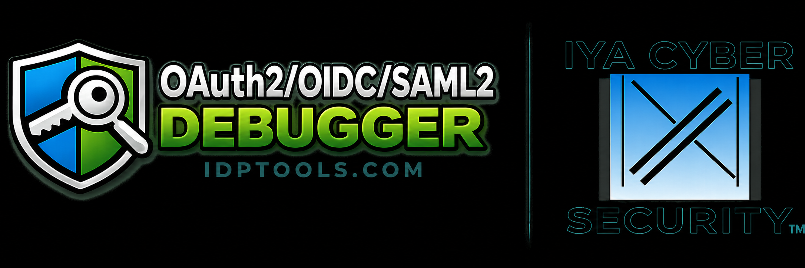

# id-proto-debugger

A **protocol debugger for identity**: it plays the client, the relying
party, the service provider, the wallet or the workload against a real
identity provider, issuer, verifier, key distribution centre or security
key, and shows every message on the way past — decoded, checked against
the specification, and explained. [This](https://github.com/rcbj/id-proto-debugger)
is the official home of the community project. It runs in your browser at
[idptools.com](https://idptools.com), or locally from a checkout or the
published images.

*Formerly `oauth2-oidc-debugger`*, renamed on 2026-08-28 because it debugs a
good deal more than OAuth 2.0 and OpenID Connect now. It began with a Red Hat
SSO blog post in November 2017. New to this kind of tool?
[**What a protocol debugger is**](docs/what-is-a-protocol-debugger.md)
explains what one does and why identity protocols in particular need one.

**The documentation is at [rcbj.github.io/id-proto-debugger](https://rcbj.github.io/id-proto-debugger/)**
(the [`docs/`](docs/) directory, published as a GitHub Pages site): a user
guide, a page per workflow, and how to run, test and release it.

## What it debugs

| Family | Major specifications | What it is |
|---|---|---|
| [OAuth 2.0 and OpenID Connect](docs/oauth2-oidc/index.md) | RFC 6749, OIDC Core 1.0, RFC 7636, RFC 8414, RFC 8628, RFC 8693, RFC 7009, RFC 7662, RFC 7591/7592, OIDC Discovery, RP-Initiated Logout | A client and relying party for every grant and the three OIDC flows, with token detail, introspection, revocation, token exchange, the device grant and dynamic registration. |
| [OAuth security](docs/rfc9700.md) | RFC 9700, RFC 9449 (DPoP) | A compliance mode that enforces the OAuth 2.0 Security BCP, and DPoP proof of possession. |
| [SAML 2.0](docs/saml.md) | SAML 2.0 Core, Bindings, Profiles | SP-initiated SSO over Redirect, POST and Artifact, Single Logout, signed and encrypted messages, an Assertion Tool and decoders. |
| [SAML 1.1](docs/saml11.md) | SAML 1.1, the Shibboleth AuthnRequest profile | Browser/POST and Browser/Artifact sign-in. |
| [WS-Trust](docs/wstrust.md) | WS-Trust 1.0–1.4, WS-Security, WS-Addressing | Issue, renew, validate and cancel against a security token service. |
| [WS-Federation](docs/wsfed.md) | WS-Federation 1.2 | The passive requestor profile: sign-in and sign-out, signed requests, encrypted tokens. |
| [Verifiable credentials](docs/sd-jwt-vc-issuance.md) | OID4VCI 1.0, OID4VP 1.0, SD-JWT (RFC 9901), SD-JWT VC, DCQL, JAR (RFC 9101), DIDs | A wallet: credential issuance and presentation with selective disclosure. |
| [WebAuthn](docs/webauthn.md) | WebAuthn Level 3, FIDO U2F | Registration and authentication ceremonies decoded, with a read-only browser extension. |
| [Smart cards](docs/smartcard.md) | ISO/IEC 7816-4, PC/SC, USB CCID, WebHID, Yubico OTP, YKOATH (RFC 4226, RFC 6238), NIST SP 800-73-4, FIPS 201-3, OpenPGP card 3.4.1, YubiHSM Auth | Decode, read, write and reset a YubiKey's applets, from the browser or through the api's PC/SC relay. |
| [Kerberos v5](docs/kerberos.md) | RFC 4120, RFC 3961, RFC 3962, RFC 8009, RFC 4121, MS-PAC, MS-SFU | A TGT, a service ticket and the AP exchange against a real KDC, the PAC, delegation, and a decoder. |
| [SPNEGO](docs/spnego.md) | RFC 4178, RFC 4559 | Kerberos over HTTP Negotiate. |
| [LDAP](docs/ldap.md) | RFC 4511 | Bind, search and modify against a directory, through the api. |
| [SCIM 2.0](docs/scim.md) | RFC 7643, RFC 7644 | Every SCIM request, and scenario batches that provision and deprovision populations. |
| [SPIFFE / SPIRE](docs/spiffe.md) | SPIFFE ID, X509-SVID, JWT-SVID, Workload API, SPIRE Server API | SVIDs from a Workload API, and the SPIRE Server API over gRPC. |
| [XACML 3.0](docs/xacml.md) | XACML 3.0, ALFA, the JSON Profile | An editor and a local PDP: every function held to Appendix A and every combining algorithm to Appendix C. |
| [GNAP](docs/gnap.md) | RFC 9635, RFC 9421, RFC 9530 | A client instance: grant requests with key proofs, interaction and continuation. |
| [Shared Signals](docs/ssf.md) | OpenID SSF 1.0, CAEP, RISC, RFC 8417, RFC 9493, RFC 8935, RFC 8936 | Streams and Security Event Tokens by push or poll, with the CAEP and RISC vocabularies. |
| [PKI and TLS](docs/pki.md) | RFC 5280, RFC 9881, RFC 9909, RFC 9935, TLS 1.3 | A certificate authority hierarchy and its certificates, post-quantum included, and TLS and mutual-TLS tests. |
| [Cryptography tools](docs/encryption.md) | RFC 7515–7518, XML Signature, XML Encryption, FIPS 180-4, FIPS 202, SP 800-185, FIPS 203–205, RFC 8554, RFC 8391 | Encryption, hashing, JWT, digital signature and stateful hash-based signature tools. |

The full list, with every specification linked, is
[Supported specifications and features](docs/supported-specs.md). The
identity providers it has been tested with, and what was learned about each,
are in [Identity provider notes](docs/identity-providers.md).

Kerberos, SPNEGO, LDAP and SPIFFE need the api service (a browser cannot
open their sockets), so they are not on the hosted static sites and their
landing cards there are greyed out. Run the debugger locally for them.

## Running it

From a checkout, with Docker:

```bash
git submodule update --init --recursive   # api/node-ldapjs, a nested submodule
./generate-tls-cert.sh                    # once per checkout: the TLS pair
CONFIG_FILE=./env/local.js docker-compose up
```

Then open `https://localhost:3000` and register
`https://localhost:3000/callback` as the redirect URI with your identity
provider. Trust `./generated-tls-ca/stack-tls-root.pem` once, or accept the
certificate warning on both `https://localhost:3000` and
`https://localhost:4000`.

Or run the published images, which every `master` build pushes to
`ghcr.io/rcbj/id-proto-debugger-{api,client}` and
`docker.io/iyasec/id-proto-debugger-{api,client}` as `latest` and as one
`M.N.P.B` per build:

```bash
docker pull ghcr.io/rcbj/id-proto-debugger-client:latest
docker pull ghcr.io/rcbj/id-proto-debugger-api:latest
```

[Getting started](docs/getting-started.md) walks through a first grant, and
[Running the debugger](docs/running.md) covers the published images, the TLS
certificate, docker compose and docker run, building the images, and the
debugger embedded in IYA STS.

## Running the tests

The Selenium suite runs in containers against the whole stack, including
Keycloak, walt.id and IYA STS:

```bash
docker login ghcr.io                      # the stack's images are private copies
./docker-run-tests.sh                     # every job
./run-coverage.sh                         # the same, with the coverage floors
./remote-run-tests.sh https://test.idptools.com   # against a deployed site
```

[Running the tests](docs/running-tests.md), [What each test covers](docs/test-suite-map.md),
[Testing against the deployed sites](docs/live-site-testing.md) and
[Code coverage](COVERAGE.md) have the details; `tests/CLAUDE.md` has the rules
for writing a test.

## Versioning and releases

A build is **M.N.P.B**: the release in the [`VERSION`](VERSION) file (now
`0.9.3`) and the UTC build instant. It is in every page's footer and at
`/version.json`. The first `master` build of each release creates the GitHub
release `release-M.N.P`. [Releases, versions and images](docs/releases.md)
explains the tags, what a build publishes and how to cut a release;
[Version history](docs/version-history.md) lists the releases.

## Privacy and security

The hosted sites are static: there is no application backend, and all token
handling happens in your browser, with your configuration only in its
`localStorage` (passwords excluded). An identity provider's redirect does
reach the hosting provider, so if that is not acceptable for what you are
testing, run the debugger locally. [Privacy and security](docs/privacy-and-security.md)
has the details, and [SECURITY.md](SECURITY.md) the security policy, including
how to report a vulnerability.

As of Q1 2026, Anthropic Claude has been used to implement some new features of
this project. All code is reviewed by a human before it is merged into the main
branch.

## Authors

Robert C. Broeckelmann Jr. - Initial work

## License

This project is licensed under the MIT License - see the LICENSE.md file for details

## Acknowledgments
Thanks to the following:
* [APICast (3Scale API Management Gateway OAuth2 Example)](https://github.com/3scale/apicast/tree/master/examples/oauth2) for being the starting point for this experiment.
* [Docker](https://docs.docker.com/reference/cli/docker/)
* [docker-compose](https://docs.docker.com/reference/cli/docker/compose/)
* [Node.js](https://nodejs.org/api/all.html)
* [Javascript](https://devdocs.io/javascript/)
* [Typescript](https://www.typescriptlang.org/docs/)
* [Browserify](https://github.com/browserify/browserify#usage)
* [OpenAPI](https://swagger.io/specification/)
* [Selenium](https://www.selenium.dev/selenium/docs/api/javascript/index.html)
* [Walt.ID](https://github.com/walt-id/waltid-identity)
* [KeyCloak](https://github.com/keycloak/keycloak)
* [KeyCloak WS-Federation Support](https://github.com/cloudtrust/keycloak-wsfed)
