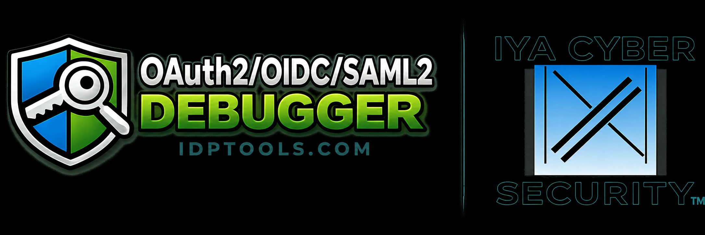

# id-proto-debugger
[This](https://github.com/rcbj/id-proto-debugger) is the official home of the community Project.

*Formerly `oauth2-oidc-debugger`.* The project was renamed on 2026-08-28: it debugs a
good deal more than OAuth2 and OIDC now — SAML 2.0 and 1.1, WS-Trust, WS-Federation,
SD-JWT VC, WebAuthn, Kerberos v5, SPNEGO, LDAP, SCIM 2.0, SPIFFE, X.509 PKI and
standalone encryption — and the old name described the first two of them. Only the
name changed; nothing about the code, the layout or the commands below did. The
deployed sites keep their own names (`idptools.com`, `test.idptools.com`).

This is a simple OAuth2 and OpenID Connect (OIDC) debugger (test tool) that I created as part of a Red Hat SSO blog post I wrote in November, 2017.  Since then, I have expanded support to include several major Identity Providers (see the complete list below). The blog post uses this debugger for testing the OpenID Connect setup.  So, checkout the blog for usage examples. This project builds a docker container that runs the debugger application.

New to this kind of tool? [**What a protocol debugger is**](docs/what-is-a-protocol-debugger.md) explains what a protocol debugger does, how it differs from a packet
sniffer or a client library, and why identity protocols in particular need one.

# Supported Specs & Features
This project currently supports the following specs & features:
* [OAuth2 - RFC 6749](https://tools.ietf.org/html/rfc6749)
* [OAuth2 Refresh Token Support](https://www.rfc-editor.org/rfc/rfc6749#section-6)
* [OAuth2 application authentication with client_id and client_secret via POST body or Basic Auth (rather than client cert or dsig).](https://www.rfc-editor.org/rfc/rfc6749#section-2.3.1)
* [OpenID Connect Core 1](https://openid.net/specs/openid-connect-core-1_0.html)
* [OpenID Connect Discovery v1.0](https://openid.net/specs/openid-connect-discovery-1_0.html)
* [JWT RFC](https://tools.ietf.org/html/rfc7519)
* [JWS JSON Web Signature](https://www.rfc-editor.org/info/rfc7515/)
* [JWE JSON Web Encryption](https://www.rfc-editor.org/rfc/rfc7516.html)
* [PKCE - RFC 7636](https://www.rfc-editor.org/rfc/rfc7636)
* [OIDC RP-Initiated Logout v1.0](https://openid.net/specs/openid-connect-rpinitiated-1_0.html)
* [OAuth2 Token Introspection Endpoint (RFC7662)](https://www.rfc-editor.org/rfc/rfc7662) -- client_credentials (basic auth) or bearer token [RFC6750](https://www.rfc-editor.org/rfc/rfc6750) authentication.
* [OAuth2 Device Authorization Grant - RFC8628](https://www.rfc-editor.org/info/rfc8628/) -- Ever registered an app on your television where it jumped ot your phone? This was probably what was used.
* [OAuth2 Token Exchange - RFC8693](https://www.rfc-editor.org/rfc/rfc8693.html) -- Exchange one token for another: impersonation or delegation, with a `subject_token`, an optional `actor_token`, and `audience` / `resource` / `scope` / `requested_token_type`. It has **its own card on the landing page**, which opens `oauth2_oidc_1.html` — you need a subject token before you can exchange one, so the exchange pane itself is on the results page (`oauth2_oidc_2.html`). Currently only tested with Keycloak v26.x.
* [OAuth2 Token Revocation - RFC7009](https://www.rfc-editor.org/info/rfc7009/)
* [OIDC Dynamic Client Registration 1.0](https://openid.net/specs/openid-connect-registration-1_0.html) -- a Relying Party registers itself at the OP's registration endpoint, sending its client metadata and getting back a `client_id` (plus a Registration Access Token and `registration_client_uri` for reading the registration back). Read/update/delete of an existing registration follow [RFC 7592](https://www.rfc-editor.org/info/rfc7592/), and the request/response bodies are [RFC 7591](https://www.rfc-editor.org/info/rfc7591/)'s. It has **its own card on the landing page**, which opens the Dynamic Client Registration pane on `oauth2_oidc_1.html` — the same page as the OAuth2 / OIDC workflow, because a registration is what that workflow then uses.
* [SAML 2.0](https://www.oasis-open.org/standard/saml/) -- SP-initiated SSO against an IdP over the HTTP-Redirect, HTTP-POST and HTTP-Artifact bindings, with Single Logout, a signed (and optionally encrypted) `AuthnRequest`, and the IdP's response decoded on a page of its own. Setup is in [Using the SAML workflow](docs/saml.md). The decoders are in [SAML decoders and certificate details](docs/saml-decoders.md).
* [SAML 1.1](https://www.oasis-open.org/committees/download.php/3406/oasis-sstc-saml-bindings-1.1.pdf) -- the same workflow's second protocol version, over the same three bindings: **Browser/POST** and **Browser/Artifact**, requested with Shibboleth's `urn:mace:shibboleth:1.0:profiles:AuthnRequest` profile, with the artifact resolved over the SOAP binding at the identity provider's SAML responder. It is **a different protocol, not an older spelling** — there is no request message, no Single Logout, nothing to sign and nothing to encrypt — so the settings that do not apply are greyed out and switched off when 1.1 is selected. See [docs/saml11.md](docs/saml11.md).
* A **SAML Assertion Tool** that composes a spec-compliant SAML 1.0 / 1.1 / 2.0 assertion and signs and encrypts it in the browser. See [SAML Assertion Tool](docs/saml-assertion.md).
* [WS-Federation v1.2 Passive Requestor Profile](https://docs.oasis-open.org/wsfed/federation/v1.2/os/ws-federation-1.2-spec-os.html) -- An older protocol, but still common with Microsoft ADFS.
* [SD-JWT — Selective Disclosure for JWTs, RFC 9901](https://www.rfc-editor.org/rfc/rfc9901.html) -- the format the credential workflows below are built on: salted claim Disclosures hashed into an `_sd` array, a Combined Serialization joined by `~`, and a **Key Binding JWT** (section 4.3) whose `sd_hash` commits to exactly the bytes presented. In-browser: nothing is disclosed that you did not tick.
* [SD-JWT VC — SD-JWT-based Verifiable Credentials](https://datatracker.ietf.org/doc/draft-ietf-oauth-sd-jwt-vc/) -- the credential type on top of SD-JWT: a `dc+sd-jwt` typed JWT with a `vct`, an issuer resolvable by `iss` (an HTTPS identifier with JWT VC Issuer Metadata, or a `did:jwk`), and holder binding through `cnf`.
* [OpenID for Verifiable Credential Issuance 1.0 (OID4VCI)](https://openid.net/specs/openid-4-verifiable-credential-issuance-1_0.html) -- the **VC Issuance workflow**: credential issuer metadata (including RFC 8414 well-known *path insertion*), the authorization code and **pre-authorized code** grants, Credential Offers by value / by `credential_offer_uri` / by QR code with a Transaction Code, `authorization_details` → `credential_identifier`, a nonce endpoint and `openid4vci-proof+jwt` proof of possession, batch issuance, deferred issuance, encrypted Credential Responses, the Notification Endpoint, and **credential refresh** (section 14.5). Appendix H use cases H.1, H.2, H.3 and H.6. See the VC Issuance section below.
* [OpenID for Verifiable Presentations 1.0 (OID4VP)](https://openid.net/specs/openid-4-verifiable-presentations-1_0.html) -- the **VC Presentation workflow**: an Authorization Request with `response_type=vp_token` and `response_mode=direct_post`, a **DCQL** query decoded into the claim paths being asked for, Client Identifier Prefixes, the request by value or as a signed Request Object by reference, cross-device by QR code, and a `vp_token` keyed by DCQL credential-query id. See the VC Presentation section below.
* [JAR — JWT-Secured Authorization Request, RFC 9101](https://www.rfc-editor.org/rfc/rfc9101.html) -- how a Verifier's OID4VP request is passed **by reference and signed**, and verified in the browser before anything is disclosed.
* [WS-Trust 1.0–1.4](https://docs.oasis-open.org/ws-sx/ws-trust/v1.4/ws-trust.html) -- Issue / Renew / Validate / Cancel against an STS, selectable protocol version (1.0/1.1/1.2 pre-OASIS, 1.3/1.4 OASIS ws-sx), with WS-Security (UsernameToken / SAML token), WS-Addressing, and optional XML Signature / XML Encryption. See [Using the WS-Trust workflow](docs/wstrust.md).
* [Kerberos v5 — RFC 4120](https://www.rfc-editor.org/rfc/rfc4120) -- the **Kerberos workflow**: get a ticket-granting ticket from a real Key Distribution Center (a Windows domain controller, MIT or Heimdal krb5, or this project's mock KDC), spend it on a service ticket, and present that to a service with mutual authentication — every field of every message shown on the way past, and the encrypted parts opened when you supply the key. Plus a **Kerberos Decoder** that parses a pasted message, ticket, GSS-API token, keytab or PAC with no network at all. Unlike every other workflow here this one is **not available on the hosted site** and its card there is greyed out: Kerberos speaks DER over TCP and UDP port 88, and a browser cannot open a socket, so it needs the api service running locally. The decoder needs no network of its own, but it ships with the rest of the workflow rather than alone — run the debugger locally for any of it.
* [Kerberos encryption — RFC 3961, RFC 3962, RFC 8009, RFC 4757](https://www.rfc-editor.org/rfc/rfc3961) -- the encryption framework and the types actually in use: `aes128/256-cts-hmac-sha1-96` (17, 18), the SHA-2 pair (19, 20) and `arcfour-hmac-md5` (23), implemented in the browser. DES is decode-only — Windows Server 2025 removed it — so an old capture still renders without pretending the protocol is still safe.
* [GSS-API Kerberos mechanism — RFC 4121](https://www.rfc-editor.org/rfc/rfc4121) -- the AP exchange as a service actually receives it, including the **0x8003 checksum** (which is not a checksum: it carries the channel bindings and the delegation and mutual-authentication flags, with its integers little-endian in a protocol that is otherwise big-endian), and per-message MIC and Wrap tokens.
* [The Windows PAC — MS-PAC](https://learn.microsoft.com/en-us/openspecs/windows_protocols/ms-pac/) -- what a Windows service actually authorizes on. A Kerberos ticket proves *who* you are and says nothing about your group memberships; the PAC inside it carries the account's SID, its groups and its `UserAccountControl` flags, signed four different ways with two different keys. "Authentication succeeded but access was denied" is nearly always a question about this structure, and the debugger decodes it and verifies each signature separately.
* [Kerberos delegation — MS-SFU](https://learn.microsoft.com/en-us/openspecs/windows_protocols/ms-sfu/) -- **S4U2Self** (a service obtains a ticket for a user who takes no part in it), **S4U2Proxy** authorized either by `msDS-AllowedToDelegateTo` on the front end or by `msDS-AllowedToActOnBehalfOfOtherIdentity` on the back end — the resource-based form, which is why "I can write to this computer account" becomes "I can reach this service as anybody" — plus unconstrained delegation with forwarded tickets in a `KRB-CRED`, and renewals. Every refusal in this area is `KDC_ERR_BADOPTION` whatever the cause, so the page's job is to narrow it: which attribute on which account, whether the evidence ticket is forwardable, and whether the required padata was sent.
* [XML Signature](https://www.w3.org/TR/xmldsig-core/)
* [XML Encryption](https://www.w3.org/TR/xmlenc-core1/)
* [Base64 Encoding](https://www.rfc-editor.org/info/rfc4648/)
* [X.509 Public-Key and Attributes Certificate Framework](https://www.itu.int/rec/t-rec-x.509/en) -- and, on the **Certificate Authority & X.509 Tools** page, the ability to *build* one: a Root CA, an Intermediate and an Issuing CA, then the leaf certificates any of them can sign — TLS server, TLS client for mutual authentication, code signing, S/MIME, OCSP responder, time stamping, smartcard logon and Kerberos PKINIT — with every [RFC 5280](https://www.rfc-editor.org/rfc/rfc5280) X.509v3 extension editable including its critical flag, and any extension at all addable by OID. Then it opens a real **TLS or mutual-TLS connection** with what you issued. See the Certificate Authority & X.509 Tools section below.
* [RFC8414]](https://www.rfc-editor.org/rfc/rfc8414.html)
* With the ability to add custom parameters to the Authorization Endpoint call and Token Endpoint call, numerous other protocols can be supported. We'll eventually get around to adding direct support.
* Token Endpoint calls can be initiated from the front-end or back-end depending on what the IdP requires in various use cases.
* The client_id and client_secret can be submitted to the Token Endpoint via POST body or Authorization Request Header.

It also supports a couple of proprietary IdP extensions as described below.
# Supported OAuth2 Authorization Grants
The following OAuth2 Authorization Grants are supported:
* [Authorization Code Grant](https://medium.com/@robert.broeckelmann/openid-connect-authorization-code-flow-with-red-hat-sso-d141dde4ed3f)
* [Implicit Code Grant](https://medium.com/@robert.broeckelmann/oauth2-implicit-grant-with-red-hat-sso-v7-1-234810b0ea6f)
* [Resource Owner Password Grant](https://medium.com/@robert.broeckelmann/red-hat-sso-v7-1-oauth2-resource-owner-password-credential-grant-support-6ee40f047f31)
* [Client Credentials Grant](https://medium.com/@robert.broeckelmann/red-hat-sso-v7-1-oauth2-client-credentials-grant-6c64e5ec8bc1)
* [Refresh Grant](https://medium.com/@robert.broeckelmann/refresh-token-support-in-oauth2-oidc-debugger-c792b3a3f65a)
* [Device Authorization Grant](https://www.rfc-editor.org/info/rfc8628/)

# Supported OIDC Authentication Flows
The following OpenID Connect Authentication Flows are supported
* Authorization Code Flow (could also use Authorization Code Grant option and scope="openid profile")
* Implicit Flow (2 variants)
* Hybrid Flow (3 variants)

# Privacy & Security
This project is built with your privacy and security as a priority. There is, however, one consequence of how the public site is hosted that you should be aware of.

The public site (for example, the hosted `idptools.com` / `test.idptools.com` deployments) is served as **static content** — there is no application backend. Because of this, when your Identity Provider redirects back to the debugger, the **authorization code** (along with the other OAuth2/OIDC response parameters and the redirect URI) is delivered to the debugger page *through the static hosting provider* as part of the normal page request. This is an unavoidable property of a static, backend-less build of an OAuth2/OIDC client.

To be clear about what we do with that data:

* **We do not log** any of the query parameters, fragments, authorization codes, tokens, or redirect URIs that are sent to the site as part of normal debugger operations.
* All token handling, decoding, and validation happens **client-side in your browser**; your configuration is stored only in your browser's `localStorage`.

If sending authorization codes to a third-party hosting provider is not acceptable for your use case (for example, when testing against a production Identity Provider), we strongly encourage you to **run a local build of the debugger** so that nothing leaves your machine. See [Getting Started / running locally](#general-usage-notes) below — in short:

```bash
./generate-tls-cert.sh                 # once per checkout: the TLS pair
sudo CONFIG_FILE=./env/local.js docker-compose up
```

Then use the debugger at `https://localhost:3000`, and register `https://localhost:3000/callback` as your redirect URI with your Identity Provider. The services present a leaf from a local issuing CA. `./generate-tls-cert.sh` creates the root once and reuses it, and prints that root's SHA-256 fingerprint first. Trust the root. A later run issues a new leaf from the same root, so the browser keeps that trust. `--rotate-ca` starts a new root. In a local build, the authorization code is delivered to the debugger running on your own machine and never transits a third-party host.

# AI Coding Tool Disclosure
As of Q1, 2026, Anthropic Claude was used to implement some new features of this project. All code is reviewed by a human before being merged into the main branch.

# Tested Platforms
So far, this tool has been tested with the following OAuth2 or OIDC implementations:

* Red Hat SSO v7.1 (OAuth2 + OIDC)
* 3Scale SaaS with self-managed APICast Gateway (OAuth2 + OIDC)
* Azure Active Directory / EntraId (v1 endpoints, OIDC + OAuth2)
* Azure Active Directory / EntraId (v2 endpoints, OIDC + OAuth2)
* Apigee Edge (OAuth2, with caveats described [here](https://medium.com/@robert.broeckelmann/demo-apigee-edge-oauth2-debugging-a10223eb334))
* Ping Federate (OAuth2 + OIDC)
* AWS Cognito (OAuth2 + OIDC)
* Facebook (OAuth2)
* Google STS (OAuth2 + OIDC)
* KeyCloak (recent versions used in our automated test suite, Red Hat SSO is KeyCloak under the Red Hat banner, so it should work)
* Okta (OIDC + OAuth2)
* Auth0 (OIDC + OAuth2)
* ForgeRock (OIDC + OAuth2 + SAML2)
* Walt.ID (VC Issuance + Presentation)

# 3Scale Usage Notes
The version of 3Scale SaaS + APICast only supports OAuth2; 3Scale can support the OIDC Authorization Code Flow since the response_type and grant_type values match OAuth2's Authorization Code Grant.  The other OIDC Authentication Flows are not supported by 3Scale OAuth2.  The latest version of 3Scale on-premise has OIDC support.  As of 12/3/2017, I haven't been able to test this yet.

# Azure Active Directory Usage Notes
Azure Active Directory (v1 endpoints) support OIDC Authorization Code Flow, Implicit Flow, and the Hybrid Flow with response_type="code id_token".

# Apigee Edge Usage Notes
Apigee Edge supports OAuth2 by providing the building blogs of an OAuth2 Provider.  The developer has much leeway in how the pieces are used.  This debugger can only be used with Identity Providers that adhere to the spec.

# AWS Cognito Usage Notes
AWS Cognito has been tested with the OIDC Authorization Code Flow (with a user defined in a user pool and with a facebook federation relationship. Cognito supports federation, but has optional parameters that need to be passed in to tell Cognito which Userpool and Identity Provider to use (like Facebook). The debugger does not support passing in these parameters at this time (we'll call that a future enhancement). It appears to have worked because I tested in a browser session where I had previously authenticated against Cognito using Facebook. Also, when the refresh grant is used, it works without issue the first time; however, the refresh grant response does not include a new refresh token. So, the refresh_token is not prepopulated correctly. The original refresh token can be copied into the field and subsequent refresh token calls will work. I admit I didn't test all possible scenarios, but I imagine that once the refresh token expires, it will issue a new refresh token. Another interesting note that mattered a lot in a recent project, each refresh token grant response has a new ID Token--and, access token, of course.

# Facebook Usage Notes
Facebook OAuth2 was tested with the OAuth2 Authorization Code Grant. It worked, but there was no refresh token provided in the OAuth2 Token Endpoint response. So, the refresh grant is obviously not going to work. Configuration details can be found [here](https://developers.facebook.com/docs/facebook-login/manually-build-a-login-flow). 

# Google+ Usage Notes
Google+ login was tested with the Authorization Code3 Grant. It worked. No refresh token was provided. Configuration details can be found [here](https://developers.google.com/identity/protocols/OAuth2WebServer).

# General Usage Notes

Note, that all configuration values except for the user password is written to local storage to prepopulate fields later.  If this is not desired, clear your browser's local storage for the debugger when done using.

The debugger has been tested with recent versions of Chrome.

## Getting Started
If you have docker / docker-compose installed already:
```
git clone --recurse-submodules https://github.com/rcbj/id-proto-debugger.git
cd id-proto-debugger
sudo CONFIG_FILE=./env/local.js docker-compose build
./generate-tls-cert.sh                 # once per checkout: the TLS pair
sudo CONFIG_FILE=./env/local.js docker-compose up
```
Note, you will need at least 950MB of disk space ree in order to build this Docker image.

`--recurse-submodules` fetches the one submodule,
[`rcbj/node-ldapjs`](https://github.com/rcbj/node-ldapjs) at `api/node-ldapjs/`
(branch `master`): a fork of `ldapjs` for the LDAP support of issue #257, pinned
at the final commit its maintainer left behind when the project was
decommissioned on 2024-05-14 — which is why it is a submodule rather than a
dependency in `api/package.json`. An uninitialised submodule is an *empty
directory* rather than a missing one, so the api image builds and dies at
startup with `Cannot find module 'ldapjs'`. In a checkout cloned without it:
```
git submodule update --init
```
The test launchers do this for you (`requireApiLdapjsCheckout()` in
[`common/common.sh`](common/common.sh)); a bare `docker-compose build` does not.

The mock STS the test suite and the local stack run against,
[`rcbj/iya-sts`](https://github.com/rcbj/iya-sts), is **not** a submodule: every
compose file runs its published release image — the private copy of
`ghcr.io/rcbj/iya-sts:<version>` in this repository's image mirror,
`ghcr.io/rcbj/id-proto-debugger/mirror/iya-sts:<version>`, which needs
`docker login ghcr.io` (see *The mock STS runs from its release image* below).

From a bash command prompt on Fedora or RHEL 7.x, run the following::
```
dnf install git # Or, yum install git
git clone --recurse-submodules https://github.com/rcbj/id-proto-debugger.git
dnf install docker
systemctl start docker
cd id-proto-debugger
sudo CONFIG_FILE=./env/local.js docker-compose build
./generate-tls-cert.sh                 # once per checkout: the TLS pair
sudo CONFIG_FILE=./env/local.js docker-compose up
```
# Clean Up / Start Over
This is a nuclear option to cleanup docker. You may not want to do this if you have other important things running on your site.

* List all containers (only IDs) ```sudo docker ps -aq```
* Stop all running containers: ```sudo docker stop $(docker ps -aq)```
* Remove all containers: ```sudo docker rm $(docker ps -aq)```
* Remove all images: ```sudo docker rmi $(docker images -q)```
* Prune volumes: ```sudo docker volume prune --all --force```
* Remove all volumes: ```sudo docker volume rm $(sudo docker volume ls | awk '{ print $2 }')```
* Remmove all networks: ```sudo docker network prune -f```

On other systems, the commands needed to start the debugger in a local docker container will be similar. The API container has to be able to establish connections to a remote IdP endpoint (whether locally in other docker containers, on the host VM, or over the network/internet). On the test system, it was necessary to add "--net=host" to the "docker run" args. The network connectivity details for docker may vary from platform-to-platform.

### Running
**Step-by-step guides with screenshots** for every OAuth2 grant and OIDC flow
are in [docs/oauth2-oidc](docs/oauth2-oidc/index.md):
[OAuth 2.0 authorization grants](docs/oauth2-oidc/oauth2-grants.md) and
[OpenID Connect authentication flows](docs/oauth2-oidc/oidc-flows.md). The
summary below is the short version. The same guide covers [dynamic client registration](docs/oauth2-oidc/dynamic-client-registration.md) and the [token detail, introspection, UserInfo, and JWKS pages](docs/oauth2-oidc/related-tools.md). SAML 2.0 is [Using the SAML workflow](docs/saml.md). WS-Trust is [Using the WS-Trust workflow](docs/wstrust.md).

* Open your favorite browser and enter "https://localhost:3000" in the address bar.
* Choose the OAuth2 Grant or OIDC Flow that you want to test.
* Enter the Authorization Endpoint.
* Enter the Token Endpoint.
#### OAuth2 AUthorization Grant:
* Enter the client identifier.
* Enter the Redirect URI (use https://localhost:3000/callback by default)
* Enter the scope information.
* If you need to provide a resource parameter, click the radio button.  Then, enter the desired resource parameter.
* Click the Authorize button.  
* Authenticate the user.
* Scroll down to the "Exchange Authoriztaion Code for Access Token" Section.
* Verify that the Code field is filled in below in the Token Step section.
* Enter the client identifier
* Enter the client secret if this is a confidential client.
* Enter the scope information.
* If a resource is needed, click Yes.  Enter the resource information in the Resource field.
* If the provider's certificate is not in the API image's trust store, set **SSL Certificate Validation** to **No**. That switch applies when the token request is sent from the back end. A certificate from a public CA is checked against the trust store in the API container.
* Click the Get Token button.
* The standard tokens that are returned from the token endpoint are displayed at the bottom.
#### OAuth2 Implicit Grant:
* Enter the client identifier.
* Enter the Redirect URI  (use https://localhost:3000/callback by default)
* Enter the scope information.
* If you need to provide a resource parameter, click the radio button.  Then, enter the desired resource parameter.
* Click the Authorize button.
* Authenticate the user.  
* The access_token will be listed at the bottom of the screen.
#### Refresh Token Grant
 * In the configuration section, click the the "Yes" radio button next to "Use Refresh Token".  This will make the Refresh Token Section appear.
 * The refresh token is automatically populated from the Token Endpoint call response.
 * Enter the client identifier.
 * Enter the client secret.
 * Enter the scope.
 * Press Enter.
For the other grants and flows, similar steps to the above are used.

See the blog [posts](https://medium.com/@robert.broeckelmann/red-hat-sso-and-3scale-series-d904f2127702) for more information.

## Running tests
To run the docker-based tests locally, run the following commmand:
```sudo CONFIG_FILE=./env/local.js docker compose -f docker-compose-run-tests.yml up --abort-on-container-exit```
To run tests locally, run: ```./local-run-tests.sh```

If you need to pop up the browser for troubleshooting, pass in the --browser option to the test scripts.

To generate a code coverage report, run ```./run-coverage.sh```. The report will be under the coverage directory.

### The mock STS runs from its release image
Everything the suite needs on the *other* side of a protocol — the WS-Trust STS, the SAML 2.0 IdP endpoints, the OAuth 2.0 / OIDC authorization server, the OID4VCI Credential Issuer, the OID4VP Verifier, the KDC, the LDAP directory and the `did:web` document — is one Node service, [`rcbj/iya-sts`](https://github.com/rcbj/iya-sts). It used to live in `sts/` in this repository and was then linked as the `sts/` submodule; since 2026-11-13 this repository holds no copy of it. Every compose file runs its published release image — not iya-sts's public package itself but the PRIVATE copy of it in this repository's image mirror (`.github/image-mirror.txt`), which the Mirror Images workflow refreshes from iya-sts's release, like every other image the stacks pull. Pulling it needs `docker login ghcr.io` with a token that can read packages:

| What | How |
|---|---|
| the `sts` service | `image: ${IYA_STS_IMAGE:-${IMAGE_MIRROR:-ghcr.io/rcbj/id-proto-debugger/mirror}/iya-sts:<version>}` — the default in `docker-compose-run-tests.yml` is the one place the release is named, and `tests/image_mirror_coverage.js` fails when another compose file disagrees or the default is not the mirror's copy |
| its companion (demo pages, SPNEGO page, Kerberos TCP service) | built from iya-sts's repository at the matching tag, `${IYA_STS_COMPANION_CONTEXT:-https://github.com/rcbj/iya-sts.git#v<version>:companion}` |
| tests that load iya-sts's code in process | the tests image copies the image's `/usr/src/sts`; a host run copies it once into `~/.cache/id-proto-debugger/iya-sts/` (`tests/module_paths.js`, `iyaStsTree()`) |

Set `IYA_STS_IMAGE` to run a candidate image, or `MOCK_STS_DIR` to load a working copy of iya-sts's tree in the in-process tests. A checkout from before 2026-11-13 keeps an `sts/` directory after pulling; nothing reads it, and it can be deleted.

### The SAML SP key pair
The SAML tests sign the AuthnRequest and LogoutRequest, and decrypt an encrypted assertion, with a Service Provider key pair. **No key pair is stored in this repository.** `generateSpKeyPair()` in [`common/common.sh`](common/common.sh) creates a fresh self-signed RSA 2048 pair at the start of every run — in a temporary directory that is deleted as soon as the PEMs have been read — and exports it:

| Variable | What it is | Who uses it |
|---|---|---|
| `SAML_SP_PRIVATE_KEY` | the private key, PEM | the tests, via [`common/sp_keypair.js`](common/sp_keypair.js) — pasted into the debugger's SP key fields to sign and to decrypt |
| `SAML_SP_CERT` | the matching certificate, PEM | the tests, as the SP public key |
| `SAML_SP_SIGNING_CERT` | the same certificate as base64 DER | `configureKeycloak`, which registers it on the SAML client so Keycloak validates the request signature |

So the key exists only in the environment of the run that generated it: on the host for `./local-run-tests.sh` and `./remote-run-tests.sh`, and inside the tests container for the fully-containerized suite (`tests/run-tests-in-container.sh` generates its own, so nothing is baked into the image). The generator turns the shell's `set -x` trace off around the key material and logs only a SHA-256 fingerprint, so the private key never reaches a build log.

Running a single SAML test script by hand needs those variables in the environment — its certificate is what Keycloak was told to trust, so a self-generated pair would not validate. The scripts say so and stop if they are missing.
## Prerequisites

To run this project you will need to install docker.

## Running the published images

The api and the client are published on every build of `master` and
`develop`, to the GitHub Container Registry and to Docker Hub, so they can be
run without building anything. Both registries get the same images with the
same tags from the same build — use whichever you prefer:

| GitHub Container Registry | Docker Hub |
|---|---|
| `ghcr.io/rcbj/id-proto-debugger-api` | `iyasec/id-proto-debugger-api` |
| `ghcr.io/rcbj/id-proto-debugger-client` | `iyasec/id-proto-debugger-client` |

Tags: `latest` (the newest `master` build), `develop` (the newest `develop`
build), and one `M.N.O` per build.

`M.N.O` (for example `0.9.20260928070000`) is the build's version, and the git
tag of the same name marks the commit that image was built from — so
`git checkout 0.9.20260928070000` is the source of
`ghcr.io/rcbj/id-proto-debugger-api:0.9.20260928070000`. The version is also in
each running client's footer and in `/version.json`.

No login is needed: both packages are public, so an anonymous `docker pull`
works.

### Pulling the images

```bash
# The newest master build
docker pull ghcr.io/rcbj/id-proto-debugger-api:latest
docker pull ghcr.io/rcbj/id-proto-debugger-client:latest

# Or one specific build, pinned to the commit tagged with the same version
docker pull ghcr.io/rcbj/id-proto-debugger-api:0.9.20260928070000
docker pull ghcr.io/rcbj/id-proto-debugger-client:0.9.20260928070000

# Or the newest develop build
docker pull ghcr.io/rcbj/id-proto-debugger-api:develop
docker pull ghcr.io/rcbj/id-proto-debugger-client:develop

# The same images from Docker Hub
docker pull iyasec/id-proto-debugger-api:latest
docker pull iyasec/id-proto-debugger-client:latest
```

The tags are listed at
<https://github.com/rcbj/id-proto-debugger/pkgs/container/id-proto-debugger-api>
(and `.../id-proto-debugger-client`) and at
<https://hub.docker.com/r/iyasec/id-proto-debugger-api> (and
`.../id-proto-debugger-client`).

### The TLS certificate

Both services serve TLS and need the certificate pair `./generate-tls-cert.sh`
writes, so that script is still run once, from a checkout. It needs Node.js
and npm on the host (it installs the client's dependencies to issue the
certificate with this project's own X.509 code) and `openssl`:

```bash
git clone https://github.com/rcbj/id-proto-debugger.git
cd id-proto-debugger
./generate-tls-cert.sh          # writes ./generated-tls; trust the root it prints
```

The script prints the root CA's fingerprint and writes it to
`./generated-tls-ca/stack-tls-root.pem`. Trust that root in your browser (or
accept the certificate on BOTH `https://localhost:3000` and
`https://localhost:4000` — the api is a separate origin, and a browser that has
not accepted it reports every call to it as a CORS error).

### With docker compose

Save this as `docker-compose.yml` beside the `generated-tls` directory the
script wrote:

```yaml
# id-proto-debugger from its published images on ghcr.io.
# DEBUGGER_TAG selects the build: latest (default), develop, or an M.N.O
# version such as 0.9.20260928070000.
services:
  api:
    image: ghcr.io/rcbj/id-proto-debugger-api:${DEBUGGER_TAG:-latest}
    container_name: api
    environment:
      - CONFIG_FILE=./env/local.js
      - TLS_ENABLED=true
      - TLS_CERT_FILE=/etc/idptools/tls/stack-tls-cert.pem
      - TLS_KEY_FILE=/etc/idptools/tls/stack-tls-key.pem
    volumes:
      - ./generated-tls:/etc/idptools/tls:ro
    ports:
      - "4000:4000"
    restart: unless-stopped

  client:
    image: ghcr.io/rcbj/id-proto-debugger-client:${DEBUGGER_TAG:-latest}
    container_name: client
    environment:
      - CONFIG_FILE=./env/local.js
      - TLS_ENABLED=true
      - TLS_CERT_FILE=/etc/idptools/tls/stack-tls-cert.pem
      - TLS_KEY_FILE=/etc/idptools/tls/stack-tls-key.pem
    volumes:
      - ./generated-tls:/etc/idptools/tls:ro
    ports:
      - "3000:3000"
    depends_on:
      - api
    restart: unless-stopped
```

Then:

```bash
docker compose pull                                  # fetch the images
docker compose up -d                                 # start both services
DEBUGGER_TAG=0.9.20260928070000 docker compose up -d # or pin one build
docker compose logs -f                               # follow the logs
docker compose down                                  # stop and remove them
```

To take the images from Docker Hub instead, replace `ghcr.io/rcbj/` with
`iyasec/` in the two `image:` lines.

This is not the repository's own `docker-compose.yml`, which BUILDS the images
from source and also starts the mock STS used by the test suite.

### With docker run

The same two services without compose:

```bash
for svc in api:4000 client:3000; do
  docker run -d --name "${svc%%:*}" -p "${svc##*:}:${svc##*:}" \
    -e CONFIG_FILE=./env/local.js -e TLS_ENABLED=true \
    -e TLS_CERT_FILE=/etc/idptools/tls/stack-tls-cert.pem \
    -e TLS_KEY_FILE=/etc/idptools/tls/stack-tls-key.pem \
    -v "$PWD/generated-tls:/etc/idptools/tls:ro" \
    "ghcr.io/rcbj/id-proto-debugger-${svc%%:*}:latest"
done
```

Either way, open `https://localhost:3000`. The images are built with the
`local` configuration, which is what makes the client call the api at
`https://localhost:4000` — so the published images run on the machine whose
browser uses them, and register `https://localhost:3000/callback` as the
redirect URI with your identity provider.

## Building the docker image
```bash
yum install git
git clone --recurse-submodules https://github.com/rcbj/id-proto-debugger.git
yum install docker
systemctl start docker
cd id-proto-debugger
sudo docker build -t rcbj/debugger-client --build-arg CONFIG_FILE=./env/local.js -f client/Dockerfile .
sudo docker run -p 3000:3000 -e CONFIG_FILE=./env/local.js -d rcbj/debugger-client
sudo docker build -t rcbj/debugger-api --build-arg CONFIG_FILE=./env/local.js -f api/Dockerfile .
sudo docker run -p 4000:4000 -e CONFIG_FILE=./env/local.js -d rcbj/debugger-api
```
On other systems, the commands needed to start the debugger in a local docker container will be similar. The API container has to be able to establish connections to a remote IdP endpoint (whether locally in other docker containers, on the host VM, or over the network/internet).  On the test system, it was necessary to add "--net=host" to the "docker run" args. The network connectivity details for docker may vary from platform-to-platform.

## Embedded in the mock STS

The debugger has a third deployment shape besides the containers above and the
static idptools.com build: **embedded inside the
[mock STS](https://github.com/rcbj/iya-sts)**, which serves the UI from a
listener of its own behind an OIDC sign-in and runs the api as a child process
on a unix socket behind its own proxy. This repository builds the tree that
service consumes:

```bash
git submodule update --init
embedded/build.sh --out /path/to/tree          # without docker
docker build -f embedded/Dockerfile -t rcbj/id-proto-debugger-embedded:dev \
  --build-arg GIT_COMMIT=$(git rev-parse --short=12 HEAD) .
```

Nothing about the standalone debugger changes. The contract — the tree, the
`DEBUGGER_*` environment the api child reads, and the address allow-list it
enforces — is in `embedded/CLAUDE.md`.

# Additional Feature Information
## RFC 9700 compliance mode

The **Configuration Parameters** pane of the OAuth2 / OIDC workflow carries a checkbox, *Enforce RFC 9700 client requirements*, at the top — above the grant selector, because it governs every control below it. It turns the client-side half of [RFC 9700](https://www.rfc-editor.org/rfc/rfc9700), *Best Current Practice for OAuth 2.0 Security*, from advice into enforcement on both pages of the workflow.

**It ships OFF, and that is deliberate rather than cautious.** A debugger exists to be pointed at identity providers that are wrong — that is most of what anybody uses one for. An authorization response with no `state` on it is a finding worth *seeing*, and a client that refuses to send the request cannot show it to you; an OP that still only speaks the Implicit Grant is something somebody has to work with today, and a mode that removes it from the dropdown removes their reason for opening the page. With the box clear, this workflow behaves exactly as it did before the feature existed: no check runs, no report is drawn, nothing is refused.

With it ticked, in outline:

* the three Implicit variants, the two Hybrid flows that carry `token`, and the Resource Owner Password Credentials grant are **disabled in the selector**, each with its own reason — and refused again at the request, because `disabled` is a property of a control while the rule is a property of the request. OIDC Hybrid (`code id_token`) survives: it returns no access token from the authorization endpoint;
* **PKCE is forced on with S256**, certificate validation is forced on, `client_secret_basic` is selected, and DPoP is switched on together with the front-end token call (a proof cannot ride on the proxied one);
* `state`, `nonce` and the PKCE verifier are regenerated **per request** and frozen onto a transaction record in `sessionStorage` — per-tab, dying with the browsing session, which is what "bound to the user-agent transaction" means;
* every endpoint must be **https** (with RFC 8252's loopback exception, which is what lets the mode be used against a local stack at all), and the endpoints must have come from the server's **metadata** rather than been typed;
* `response_mode=form_post` is requested when the server advertises it *and* this build has a `/callback` to receive the POST, so the response never reaches the address bar at all; whatever does reach it is removed with `history.replaceState` as soon as it has been read;
* on the way back, `state` must match and is **single-use**, the RFC 9207 `iss` parameter must match the stored issuer (and its absence is fatal when the server advertises support for it), and the ID Token's `iss` must match too;
* **no token is used until the ID Token's `nonce` has been validated** — not rendered, not written to Token History, not offered to the UserInfo or refresh panes. A mismatch discards the whole set;
* an authorization code is presented **once**, and a rotated refresh token spends the one it replaced;
* the audience, the granted scope, the `token_type` that came back, whether the refresh token was rotated, and whether the subject is confusable with the `client_id` are **reported** rather than enforced, because a client can only observe them.

A report appears beside each step naming the requirement, the level RFC 9700 states it at, and what was found.

Four of the fifteen sections are **not** behind the checkbox, because they are this deployment's own posture and are invisible to any identity provider: `/callback` is not an open redirector and never takes its destination from the request, it redirects with **303** rather than 302 or 307, every response carries `Referrer-Policy: no-referrer`, `X-Frame-Options: DENY` and `Content-Security-Policy: frame-ancestors 'none'`, and this workflow uses no browser messaging at all.

One thing is deliberately **not implemented**: `private_key_jwt` and mutual-TLS client authentication. RFC 9700 recommends asymmetric client authentication and this workflow offers `client_secret_basic` and `client_secret_post` only; the mode reports the gap rather than pretending otherwise.

`docs/rfc9700.md` is the full account — every requirement, what is enforced and what is only detected, and how the two tests (`tests/rfc9700_client.js`, `tests/rfc9700_flows.js`) exercise it against the mock STS running in *its* RFC 9700 mode.

## State Parameters
* A state parameter can be submitted as part of the authorization endpoint request. The state parameter will be validated when the redirect comes back to the registered callback endpoint. A UUID is used as the state value. This is an optional, but recommended parameter.
## Custom Parameters
Various specs & RFCs that build on the OAuth2 & OIDC protocols add additional parameters that must be passed to the Authorization Endpoint and Token Endpoint. The debugger supports passing up to ten custom parameters.
## Nonce Parameter
A nonce parameter can be included in the Authorization Endpoint call. A UUID is used as the nonce value.

## Token Details
All tokens (Access, Refresh, ID) returned by the IdP can have their details viewed by clicking on the link next to the token on the Debugger2 page.

This feature currently only supports JWT tokens, but in the future will support other token types.

There are two views: raw-JSON or table view.

The table view will display a claim description for spec-defined claims.

Some caveats to keep in mind:

* If nothing is displayed, then the requested token retrieved from the endpoint is not a JWT or not a valid JWT.
* In the future, additional token formats may be added.
* Although, many leading IdPs use JWT as the format for OAuth2 access tokens and refresh tokens. The spec does not require this.
* Some IdPs intentionally use opaque tokens that have no deeper meaning than to be a randomly generated identifier that points back to session information stored on the IdP

## OIDC RP-Initiated Logout Spec Support
If the Logout URL can be read from the OIDC Discovery Endpoint, it will be automatically populated; otherwise, you will need to manually copy in this URL.

The associated refresh token should be invalidated at this point. The corresponding JWT tokens could still be validated unless you compare them against the Introspection Endpoint.

## JWT Validation

The token detail page (`/token_detail.html`) checks a JWT signature. Open
it by clicking the token's name on step 2. **Verification Type** defaults
to **HMAC Secret**. The other choices are **X.509 Certificate (PEM)** (a
certificate or a bare public key), **JWKS (JSON)**, and **JWKS (URL)**. A
JWKS is selected by `kid` and verifies every algorithm this page can check,
not only RSA.

Field-by-field notes for that page, and for introspection, UserInfo, JWKS,
and the logout status page, are in
[Token detail, introspection, UserInfo, and JWKS](docs/oauth2-oidc/related-tools.md).

## JWT Tools

**JWT Tools** (`/jwt_tools.html`) builds, signs, encrypts, verifies, and
decrypts a token in the browser. Open it from the **Tools** pane on the
OAuth2 / OIDC pages. Signing uses Web Crypto, so use the page over
`https://` or `http://localhost`.

The signing menu is `RS256` (the default) and the rest of `RS*` / `PS*`,
`ES256` / `ES384` / `ES512`, `EdDSA` (Ed25519), and `HS256` / `HS384` /
`HS512`. Ed448, secp256k1, and the post-quantum algorithms are on the
Digital Signature page's JWS pane.

Encryption pairs a key-management algorithm with a content-encryption
algorithm. **Key Management** defaults to `RSA-OAEP` (also `RSA-OAEP-256`
and `ECDH-ES`, `ECDH-ES+A128KW`, `+A192KW`, `+A256KW`, all on P-256).
**Content Encryption** defaults to `A256GCM` (also `A192GCM`, `A128GCM`,
`A128CBC-HS256`, `A192CBC-HS384`, `A256CBC-HS512`). `RSA1_5` is not
offered. AES-192 (`A192GCM`, `A192CBC-HS384`, and `ECDH-ES+A192KW`) fails
in Chromium-based browsers. Nothing on this page is written to
`localStorage`.

The fields, the defaults, and the trust-chain checkbox are in
[JWT Tools](docs/jwt-tools.md).

## Encoding / Hashing Tools

**Encoding / Hashing Tools** (`/encoding_tools.html`) is six panes. Open it
from the **Tools** pane. Nothing is stored.

| Pane | Buttons | Default |
|---|---|---|
| Base64 | Encode, Decode | standard Base64, not base64url |
| URI Encoding | Encode, Decode | the same transform as `encodeURIComponent` |
| Checksum (CRC-32) | Encode | IEEE CRC-32, eight hex digits |
| SHA-1 / SHA-2 (FIPS 180-4) | Encode | SHA-256, input text, output hex |
| SHA-3 / SHAKE (FIPS 202) | Encode | SHA3-256. Keccak-256 and Keccak-512 are in this menu and are not SHA-3 |
| cSHAKE / KMAC / TupleHash / ParallelHash (SP 800-185) | Compute | KMAC128. The message box starts as hex. TupleHash is one element per line |

The hash panes do not use Web Crypto. `crypto.subtle` has no SHA-3 and
none of SP 800-185, and it is absent outside a secure context. What each
function is for, including its post-quantum role, is in
[Hashing](docs/hashing.md).

## Digital Signature

**Digital Signature** (`/digital_signature.html`) signs and MACs in the
browser with pure JavaScript, so it does not need Web Crypto. Keys are not
stored. Opening **View certificate details** is the exception: that
certificate is passed to the certificate page through `localStorage`.

The page has twelve panes, in this order.

| # | Pane | Default |
|---|---|---|
| 1 | SLH-DSA | SLH-DSA-SHA2-128s, pure |
| 2 | Stateful hash-based signatures (LMS/HSS and XMSS) | HSS, one tree. See [Stateful hash-based signatures](docs/hbs.md) |
| 3 | RSA | PKCS#1 v1.5, SHA-256, 2048-bit |
| 4 | ECC | ECDSA P-256, SHA-256 |
| 5 | ML-DSA | ML-DSA-65, pure |
| 6 | Composite ML-DSA (draft) | ML-DSA-44-ES256 |
| 7 | BBS | BLS12-381-SHA-256, UTF-8 messages |
| 8 | JWS | HS256, compact serialization |
| 9 | XML Digital Signature | enveloped, RSA-SHA256, exclusive C14N, last child of the root |
| 10 | Keyed-hash MACs | HMAC-SHA256 |
| 11 | Block-cipher MACs | AES-CMAC |
| 12 | Universal-hash MACs | Poly1305 |

On load, the XML **SignatureMethod** menu gains the draft post-quantum
group described in
[Post-quantum XML Signature](docs/xmldsig-pqc.md). The introduction on
the page numbers these twelve panes in this order, and the note on the
XML pane says those methods are a draft. The Tools blurb on both
OAuth2 / OIDC pages names the same twelve panes.

The field list is in [Digital Signature](docs/digital-signature.md).

## Certificate Authority & X.509 Tools
How the page is built, including the three ways a certificate here carries post-quantum keys, is in [PKI and TLS](docs/pki.md).

The **Certificate Authority & X.509 Tools** page (`/pki.html`) builds the PKI the other protocols on this site run on, and then tests it. Reach it from the **Tools** pane on the OAuth2/OIDC, SAML, WS-Federation and Verifiable Credential pages, or browse directly to `/pki.html`.

### Building a hierarchy
Three CA profiles, in the shape a real deployment uses:

* **Root CA** — self-signed, long-lived, and the only certificate here that signs itself. Its private key signs the intermediate and then ideally never comes out again.
* **Intermediate CA** — signed by the root, `pathLenConstraint 1`, so exactly one more CA may follow it.
* **Issuing CA** — signed by the intermediate, `pathLenConstraint 0`, so it may sign leaves and nothing else. A validator enforces that, and the page lets you prove it by trying.

Then eleven leaf profiles: TLS server, TLS client, both at once, digital signature / non-repudiation, key encipherment, code signing, S/MIME, OCSP responder (with `id-pkix-ocsp-nocheck`), time stamping, smartcard logon and Kerberos KDC (PKINIT). A profile sets the extensions that kind of certificate normally carries; every one of them is then editable, which is the point — issuing the certificate that is wrong in **exactly one way** is how you find out what refuses it and what does not.

### Every algorithm combination
The **signature algorithm** (what the issuer signs with) and the **subject key algorithm** (what is being certified) are chosen independently, and every combination works:

| | |
|---|---|
| Signature | RSASSA-PKCS1-v1_5 and RSA-PSS over SHA-256/384/512, ECDSA over SHA-256/384/512, Ed25519 — plus SHA-1 with RSA and ECDSA, marked weak and defaulted to by nothing, because *"does my stack still accept a SHA-1 certificate?"* is a question a debugger should be able to ask — and the post-quantum ones below |
| Subject key | RSA 2048 / 3072 / 4096, ECDSA P-256 / P-384 / P-521, Ed25519 — and the post-quantum ones below |

The signature list is filtered to what the signing key can actually produce, since an RSA key cannot make an ECDSA signature and offering it produces a browser error that names neither.

### Post-quantum, in three ways, and you choose which
The page issues certificates with post-quantum keys and signatures, and it can carry them in **three different ways**. They are not variations on one idea — they are three answers to *"what do I do about a validator that has never heard of ML-DSA"* — so the **Cryptographic Approach** selector is a control rather than a default:

| Approach | What the certificate holds | Who accepts it |
|---|---|---|
| **Pure** | one post-quantum key, one post-quantum signature, one OID — ML-DSA (RFC 9881), SLH-DSA (RFC 9909), and ML-KEM (RFC 9935) as a subject key | OpenSSL 3.5 and later; anything older refuses it outright |
| **Composite** | one OID naming an ML-DSA key **and** a traditional key, with both signatures concatenated inside the single `signatureValue` (draft-ietf-lamps-pq-composite-sigs-19, sixteen of its eighteen algorithms) | nothing released yet — a verifier either checks both halves or understands neither |
| **Hybrid** | an ordinary classical certificate **plus** a second key and signature in three non-critical extensions (ITU-T X.509 (2019) clause 9.8) | everything, because a validator that does not know the extensions ignores them — which is the whole point |

Thirty-four algorithms in all: ML-DSA-44/65/87, all twelve SLH-DSA parameter sets, ML-KEM-512/768/1024, and sixteen composites. A chain may **mix** them — an RSA root over an ML-DSA intermediate over an ECDSA leaf is issued and verified here, because that is the shape an organisation actually has during a migration.

Two things about it are worth knowing before you look for them:

* **ML-KEM cannot sign.** It is a key-encapsulation mechanism, so it is a legitimate subject key — an encryption certificate is exactly a certificate over one — and it can never be self-signed or make the proof of possession a PKCS#10 request *is*. The page says so rather than offering a menu that cannot work.
* **SLH-DSA does not work in TLS**, and the refusal is immediate: OpenSSL rejects the certificate before a byte is sent, because there are no TLS signature-algorithm codepoints for it. It is a certificate algorithm, not a handshake one. ML-DSA certificates negotiate perfectly.

### Full X.509v3 extension control
`basicConstraints`, `keyUsage` (all nine bits), `extendedKeyUsage` (sixteen named purposes plus any OID), `subjectAltName` and `issuerAltName` (DNS, IP v4/v6, email, URI, directory name, registered ID, Microsoft **UPN** and RFC 4556 **Kerberos principal** otherNames, and raw otherNames by OID), `subjectKeyIdentifier`, `authorityKeyIdentifier`, `cRLDistributionPoints`, `freshestCRL`, `authorityInfoAccess`, `subjectInfoAccess`, `certificatePolicies` (with CPS and user-notice qualifiers), `policyMappings`, `policyConstraints`, `nameConstraints` (permitted and excluded subtrees, with the address-plus-mask encoding an IP constraint actually requires), `inhibitAnyPolicy`, `privateKeyUsagePeriod`, RFC 7633 TLS Feature (must-staple), `id-pkix-ocsp-nocheck`, the Netscape certificate type and comment — and **any extension at all** as an OID, a critical flag and base64 DER.

The **critical** flag is separately settable on each. A validator must reject a certificate carrying a critical extension it does not understand, so marking the wrong one critical is a good way to find out what your stack really implements.

### Keys and certificates are kept
Everything issued is kept in the browser, because a certificate authority is only worth having if it is still there tomorrow — the whole point of a root is that it signs an intermediate next week and an issuing CA the week after. Each object records who issued it, so the page can assemble the chain for an export, a truststore or the TLS test below.

Key pairs come from the same pane, and the same code, as the [JWT Tools](#jwt-tools) page, and download in the same formats: **PEM**, **DER**, a **JWK set**, or a password-protected **PKCS#12** carrying the key with its whole certificate chain — the format `keytool`, OpenSSL, Windows and macOS all import. The private key can be encrypted (PBES2) in every format.

**Private keys are saved by default and there is a checkbox to stop it**, as on every other key-generating page here. It is the private half only: clearing it strips the private keys already written and keeps the certificates and public keys, which are public documents — so the trust anchors and the chains stay usable while nothing can sign any more.

### The TLS / mutual-TLS test
The last pane opens a real TLS connection with what you issued and reports the whole handshake: negotiated version and cipher, ALPN protocol, the server's certificate chain, whether it verified against the truststore **you** chose, and the TLS alert when it did not. It also reports the **post-quantum posture in two halves**, because *"is this connection post-quantum"* is two questions: the key exchange decides whether a recording made today survives a quantum computer, and the certificate decides whether the server can be impersonated by one. A connection with an ML-KEM key exchange and an RSA certificate — the normal state of the world today — is protected against the first and not the second. You can name the key-exchange groups (`X25519MLKEM768`, which OpenSSL 3.5 offers by default, so naming it *proves* it was used) and the signature algorithms (`mldsa65`, to find out whether the far end can authenticate post-quantum at all). You choose the client certificate to present (or none), the trust anchors (yours, the platform's, both, or nothing at all), the minimum and maximum TLS version, the cipher list, the ALPN protocols and the SNI name — separately from the address dialled, so a certificate for `www.example.com` can be tested against a staging host.

Ask it to and it will connect **twice**, with the client certificate and without, and tell you whether the server *requires* client authentication, does not, or refused the certificate you offered. That has to be measured rather than read: nothing exposes the server's CertificateRequest, and under TLS 1.3 the handshake completes before the server has said anything about your certificate — its refusal arrives afterwards, as an alert or as a bare hang-up.

**This test is made by the API layer, and there is deliberately no option to make it from the browser.** A page cannot choose which client certificate to present (the browser picks from its own store, through its own UI), cannot be given a truststore, cannot read the negotiated version, cipher or chain, and receives a failed handshake as a generic network error with the alert — the one informative thing — discarded. So it is one of the few features here that needs the api service running.

## SAML Assertion Tool

**SAML Assertion Tool** (`/saml_tools.html`) builds a SAML 1.0, 1.1, or 2.0
assertion, signs it, and encrypts it, in the browser. It does not send
anything. Open it from the **Tools** pane on the SAML pages. **Assertion
Version** defaults to SAML 2.0. **Issuer** defaults to this debugger's
origin plus `/issuer`.

The signature menu starts at RSA-SHA256. On load it gains the same draft
post-quantum group as the SAML request page. Where `<ds:Signature>` sits
follows the version: after `<saml:Issuer>` in 2.0, and the last child of
the assertion in 1.1 and 1.0.

Every stored field on this page is written to `localStorage`, including
the private keys. There is no checkbox to turn that off. Do not paste a
production key. Timestamps are the exception: they are regenerated on each
visit.

The fields and the encryption defaults are in
[SAML Assertion Tool](docs/saml-assertion.md).

## WS-Trust Test Tools

The **WS-Trust Protocol** card opens `wstrust_tools.html`. The page builds
a SOAP `RequestSecurityToken` and shows the response on
`wstrust_response.html`.

**WS-Trust Version** defaults to 1.4. **SOAP Version** defaults to 1.2.
**Operation** defaults to Issue, **Token Type** to SAML 2.0, and **Key
Type** to Bearer. **STS URL** is empty in the form; while it stays empty
the page fills `https://localhost:8081/sts` (iya-sts). The tooltip on that
field still shows an `http://` example.

**Username** and **Password** default to `wstrust` / `wstrust`. The
password is not stored. **Digitally sign the request** defaults to off.
**Save this key pair in browser localStorage** defaults to on. **Encrypt
the request body** defaults to off. **Add WS-Addressing headers**
defaults to on.
**Initiate STS Call From** defaults to **Backend (proxy)**. **Validate STS
TLS certificate (backend)** defaults to on. On load the signature menu
gains the draft post-quantum group.

The field list is in [Using the WS-Trust workflow](docs/wstrust.md).

### Mock authorization server
The same `sts/` service also answers **every endpoint its RFC 8414 metadata advertises**, so the OAuth2 / OIDC panes have a complete server to talk to without an identity provider:

| Endpoint | What it does |
|---|---|
| `GET /oauth2/authorize` | A browser flow: an unauthenticated request is answered with a **login screen**; once the user signs in it redirects back to itself and issues the authorization code (or the implicit / hybrid tokens), echoing `state` and identifying itself with `iss` (RFC 9207). Errors go where OAuth 2.0 says — back to the client when `redirect_uri` is usable, to the user agent when it is not. |
| `POST /oauth2/login` | The login screen's target. **No password is checked**: the username typed in is the identity every issued token then describes (`sub`, `username`, `preferred_username`, `given_name`, `email`). `login_hint` pre-fills the field, Cancel returns `access_denied`, an empty username re-prompts, and the password `invalid` is refused. A session cookie means later authorization requests do not prompt again; `prompt=login` forces a prompt, `prompt=none` fails with `login_required`, and `GET /oauth2/logout` ends the session. |
| `POST /oauth2/token` | `authorization_code` (verifying PKCE, single-use codes), `refresh_token`, `client_credentials`, `password`, and RFC 8693 `token-exchange`. Anything else is an `unsupported_grant_type`, and the metadata advertises exactly this list. |
| `POST /oauth2/introspect` | RFC 7662. Reports the real claims of a token it signed; anything forged, expired or revoked is `{"active": false}`. |
| `POST /oauth2/revoke` | RFC 7009. Always 200; a revoked token stops introspecting as active and stops refreshing. |
| `/oauth2/register` | RFC 7591 registration plus RFC 7592 read / update / delete, protected by the registration access token. |
| `GET /oauth2/jwks` | The signing key, so every token above can be verified. |
| `/docs`, `/policy`, `/tos` | The documents `service_documentation`, `op_policy_uri` and `op_tos_uri` link to. |

Every access, ID and refresh token is a real **RS256 JWT signed with the STS key** and verifiable against `jwks_uri`, with the claims OIDC asks for (`aud`, `nonce`, `at_hash`, `c_hash`). What it does **not** do is verify anything: no password is checked and any client secret or `redirect_uri` is accepted. The one credential it refuses is the password `invalid`, so a negative test has something to fail on.

Because it authenticates interactively, the debugger's own OAuth2 / OIDC workflow runs against it end to end with **no identity provider at all** — point the Metadata Retrieval pane at `/.well-known/oauth-authorization-server` (the default), Populate, and Authorize. The login screen deliberately uses the same field ids as the Keycloak login page (`username`, `password`, `kc-login`), so the Selenium helpers that drive one drive the other unchanged. The suite is `tests/oauth2_sts_endpoints.js` (no browser).

### What the mock records
The service logs with **bunyan**, at the level its `CONFIG_FILE` names (`sts/env/local.js` for the dev and live stacks, `sts/env/docker-tests.js` for the containerized suite — the same convention the api and client services use). At the default `debug` level the log is a complete account of what the mock did, which is what makes it useful when a test fails:

* **every endpoint call** — the path, the request headers and body, the response headers and body, the status code, and how long it took;
* **every security artifact both before and after it was protected** — a SAML assertion before signing and after, and again before and after encryption; a WS-Trust JWT, an OAuth access/ID/refresh token, an RFC 8414 or OID4VCI `signed_metadata` document, and an SD-JWT VC (its claims, its disclosures with salts and digests, the issuer-signed JWT, and the final Combined Serialization) — with the signed or encrypted object recorded in full;
* **entering and leaving** every function and every endpoint, on every path.

Set the level to `info` (`sts/env/test.js`) for a quiet run.

### STS for testing
The workflow is intended to run against [Apache CXF's WS-Trust STS](https://cxf.apache.org/docs/ws-trust.html). For the automated test suite it also runs against a small **WS-Trust STS mock** — [`rcbj/iya-sts`](https://github.com/rcbj/iya-sts), run from its release image (see *The mock STS runs from its release image* above) — that speaks the four operations (Issue mints a signed SAML 2.0 assertion or a JWT; Validate/Cancel return the corresponding status), accepts a `UsernameToken` of `wstrust`/`wstrust`, and sends permissive CORS headers. It runs as the `sts` service (port 8081) in the test/dev compose files, and the WS-Trust tests (`tests/wstrust.js`, one per operation plus a signed Issue) target it via `WSTRUST_STS_URL`. **That port is HTTPS in every stack here** (`STS_HTTPS=true`), because the RFC 9700 pass is a trust realm on the same instance rather than a second container and a realm binds no socket of its own — see `docs/rfc9700.md`; the compose files hand iya-sts the same leaf `./generate-tls-cert.sh` writes for the api and the client (`STS_TLS_CERT_FILE`), so one root covers all three. Without that file, iya-sts still issues its own certificate at every start. `trustStsCertificate()` in `common/common.sh` fetches `GET /tls/server-certificate` and installs that PEM as an anchor for node and as an exact key pin for Chrome. Against a **deployed static site** the same mock is started on the host and reached over loopback (`https://localhost:8081/sts`) so the browser can call it directly from the HTTPS page — a container/bridge hostname would not resolve in a browser off that network. There is no API proxy on that target, so those jobs are routed through the browser (frontend) and the backend-routing job is skipped; setting `WSTRUST_STS_URL` empty skips the WS-Trust jobs altogether rather than failing them.

## VC Issuance (OID4VCI)

Issue a **Selective Disclosure JWT Verifiable Credential** — [SD-JWT, RFC 9901](https://www.rfc-editor.org/rfc/rfc9901.html) — from a Credential Issuer using [OpenID for Verifiable Credential Issuance](https://openid.net/specs/openid-4-verifiable-credential-issuance-1_0.html) (OID4VCI). The workflow plays the wallet's part across five pages — choose a use case, discover the issuer, authorize and approve, inspect the credential, and refresh it — and deliberately **reuses the OIDC Authorization Code flow already implemented on `oauth2_oidc_1.html` / `oauth2_oidc_2.html`** to authorize the issuance, exactly as OID4VCI intends. It is reached from its own card on the landing page.

### Step 0 — Choose a use case (`vc-issuance-0.html`)
A credential reaches a wallet in more than one way, and OID4VCI's [Appendix H](https://openid.net/specs/openid-4-verifiable-credential-issuance-1_0.html#name-use-cases) names them. They are not different protocols — they differ in **who starts**, **how the wallet learns what is on offer**, and **which grant authorizes it** — so the choice is made once, here, and the rest of the workflow follows it. Each is a card describing what it is and what it does on the wire; the two that are not implemented yet are listed anyway, plainly marked, because knowing what is coming is more useful than a shorter list.

| | Use case | Who starts | On the wire |
|---|---|---|---|
| **H.6** | Wallet-initiated | the wallet | issuer metadata by URL → Authorization Code + PKCE → Credential Request |
| **H.1** | Credential Offer, same device | the issuer | Credential Offer (by value or by reference) → `issuer_state` on the authorization request → Credential Request |
| **H.2** | Credential Offer, cross device | the issuer | offer by QR code → pre-authorized code + `tx_code` → Token Request → Credential Request (no authorization request at all) |
| **H.3** | Credential Offer, cross device & deferred | the issuer | the same, and then a `202` Credential Response carrying a `transaction_id`, collected from the Deferred Credential Endpoint |

Every page of the workflow opens with the same **row of links to all five steps** (with the current one marked and
the finished ones ticked off), so you can move between them directly rather than retracing the flow, and carries a
badge saying which use case is running, with a link back here. Changing it discards any Credential Offer in hand but keeps the issuer and client settings already configured.

**H.2 and H.3 in this workflow**: the issuer displays a **QR code** on its own screen (the mock's is at
`<credential issuer>/issuer/offer?mode=cross-device`, or `?mode=deferred`) together with a **Transaction Code**
that is deliberately *not* in the offer — it reaches the End-User by another channel, which is what makes a QR
code anyone can photograph safe to display. Because the wallet is on the other device, nothing navigates it
here: step 1's **Receive a Credential Offer** pane takes whatever the QR code encodes (an
`openid-credential-offer://` URI, an `https://` link carrying the same parameters, or the bare JSON).

The offer carries a `pre-authorized_code` instead of an `issuer_state`, so **there is no authorization request
and nobody is sent to a login page** — the End-User was identified by the issuer beforehand. Step 2 grows a
**Token Request** pane: the assembled call, a field for the Transaction Code, and the token endpoint's answer.
The wallet refuses to send without the code; the issuer refuses a wrong one; the code is single use.

For **H.3** the Credential Response is `202` with a `transaction_id` and an `interval` rather than a credential.
A **Deferred Issuance** pane then shows the assembled Deferred Credential Request, every attempt and what came
back, and the wallet keeps asking at the interval the issuer named until the credential arrives — after which
the `transaction_id` stops working, as OID4VCI section 9 requires.

**H.1 in this workflow**: choosing it sends the End-User to the *issuer's* web page (the mock issuer's is at `<credential issuer>/issuer`) rather than into the wallet. Following the offer link there brings them back to step 1 with a **Credential Offer** — passed either by value in `credential_offer` or by reference in `credential_offer_uri`, both of which the page accepts — which names the issuer, the credential configuration on offer, and the `authorization_code` grant with its **`issuer_state`**. The offer is shown in its own pane, the wallet discovers the issuer *and* the authorization server it names without being asked, and the `issuer_state` is carried into the authorization request so the issuer can tie the two halves together. The offer can be discarded, which returns the workflow to wallet-initiated.

### Step 1 — Discover the issuer (`vc-issuance-1.html`)
Four panes, plus a fifth — **Credential Offer** — shown only when an offer brought the End-User here:

1. **Credential Issuer Metadata (OID4VCI)** — retrieve `/.well-known/openid-credential-issuer`, tabulate it (with a note saying which document it is and where it came from), pick one entry of `credential_configurations_supported`, and **Validate Signature** on the document's `signed_metadata` JWT. The issuer's keys are resolved the SD-JWT VC way, from `/.well-known/jwt-vc-issuer` under the credential issuer identifier (or a `jwks_uri` in the document itself); the rest of the check is the same code the Metadata Retrieval pane on `oauth2_oidc_1.html` runs — signature, `iss`, and any signed claim that disagrees with the plain JSON.
2. **Authorization Server Metadata (RFC 8414)** — the same pane as `oauth2_oidc_1.html`'s. Its URL starts on the deployment's configured RFC 8414 endpoint (`rfc8414MetadataUrlDefault`, the mock authorization server the STS service publishes; empty where there is no such service) and is replaced by the server named in the issuer's `authorization_servers` once the issuer metadata is retrieved. It writes to the **same `localStorage` names** `oauth2_oidc_1.html` uses (`discovery_info`, `authorization_endpoint`, `token_endpoint`, the OpenID Provider metadata members, …), so retrieving it here also configures the OAuth2 / OIDC workflow.
3. **Configuration Parameters** — every parameter both documents can define, generated from the shared member lists (`client/src/op_metadata.js` for the OpenID Provider / RFC 8414 members, `client/src/vci_metadata.js` for the credential issuer ones) so the pane cannot drift from them. Each value is overridable; a member the retrieved document omits shows the same grayed-out `-->not defined<--` note as the debugger pane. The OAuth2 / OpenID Provider half shares its storage with the debugger pages; the OID4VCI half is prefixed `vci_`.
4. **Authorize Issuance** — hands off to `oauth2_oidc_1.html?sdjwtvc=1`.

### The OIDC leg (`oauth2_oidc_1.html` → IdP → `oauth2_oidc_2.html`)
The `sdjwtvc=1` query parameter puts the debugger into this workflow: it shows a banner saying so, starts the Authorization Code request with the configuration from step 1, and — once the user has authenticated and `oauth2_oidc_2.html` has exchanged the code for tokens — sends the browser on to step 2. Without the parameter neither page behaves any differently.

### Step 2 — Approve and request (`vc-issuance-2.html`)
Shows the access / ID / refresh tokens the OIDC leg obtained (and the decoded ID token claims), generates an **ES256 holder key pair** in the browser (the private half never leaves it), and asks the user to approve the issuance.

The whole request is assembled **before** the user approves — the page fetches a `c_nonce` from the issuer's Nonce Endpoint and signs a proof of possession (`typ: openid4vci-proof+jwt`, the holder public key in the header, the credential issuer as `aud`) on load — so the nonce, the proof (raw and decoded), the JSON body, and a box showing the **fully assembled call** (method, full URL, headers including the Bearer access token, and body) are all there to read first. Approving sends exactly that; because a `c_nonce` is single use and expires, a proof that has gone stale by then is rebuilt and the request retried once. **Deny** sends nothing and returns to step 1.

### Naming the credential: `scope` or `authorization_details`
OID4VCI has two ways for a wallet to say which credential it wants
([§3.3.4](https://openid.net/specs/openid-4-verifiable-credential-issuance-1_0.html) contrasts them), and step 1's
hand-off pane offers both. A **scope** is the simple one. **`authorization_details`** ([RFC 9396](https://www.rfc-editor.org/rfc/rfc9396.html))
of type `openid_credential` is the expressive one, and choosing it changes what happens afterwards: the token
response grants `credential_identifiers`, and the Credential Request then **MUST** name one of those and **MUST
NOT** send a `credential_configuration_id`. Step 2 says which of the two it is using and why — that is not a
preference, it follows from what was granted — and the mock issuer refuses all three ways of getting it wrong
(both parameters together, the configuration id after identifiers were granted, and an identifier that was never
granted).

### Batch issuance and an encrypted Credential Response
Step 2's **Credential Request Options** pane offers the two things an issuer's metadata can advertise and a
wallet has to opt into:

- **Keys to bind** — one proof per key, one credential per proof ([§8.3](https://openid.net/specs/openid-4-verifiable-credential-issuance-1_0.html)),
  capped at the issuer's `batch_credential_issuance.batch_size`. Step 3 then shows every credential that came
  back, with a picker, and verifies whichever is selected — each is bound to *its own* key.
- **Encrypt the response** — the wallet generates an RSA key, sends the public half as
  `credential_response_encryption`, and the issuer returns a **JWE** (`application/jwt`) instead of JSON, which the
  page decrypts in the browser. The private half is generated non-extractable, so it cannot leave the page.

Both controls are disabled, with the reason stated, against an issuer whose metadata does not advertise the
feature — which is the case for walt.id, and is what the interoperability suite checks.

### Telling the issuer what happened
The Credential Response carries a `notification_id`, and step 3's **Notify the Issuer** pane sends the
[§11](https://openid.net/specs/openid-4-verifiable-credential-issuance-1_0.html) Notification Request for it:
the assembled call, one of the three events the spec defines (`credential_accepted`, `credential_failure`,
`credential_deleted`), and the issuer's answer. It is optional for a wallet — an issuer cannot assume it will be
told — so it is a button, not something that happens automatically. The mock issuer validates the id and the
event rather than answering `204` to anything, and records what it was told, so a test can check that the
notification actually landed.

### Step 3 — The credential (`vc-issuance-3.html`)
Takes the returned SD-JWT VC apart the way a verifier would: the Combined Serialization with its `~` separators, the issuer-signed JWT header and payload, and one row per **Disclosure** — salt, claim name, value, and the digest recomputed in the browser (`base64url(SHA-256(the ASCII of the base64url Disclosure))`) and looked up in the JWT's `_sd`. A checks table reports the media type (`dc+sd-jwt`), the algorithm, `vct`, the `cnf` binding to the holder key from step 2, `_sd_alg`, the validity window, whether a Key Binding JWT is present (it is not, at issuance), digest coverage, and the **issuer signature**, verified against the issuer's published JWKS. The last pane shows the claim set a verifier ends up with if every Disclosure is presented.

### Step 4 — Refresh the credential (`vc-issuance-4.html`)
A credential goes stale: its claim values age and its validity window runs out.
[Section 14.5](https://openid.net/specs/openid-4-verifiable-credential-issuance-1_0.html), *Refreshing Issued
Credentials*, gives two mechanisms — get an updated credential from the Credential Endpoint with a valid access
token, **with no End-User interaction at all**, or start the issuance over from step 1, which needs the End-User
and is the only route left once the refresh token has gone too. This step is the first, in the two calls it is
made of:

1. **Refresh the access token** — `grant_type=refresh_token` at the authorization server's Token Endpoint
   ([RFC 6749 §6](https://www.rfc-editor.org/rfc/rfc6749.html#section-6)). Nothing about this call is
   OID4VCI-specific, which is section 14.5's point; the pane shows it assembled, sends it, and says whether the
   refresh token **rotated** — because if it did, the old one is spent. This half is skippable:
   [§14.3](https://openid.net/specs/openid-4-verifiable-credential-issuance-1_0.html) allows asking the Credential
   Endpoint again with the token already in hand, and the pre-authorized code grant (H.2/H.3) issues no refresh
   token at all, so the page says so and offers the routes that remain rather than a button that cannot work.
2. **Ask the Credential Endpoint again** — the same Credential Request step 2 makes, built by the same module
   (`client/src/vci_wallet.js`), with a fresh `c_nonce` and a new proof of possession. The wallet chooses whether
   to stay bound to the **holder key the credential already uses** (which is what makes the result a replacement)
   or to bind a new one. An issuer that cannot answer at once may defer this too, so a `202` with a
   `transaction_id` is collected from the Deferred Credential Endpoint — on a button, since nobody is waiting on a
   refresh.

Then the part that is actually interesting: **what changed**. Section 14.5 leaves it to the issuer *"whether to
update both the signature and the claim values, or only the signature"*, and §14.3 permits the same credential
over again, so none of it can be assumed — it is read off the two credentials side by side (`vct`, `iss`, `sub`,
`iat`/`nbf`/`exp`, the bound key, the signature, the Disclosure and digest counts) with a separate comparison of
disclosed claim **values**. Values, because the salts and therefore every Disclosure and digest are new each time
an issuer mints a credential; reporting those as changes would bury the ones that matter. The verdict names which
case it was.

**Credential History.** A credential is not one object over its life, so step 4 carries the counterpart of the
**Token History** pane on `oauth2_oidc_2.html` — and records more than it does: **every attempt**, not only the ones
that worked. One row each, newest first, for every access-token refresh, every Credential Request, every poll of
the Deferred Credential Endpoint and every decision you made about what came back, with the outcome
(`success`, `FAILED` with the refusal, `deferred`, `returned — not kept yet`, `kept`, `discarded`) and what the
issuer actually said. Because "I tried to refresh and it did not work" is the case a debugger is most needed for,
and a pane that shows only successes cannot tell you whether the request was refused, deferred, or never made.
Retrying a stale proof leaves both rows; discarding a credential leaves the attempt on record and takes the
credential away. Every row is numbered in `#` by attempt order; the separate `Gen`
column carries the generation number, which only the **`kept`** rows have, because only those are credentials the
wallet holds and can go back to. The one in hand is marked; every other row says `log only`. The newest **100**
attempts are kept, in a fixed-height scrolling list with a sticky header, so a long log does not push the rest of
the page around. `◀ Older` / `Newer ▶` (and Oldest / Latest, or **Activate** on any generation row) move **backwards and
forwards** through those generations, skipping the log rows, and moving is a real change rather than a highlight: the generation you land on becomes
the credential the wallet holds, **together with the holder key pair it is bound to** — without that private key
the credential could not be presented at all, so each entry keeps its own. That is what makes going *back*
useful: a refresh that turned out worse than what it replaced is a real outcome, and this is how you return to
the credential that was working. A refreshed credential you discarded is not in the list, because it was never
held; the `Source` column distinguishes `issued`, `refreshed` (a fresh access token was obtained first) and
`refreshed (§14.3)` (the token in hand was reused). *Clear History* forgets the generations and leaves the
credential in hand alone.

A credential the issuer has just returned appears in the pane **immediately**, marked *not kept yet* and carrying
its own Keep / Discard buttons: the list reacts to the retrieval, not only to the keeping. Keeping it does not
navigate anywhere — the new generation simply becomes the one in hand, in the pane you were looking at, and
*Verify in step 3* is there when you want the full check.

Nothing is replaced until you say so. Section 14.5 again: *"the Wallet might need to check if it already has a
Credential of the same type and, if necessary, delete the old Credential. Otherwise, the Wallet might end up with
more than one Credential of the same type, without knowing which one is the latest."* So **Replace** promotes the
refreshed credential (keeping the old one, and its holder key, for comparison) and opens step 3 to verify it,
while **Discard** leaves the wallet exactly as it was — including its holder key, which a declined refresh must
never rotate: the credential still in hand needs the private half to be presented at all.

### Interoperability: the same workflow against walt.id

A mock issuer that agrees with us proves only that we agree with ourselves. The
test suite therefore also runs **[walt.id's `issuer-api2`](https://github.com/walt-id/waltid-identity)**
— an independently written OpenID4VCI 1.0 Credential Issuer — as a container
(`waltid/issuer-api2`, configured by `waltid/config/*.conf`), and drives *the
same pages, the same bundles and the same buttons* against it:
`tests/sd_jwt_vc_waltid.js`, covering both implemented use cases (H.6 and H.1,
the offer created through walt.id's own management API exactly as its portal
would create it).

Nothing in the workflow is walt.id-specific. Everything below is a difference in
the **issuer**, and the wallet either copes with it or the test fails:

| What walt.id does | What it means for a wallet |
|---|---|
| Its Credential Issuer Identifier has a **path** (`…/openid4vci`) | The metadata is at `/.well-known/openid-credential-issuer/openid4vci` — [RFC 8414 §3.1](https://www.rfc-editor.org/rfc/rfc8414.html#section-3.1) **inserts** the well-known segment before the path; it is not appended. Both forms are tried, insertion first (`wellKnownCandidates()` in `client/src/metadata_client.js`), and the provenance note says which one answered. |
| It publishes no `authorization_servers` | Per OID4VCI §11.2.3 the Credential Issuer is then its own authorization server, and the wallet must fall back to it. |
| It signs with a **`did:jwk`** | The credential's `iss` is not a URL, so there is no `/.well-known/jwt-vc-issuer` to fetch — but a `did:jwk` *is* the key, base64url-encoded in the identifier, so step 3 resolves it without a network call. Its `kid` is a DID URL whose **fragment** is the JWKS key id, which is why key selection falls back from an exact `kid` match to the fragment and then to trying every published key (a `kid` is a hint for finding the key, not part of the signature). |
| It authenticates the End-User at an **external** OpenID Provider | Its authorization endpoint always redirects there. In this suite that provider is the same Keycloak realm everything else uses, so the run is a genuine three-party issuance — our wallet, walt.id as issuer and authorization server, Keycloak as IdP — and the credential ends up carrying the claims of whoever signed in. |

Those four points are exactly the changes the interoperability work produced;
the mock issuer never exercised any of them, because it agreed with us by
construction.

One thing walt.id does **not** do is CORS: its services install no CORS plugin at all (walt.id's own compose
stack fronts every one of them for that reason), and a browser-based wallet cannot read a response without
`Access-Control-Allow-Origin`. So the container runs behind a small proxy — `waltid/cors-proxy.js`, no
dependencies, run by a stock `node` image — that adds those headers and answers preflights itself, and the
issuer's `baseUrl` names the **proxy**: every URL walt.id publishes has to be one the browser can actually use,
and the proof of possession's `aud` has to be that same identifier, so the proxy cannot merely forward — it has
to *be* the issuer's address. The public demo at `issuer2.demo.walt.id` shows the same
thing from the other side: its edge sends `Access-Control-Allow-Methods: OPTIONS` only, so a browser wallet can
read its metadata and never POST to it.

walt.id also publishes no `authorization_details_types_supported`, `notification_endpoint`,
`batch_credential_issuance` or `credential_response_encryption`. All four are OPTIONAL, so that is not a defect —
but it is the situation a wallet most easily gets wrong, by assuming a feature is there or offering the End-User
something the issuer cannot do. The interoperability suite therefore checks **capability detection**: every
omitted member is marked `-->not defined<--`, the batch and encryption controls are disabled with the reason
given, step 3 offers no notification, choosing `authorization_details` warns that this server does not advertise
it — and the issuance still completes by the route the issuer does support. The mock covers the mechanics of each
feature; only a second implementation can cover behaving correctly when the feature is absent.

Deferred issuance (H.3) is the one use case walt.id cannot exercise: `issuer-api2` publishes no
`deferred_credential_endpoint` and issues everything immediately, which OID4VCI permits — section 9 makes the
endpoint OPTIONAL. The walt.id suite therefore checks that the wallet *reads that capability off the metadata*
rather than assuming it, and the mock issuer covers the deferred mechanics themselves. That division is what
having both stacks is for: the mock exercises what real deployments leave out.

The issuer's signing key is generated fresh per run (`generateWaltidIssuerKey`
in `common/common.sh`) and passed in through the environment, so no private key
is committed here — the same rule the SAML SP key pair follows. The container is
part of `docker-compose-run-tests.yml` and `local-tests.yml`; the job is skipped
when `WALTID_ISSUER_URL` is unset, so a run without that container still passes.

### Mock Credential Issuer for testing
The `sts/` service also hosts a **bare-minimum OID4VCI Credential Issuer**: `/.well-known/openid-credential-issuer` (with `signed_metadata` and one `dc+sd-jwt` credential configuration), `/.well-known/jwt-vc-issuer` for key resolution, `POST /oid4vci/nonce`, and `POST /oid4vci/credential`. It requires a Bearer token, and properly verifies the wallet's proof of possession (typ, algorithm, audience, single-use nonce, and the signature against the key in the proof's own header) before minting an SD-JWT VC per RFC 9901 — disclosures with 128-bit salts, `_sd` digests plus a decoy, `_sd_alg`, `cnf.jwk`, and the required trailing `~`. It cannot validate an access token issued by a separate authorization server, and does not pretend to. It also implements **`authorization_details`** of type `openid_credential` (advertised as `authorization_details_types_supported`, granting `credential_identifiers` in the token response and enforcing the mutual exclusion at the credential endpoint), **batch issuance** (several proofs, one credential per proof, `batch_size` enforced — and one `c_nonce` per *request*, not per proof), **response encryption** (RSA-OAEP-256 to the wallet's key, refusing any algorithm it does not perform), a **Notification Endpoint** that validates the `notification_id` and the event and remembers what it was told, the **pre-authorized code grant** (`tx_code` required, checked, and single use), and a **Deferred Credential Endpoint** — `202` with a `transaction_id` for a few seconds, then the credential, then `invalid_transaction_id` for anyone who asks again. For H.1 it also hosts the **issuer's side of a Credential Offer**: a web page at `/issuer` with the offer links, `GET /issuer/offer` which builds the offer and sends the End-User to the wallet (`OID4VCI_WALLET_URL`) with it — by value or, with `?by=reference`, as a `credential_offer_uri` pointing at `GET /oid4vci/credential-offer/:id` — and it remembers each `issuer_state` so the authorization endpoint can recognise a request as belonging to an offer it made. For the cross-device use cases it shows a real **QR code** and the Transaction Code on its own page (`/issuer/offer?mode=cross-device|deferred`). By default the metadata advertises the mock **itself** as its authorization server, which is what lets an issuer-initiated offer be walked end to end with no identity provider at all; `OID4VCI_AUTHORIZATION_SERVER` points it at a real one instead. The end-to-end test is `tests/sd_jwt_vc_issuance.js`.

## VC Presentation (OID4VP)

Issuance puts a credential in a wallet; **presentation** is what it is for. This workflow plays the wallet's part
when a **verifier** asks for part of a credential over
[OpenID for Verifiable Presentations](https://openid.net/specs/openid-4-verifiable-presentations-1_0.html)
(OID4VP 1.0), answering with the presentation format
[RFC 9901](https://www.rfc-editor.org/rfc/rfc9901.html) defines: an **SD-JWT+KB**. It has its own card on the
landing page, and it presents whatever credential the issuance workflow left in this browser — the two workflows
meet at those `localStorage` keys and nowhere else.

### Step 0 — Choose a flow (`vc-presentation-0.html`)
The three shapes an OID4VP request can take. All of them **start at the verifier**, because a presentation is
something a verifier asks for:

| Flow | How the request travels | What the wallet can prove about the asker |
|---|---|---|
| Same device, by value | The whole request in the query string | Nothing cryptographic: `client_id` uses the `redirect_uri` prefix, so the request *cannot* be signed. What binds it to the verifier is that the presentation goes to that same URL |
| Same device, signed by reference | `client_id` + `request_uri`; the wallet fetches a signed Request Object ([RFC 9101](https://www.rfc-editor.org/rfc/rfc9101.html)) | That the request really came from a pre-registered client with a known key, and that the claims asked for are the ones it signed |
| Cross device | A QR code (`openid4vp://…`) on the verifier's screen | The same as by value — and nothing can be redirected, which is why `direct_post` exists |

The page also says whether this wallet is holding a credential *and* the private half of the key it is bound to,
because without both there is nothing to present.

### Step 1 — The verifier's request (`vc-presentation-1.html`)
Nothing is disclosed here. The page answers three questions: **who** is asking (the Client Identifier and what its
prefix lets the wallet conclude — with the signature verified when there is one), **what** they are asking for (the
**DCQL** query decoded into claim paths, shown in green when the credential can disclose them and red when it
cannot, with the `vct` checked against the credential in hand), and **how** the answer travels
(`response_type=vp_token`, `response_mode`, `response_uri`). A request that cannot be answered — no `nonce`, no
`dcql_query`, no credential, no holder key — says so instead of letting step 2 discover it. A pane takes a request
pasted from a QR code for the cross-device flow.

### Step 2 — Choose what to disclose (`vc-presentation-2.html`)
The page selective disclosure exists for. One checkbox per Disclosure, marked with whether *this* verifier asked
for it; the default selection is exactly what was asked for and nothing more. Two buttons make the trade-off
concrete: **Only what was asked for**, and **Everything (over-disclose)** — which is what a credential format
without selective disclosure would force on you. From that choice the wallet assembles, in front of you:

* the **presentation** — `<Issuer-signed JWT>~<selected Disclosures>~<KB-JWT>`;
* the **Key Binding JWT**, decoded: `typ: kb+jwt`, the request's `nonce`, the verifier's Client Identifier as
  `aud`, `iat`, and `sd_hash` — the digest of the issuer-signed JWT and the presented Disclosures, each followed by
  a tilde, so it commits to the exact bytes and nothing can be added or removed afterwards;
* the **`vp_token`**: a JSON object keyed by the DCQL credential query id, each value an array of presentations;
* the claim set **the verifier will end up with**, computed from those bytes rather than from what the page meant
  to send;
* the fully assembled `direct_post` call.

**Refuse** is a first-class answer: OID4VP defines `access_denied` for it, and the verifier is told the request was
seen and declined — which is not the same as never having arrived.

### Step 3 — The verdict (`vc-presentation-3.html`)
Two accounts of the same event. **What the wallet sent**, with the presentation's parts coloured (issuer-signed
JWT · Disclosure · KB-JWT) and re-checked here over the bytes themselves — `sd_hash` recomputed, every
Disclosure's digest looked up in `_sd`, the KB-JWT's `nonce` and `aud` compared with the request. And **what the
verifier did**: its verdict check by check, what it asked for, what it received, and any **over-disclosure** —
because a verifier accepts extra claims without complaint, so the wallet is the only party that can care.

### Mock Verifier for testing
The `sts/` service also hosts a **mock OID4VP Verifier**: a web page at `/oid4vp/verifier`, `/oid4vp/start` which
builds the Authorization Request (by value, signed by reference, or as a QR code), `/oid4vp/request/:id` serving
the signed Request Object, and `POST /oid4vp/response` as the Response URI. It verifies properly — the issuer's
signature, every presented Disclosure's digest against `_sd`, the KB-JWT's `typ`, `alg`, `nonce`, `aud`, `iat` and
`sd_hash`, its signature against the credential's own `cnf.jwk`, the validity window, the `vct`, and whether the
claims it asked for actually arrived — and records a **per-check verdict** so a failure says *which* rule was
broken. `GET /oid4vp/result/:state` (not part of OID4VP; a real verifier shows the End-User its own page) makes
that verdict readable, which is what step 3 and the test suite use.

The suite is `tests/sd_jwt_vc_presentation.js`, and it is deliberately both halves:

* **positive** — the whole workflow through the pages, twice (by value and signed by reference), with the
  presentation verified independently in the test: `sd_hash` recomputed, the KB-JWT signature checked against the
  `cnf` key, and the verifier's claim set compared with what it asked for (it must know `given_name` and
  `family_name`, and must **not** know `email`, `birthdate`, `nationality` or `address`);
* **negative** — five presentations that must be refused, each failing exactly one check: one replayed against a
  different request (`KB-JWT nonce`), one signed by a key the credential is not bound to (`KB-JWT signature`), one
  with a Disclosure the issuer never signed (`Disclosure digests`), one edited after signing (`KB-JWT sd_hash`),
  and one withholding a claim the verifier asked for (`Requested claims`, driven through the pages). A control
  case is presented correctly in the same run, so the refusals cannot be an artefact of a verifier that says no to
  everything.

### Interoperability: presentation against walt.id

The mock Verifier above and our wallet were written together, so a run where they agree proves only that they
agree. The same argument that put **walt.id's `issuer-api2`** in the issuance suite puts
**[walt.id's `verifier-api2`](https://github.com/walt-id/waltid-identity)** here — an independently written
OpenID4VP 1.0 verifier with DCQL and its own policy engine — and `tests/sd_jwt_vc_presentation_waltid.js` drives
*the same four pages and the same buttons* against it.

The credential it presents is **issued by walt.id in the same run**, through our own issuance workflow. Neither end
of the exchange is ours, and the credential is walt.id's in every way that matters to a presentation: signed
**ES256** (our mock uses RS256), `iss` is a **`did:jwk`** rather than a URL, and the salts, disclosure layout and
`vct` are all its choices. The test asserts those properties before presenting anything, because a run that quietly
presented *our* credential would look identical and prove nothing.

| Step | What happens |
|---|---|
| 1 | walt.id issues a credential through `vc-issuance-*` (End-User authenticated at Keycloak, since walt.id authenticates nobody itself) |
| 2 | walt.id's management API creates a verification session: `POST /verification-session/create` with `flow_type`, a `dcql_query` (`meta.vct_values` read off the credential it just issued, not guessed) and its own `vc_policies` |
| 3 | Its Authorization Request — both shapes: the full one by value and the short `request_uri` one — is handed to our step 1, and the workflow runs: choose disclosures, sign the KB-JWT, `direct_post` the `vp_token` |
| 4 | walt.id's session record (`GET /verification-session/{id}/info`) is read back: its status, its `policy_results`, and the claims it ended up with — `given_name` and `birthdate` present, `email` and `phone_number` absent |

There are **two negatives**, and what they found is worth stating plainly.

The first withholds a claim walt.id asked for. The presentation is otherwise perfect — issuer signature, digests
and Key Binding JWT all valid, and our wallet's own checks pass — so the only thing wrong is that it does not
answer the question. **walt.id accepts it, and reports `SUCCESSFUL`.** That is not a defect in this suite or in our
wallet: `verifier-api2` runs a fixed set of policies over a `dc+sd-jwt` presentation — audience, nonce, `sd_hash`,
the KB-JWT signature, `exp`/`nbf` — and at 0.23.0 none of them asks whether the DCQL query was satisfied. So this
is the mirror of over-disclosure: a verifier that does not check cannot complain, and the wallet is the only party
in a position to say anything. The test asserts what is actually guaranteed — the withheld claim never reached
walt.id — and that **our step 3 reports the shortfall** in its *Answered the request?* line.

The second is a **replay**: the exact bytes walt.id just accepted, posted to a second session. Without it a
`SUCCESSFUL` verdict would prove nothing, since a verifier that accepted everything would satisfy every other
assertion here. walt.id refuses it — HTTP 400, `nonce-check` failed, session `FAILED` with `NONCE_MISMATCH` —
because the Key Binding JWT is bound to the first session's nonce. It is posted directly rather than through the
pages, since our wallet will not build a presentation carrying someone else's nonce, which is the point of it.

Wiring: the verifier container listens on 7004 with its own CORS proxy on **7003** (walt.id sends no CORS headers,
and its `urlPrefix` must name an address the browser can use), configured from `waltid/verifier-config/*.conf`
rendered per run by `renderWaltidConfig()` with a freshly generated request-signing key. It is in both compose
files — `docker-compose-run-tests.yml` and `local-tests.yml` — and the job is skipped, not failed, when
`WALTID_VERIFIER_URL` is unset.

## Versioning
Releases are numbered **M.N.O**:

| Part | Meaning | Source |
|---|---|---|
| **M** | major | the repo-root [`VERSION`](VERSION) file |
| **N** | minor | the repo-root [`VERSION`](VERSION) file |
| **O** | build number | generated per build — the UTC build instant as `YYYYMMDDHHMMSS` |

So a build of the current `0.9` line looks like **`0.9.20260726143205`**. The build number is a timestamp rather than a counter so that it is unique for every build without any shared state, always increases, and says when the artifact was produced. Set `BUILD_NUMBER` to override it (for example with a CI run number); if you do, keeping it unique and increasing is up to you.

Each project's `package.json` (`api`, `client`, `tests`, `sts`) also carries the M.N version, as `M.N.0` — `package.json` requires a valid three-part semver, and the real build number lives in `VERSION` / `version.json` rather than in the patch slot.

To cut a new minor version, edit `VERSION`, then run `node client/version.js --sync-manifests` to bring the four manifests along. `node client/version.js --check-manifests` reports drift (non-zero exit), and the static build warns about it.

**Where it comes from.** The build number is fixed when an artifact is *built*, not when it runs, so every page of a deployment reports the same build and restarting a container does not invent a new one:

* the container image runs `node client/version.js --stamp public` during `docker build`, and `server.js` reads that record once at startup (pass `--build-arg BUILD_NUMBER=… --build-arg GIT_COMMIT=…` to supply CI values);
* the static build (`npm run build`) stamps `dist/version.json` at the start of the build.

**Tagging.** The three build workflows — *Docker Image CI*, *Deploy Static Site (idptools.com)*, and *Deploy Static Site (test.idptools.com)* — log the version they are building (in the job log and the run summary), pass its build number into the build so the artifact and the tag agree, and then tag the built commit twice:

| Tag | Example | Behaviour |
|---|---|---|
| `M.N.O` | `0.9.20260726143205` | created once, never moved — the permanent record of one build |
| `M.N` | `0.9` | **force-moved** to the newest build of that line on every build |

The floating `M.N` tag is the usual moving-tag pattern (as `actions/checkout@v4` does), so anyone who has fetched it needs `git fetch --tags --force` to follow it. Docker Image CI tags only on pushes and manual runs, never on pull requests.

**Where it shows.** The footer of every page carries `v M.N.O`; hovering it reveals the build number, the build time, and the commit it was built from. The same record is served as machine-readable JSON at **`/version.json`** on both deployment styles:

```json
{ "version": "0.9.20260726143205", "major": "0", "minor": "9",
  "build": "20260726143205", "commit": "228a63c63edd", "builtAt": "2026-07-26T14:32:05Z" }
```

## Version History
* v0.1 - Red Hat SSO support including all OAuth2 Grants and OIDC Authorization Code Flow
* v0.2 - 3Scale + APICast support for all OAuth2 Grants and OIDC Authorization Code Flow
* v0.3 - Azure Active Directory support for OAuth2 Grans and OIDC Authorization Code Flow.  Added error reporting logic and support for optional resource parameter.  Added additional debug logging code in client.  Moved Token Endpoint interaction into server-side (Ruby/Sinatra/Docker); this was necessary because Azure Active Directory does not support CORS (making Javascript interaction from a browser impossible).  Disabled IdP server certificate validation in IdP call.
* v0.4 - Full OpenID Connect support (all variations of Implicit and Hybrid Flows).  Support for public clients (ie, no client secret).
* v0.5 - Refresh Token support. Updates to UI.
* v0.6 - Rewritten in JavaScript. Ported to AWS for idptools.io website. Numerous enhancements. See Release Notes.
* v0.7 - PKCE Support added.
* v0.8 - Added Selenium-based test suite. Token Endpoint calls can be initiated from frontend or backend. Numerous new features.
* v0.9 - SAML 2.0 and WS-Trust support (SP-initiated SSO, SAML Assertion Tool, WS-Trust 1.0–1.4), JWT / Encoding / Digital Signature tool pages, static-site deployment, and the M.N.O versioning scheme described above.

## Authors

Robert C. Broeckelmann Jr. - Initial work

## License

This project is licensed under the MIT License - see the LICENSE.md file for details

## Acknowledgments
Thanks to the following:
* [APICast (3Scale API Management Gateway OAuth2 Example)](https://github.com/3scale/apicast/tree/master/examples/oauth2) for being the starting point for this experiment.
* [Docker](https://docs.docker.com/reference/cli/docker/)
* [docker-compose](https://docs.docker.com/reference/cli/docker/compose/)
* [Node.js](https://nodejs.org/api/all.html)
* [Javascript](https://devdocs.io/javascript/)
* [Typescript](https://www.typescriptlang.org/docs/)
* [Browserify](https://github.com/browserify/browserify#usage)
* [OpenAPI](https://swagger.io/specification/)
* [Selenium](https://www.selenium.dev/selenium/docs/api/javascript/index.html)
* [Walt.ID](https://github.com/walt-id/waltid-identity)
* [KeyCloak](https://github.com/keycloak/keycloak)
* [KeyCloak WS-Federation Support](https://github.com/cloudtrust/keycloak-wsfed)
