<!--
  Lead-generation report for idptools.com — the hosted, backendless deployment.
  Deliberately UNLINKED from the rest of docs/ (handed out on request, not
  published in the guide). Every feature below is defined by a published
  specification and works in the browser on the static site; drafts are marked
  as drafts. Last reviewed 2026-11-18.
-->

# Verifiable Credentials on idptools.com

### What the hosted debugger does, entirely in your browser

**idptools.com** is a free, hosted build of the identity-protocol debugger.
Its Verifiable Credential workflows let you act as a **wallet** — receiving
credentials from any OpenID4VCI issuer and presenting them to any OpenID4VP
verifier — against your own systems, with nothing to install. Every feature
in this report is defined by a **published specification**; nothing here is
proprietary to one product, and emerging drafts are labelled as drafts.

> **Standards at a glance:** OpenID4VCI 1.0 · OpenID4VP 1.0 · HAIP 1.0 ·
> SIOPv2 · SD-JWT VC · ISO mdoc · W3C VC Data Model 2.0 · AnonCreds · DPoP ·
> DCQL · Presentation Exchange · Token & Bitstring Status Lists.

---

## Specifications implemented

Every specification the debugger implements, grouped and linked as on the live [Supported Standards](https://idptools.com/supported_standards.html) page. The final group names the ones it deliberately does **not** implement, and why.

### OAuth 2.0

- [RFC 6749](https://www.rfc-editor.org/rfc/rfc6749) — The OAuth 2.0 Authorization Framework
- [RFC 6750](https://www.rfc-editor.org/rfc/rfc6750) — Bearer Token Usage
- [RFC 7009](https://www.rfc-editor.org/rfc/rfc7009) — Token Revocation
- [RFC 7591](https://www.rfc-editor.org/rfc/rfc7591) — Dynamic Client Registration
- [RFC 7592](https://www.rfc-editor.org/rfc/rfc7592) — Dynamic Client Registration Management
- [RFC 7636](https://www.rfc-editor.org/rfc/rfc7636) — PKCE
- [RFC 7662](https://www.rfc-editor.org/rfc/rfc7662) — Token Introspection
- [RFC 7800](https://www.rfc-editor.org/rfc/rfc7800) — Proof-of-Possession Key Semantics
- [RFC 8252](https://www.rfc-editor.org/rfc/rfc8252) — OAuth 2.0 for Native Apps
- [RFC 8414](https://www.rfc-editor.org/rfc/rfc8414) — Authorization Server Metadata
- [RFC 8628](https://www.rfc-editor.org/rfc/rfc8628) — Device Authorization Grant
- [RFC 8693](https://www.rfc-editor.org/rfc/rfc8693) — Token Exchange
- [RFC 8707](https://www.rfc-editor.org/rfc/rfc8707) — Resource Indicators
- [RFC 9068](https://www.rfc-editor.org/rfc/rfc9068) — JWT Profile for OAuth 2.0 Access Tokens
- [RFC 9101](https://www.rfc-editor.org/rfc/rfc9101) — JWT-Secured Authorization Request (JAR)
- [RFC 9207](https://www.rfc-editor.org/rfc/rfc9207) — Authorization Server Issuer Identification
- [RFC 9396](https://www.rfc-editor.org/rfc/rfc9396) — Rich Authorization Requests
- [RFC 9449](https://www.rfc-editor.org/rfc/rfc9449) — DPoP
- [RFC 9700](https://www.rfc-editor.org/rfc/rfc9700) — OAuth 2.0 Security Best Current Practice
- [OAuth 2.0 Form Post Response Mode](https://openid.net/specs/oauth-v2-form-post-response-mode-1_0.html)

### OpenID Connect

- [OpenID Connect Core 1.0](https://openid.net/specs/openid-connect-core-1_0.html)
- [OpenID Connect Discovery 1.0](https://openid.net/specs/openid-connect-discovery-1_0.html)
- [OpenID Connect RP-Initiated Logout 1.0](https://openid.net/specs/openid-connect-rpinitiated-1_0.html)
- [OpenID Connect Dynamic Client Registration 1.0](https://openid.net/specs/openid-connect-registration-1_0.html)
- [UserInfo endpoint](https://openid.net/specs/openid-connect-core-1_0.html#UserInfo) — (Core 1.0 section 5.3)

### JOSE — JWS, JWE, JWK, JWA and JWT

- [RFC 7515](https://www.rfc-editor.org/rfc/rfc7515) — JSON Web Signature
- [RFC 7516](https://www.rfc-editor.org/rfc/rfc7516) — JSON Web Encryption
- [RFC 7517](https://www.rfc-editor.org/rfc/rfc7517) — JSON Web Key
- [RFC 7518](https://www.rfc-editor.org/rfc/rfc7518) — JSON Web Algorithms
- [RFC 7519](https://www.rfc-editor.org/rfc/rfc7519) — JSON Web Token
- [RFC 7638](https://www.rfc-editor.org/rfc/rfc7638) — JWK Thumbprint
- [RFC 7797](https://www.rfc-editor.org/rfc/rfc7797) — JWS Unencoded Payload Option
- [RFC 8037](https://www.rfc-editor.org/rfc/rfc8037) — CFRG Curves in JOSE
- [RFC 8725](https://www.rfc-editor.org/rfc/rfc8725) — JSON Web Token Best Current Practices
- [RFC 8812](https://www.rfc-editor.org/rfc/rfc8812) — secp256k1 in JOSE / COSE

### SAML 2.0 and SAML 1.1

- [SAML 2.0 Core](https://docs.oasis-open.org/security/saml/v2.0/saml-core-2.0-os.pdf)
- [SAML 2.0 Bindings](https://docs.oasis-open.org/security/saml/v2.0/saml-bindings-2.0-os.pdf)
- [SAML 2.0 Profiles](https://docs.oasis-open.org/security/saml/v2.0/saml-profiles-2.0-os.pdf)
- [SAML 2.0 Metadata](https://docs.oasis-open.org/security/saml/v2.0/saml-metadata-2.0-os.pdf)
- [SAML 2.0 Authentication Context](https://docs.oasis-open.org/security/saml/v2.0/saml-authn-context-2.0-os.pdf)
- [SAML 1.1 Core](https://www.oasis-open.org/committees/download.php/3406/oasis-sstc-saml-core-1.1.pdf)
- [SAML 1.1 Bindings](https://www.oasis-open.org/committees/download.php/3405/oasis-sstc-saml-bindings-1.1.pdf) — and Profiles

### WS-Trust, WS-Federation and WS-Security

- [WS-Trust 1.4](https://docs.oasis-open.org/ws-sx/ws-trust/v1.4/ws-trust.html) — (and 1.0, 1.1, 1.2, 1.3)
- [WS-Security UsernameToken Profile 1.1](https://docs.oasis-open.org/wss/v1.1/wss-v1.1-spec-os-UsernameTokenProfile.pdf)
- [WS-Security SOAP Message Security](https://docs.oasis-open.org/wss/2004/01/oasis-200401-wss-soap-message-security-1.0.pdf) — and WS-Addressing
- [WS-Federation 1.2](https://docs.oasis-open.org/wsfed/federation/v1.2/os/ws-federation-1.2-spec-os.html)

### XML Signature and XML Encryption

- [XML Signature Syntax and Processing 1.1](https://www.w3.org/TR/xmldsig-core1/) — (RFC 3275)
- [Exclusive XML Canonicalization 1.0](https://www.w3.org/TR/xml-exc-c14n/) — and Canonical XML 1.0
- [XML Encryption Syntax and Processing 1.1](https://www.w3.org/TR/xmlenc-core1/)
- [RFC 4051](https://www.rfc-editor.org/rfc/rfc4051) — , RFC 6931 and RFC 9231 — additional XML Security URIs

### Verifiable credentials — SD-JWT VC, OID4VCI and OID4VP

- [OpenID for Verifiable Credential Issuance 1.0](https://openid.net/specs/openid-4-verifiable-credential-issuance-1_0.html)
- [OpenID for Verifiable Presentations 1.0](https://openid.net/specs/openid-4-verifiable-presentations-1_0.html)
- [RFC 9901](https://www.rfc-editor.org/rfc/rfc9901) — Selective Disclosure for JWTs (SD-JWT)
- [SD-JWT-based Verifiable Credentials](https://datatracker.ietf.org/doc/draft-ietf-oauth-sd-jwt-vc/)
- [Verifiable Credentials Data Model 1.1 and 2.0](https://www.w3.org/TR/vc-data-model-2.0/)
- [SD-JWT VC — dc+sd-jwt](https://datatracker.ietf.org/doc/draft-ietf-oauth-sd-jwt-vc/)
- [W3C VC as a JWT — jwt_vc_json](https://openid.net/specs/openid-4-verifiable-credential-issuance-1_0.html#appendix-A.1.1)
- [W3C VC as a JWT, JSON-LD — jwt_vc_json-ld](https://openid.net/specs/openid-4-verifiable-credential-issuance-1_0.html#appendix-A.1.2)
- [W3C VC with a Data Integrity proof — ldp_vc](https://openid.net/specs/openid-4-verifiable-credential-issuance-1_0.html#appendix-A.1.3)
- [Securing Verifiable Credentials using JOSE and COSE — vc+jwt, vc+sd-jwt, vc+cose](https://www.w3.org/TR/vc-jose-cose/)
- [ISO/IEC 18013-5 mobile document — mso_mdoc](https://www.iso.org/standard/69084.html)
- [JSON Web Proof, JSON Proof Algorithms and JSON Proof Token — jpt](https://datatracker.ietf.org/doc/draft-ietf-jose-json-web-proof/)
- [Selective Disclosure CBOR Web Token — sd-cwt](https://datatracker.ietf.org/doc/draft-ietf-spice-sd-cwt/)
- [AnonCreds — anoncreds](https://hyperledger.github.io/anoncreds-spec/)
- [Presentation Exchange 2.1.1 and predicate queries](https://identity.foundation/presentation-exchange/spec/v2.1.1/)
- [Verifiable Credential Barcodes v1.0](https://www.w3.org/TR/vc-barcodes/)
- [Gordian Envelope](https://datatracker.ietf.org/doc/draft-mcnally-envelope/)
- [Authentic Chained Data Containers (ACDC)](https://trustoverip.github.io/kswg-acdc-specification/)

### Decentralized identifiers and Data Integrity

- [DID Core 1.0](https://www.w3.org/TR/did-1.0/)
- [Well Known DID Configuration](https://identity.foundation/well-known-did-configuration/resources/did-configuration/)
- [Verifiable Credential Data Integrity 1.0](https://www.w3.org/TR/vc-data-integrity/)
- [Data Integrity EdDSA Cryptosuites — eddsa-rdfc-2022, eddsa-jcs-2022](https://www.w3.org/TR/vc-di-eddsa/)
- [Data Integrity ECDSA Cryptosuites — ecdsa-rdfc-2019, ecdsa-jcs-2019, ecdsa-sd-2023](https://www.w3.org/TR/vc-di-ecdsa/)
- [Legacy Linked Data proofs — Ed25519Signature2018, Ed25519Signature2020, JsonWebSignature2020, EcdsaSecp256k1Signature2019](https://w3c-ccg.github.io/lds-ed25519-2020/)
- [BBS+ Signatures 2020 — BbsBlsSignature2020, BbsBlsSignatureProof2020](https://w3c-ccg.github.io/ldp-bbs2020/)
- [Data Integrity BBS Cryptosuites — bbs-2023](https://www.w3.org/TR/vc-di-bbs/)
- [RDF Dataset Canonicalization (RDFC-1.0 / URDNA2015)](https://www.w3.org/TR/rdf-canon/) — and JSON-LD 1.1
- [BBS Signatures](https://datatracker.ietf.org/doc/draft-irtf-cfrg-bbs-signatures/)

### WebAuthn

- [Web Authentication Level 3](https://www.w3.org/TR/webauthn-3/)
- [RFC 9052](https://www.rfc-editor.org/rfc/rfc9052) — and RFC 9053 — COSE
- [RFC 8949](https://www.rfc-editor.org/rfc/rfc8949) — CBOR

### Kerberos v5

- [RFC 4120](https://www.rfc-editor.org/rfc/rfc4120) — The Kerberos Network Authentication Service (V5)
- [RFC 3961](https://www.rfc-editor.org/rfc/rfc3961) — , 3962, 8009 and 4757 — Kerberos encryption
- [RFC 4121](https://www.rfc-editor.org/rfc/rfc4121) — and RFC 2743 — the Kerberos GSS-API mechanism
- [[MS-PAC]](https://learn.microsoft.com/en-us/openspecs/windows_protocols/ms-pac/) — Privilege Attribute Certificate
- [[MS-SFU]](https://learn.microsoft.com/en-us/openspecs/windows_protocols/ms-sfu/) — Service for User and Constrained Delegation
- [[MS-KILE]](https://learn.microsoft.com/en-us/openspecs/windows_protocols/ms-kile/) — Kerberos Protocol Extensions
- [MIT keytab file format](https://web.mit.edu/kerberos/krb5-latest/doc/formats/keytab_file_format.html)

### SPNEGO

- [RFC 4178](https://www.rfc-editor.org/rfc/rfc4178) — SPNEGO (and its predecessor RFC 2478)
- [RFC 4559](https://www.rfc-editor.org/rfc/rfc4559) — SPNEGO-based HTTP Authentication
- [[MS-SPNG]](https://learn.microsoft.com/en-us/openspecs/windows_protocols/ms-spng/)

### LDAP

- [RFC 4511](https://www.rfc-editor.org/rfc/rfc4511) — LDAP v3: The Protocol
- [RFC 4512](https://www.rfc-editor.org/rfc/rfc4512) — Directory Information Models
- [RFC 4514](https://www.rfc-editor.org/rfc/rfc4514) — String Representation of Distinguished Names
- [RFC 4515](https://www.rfc-editor.org/rfc/rfc4515) — String Representation of Search Filters
- [RFC 4519](https://www.rfc-editor.org/rfc/rfc4519) — Schema for User Applications
- [RFC 2696](https://www.rfc-editor.org/rfc/rfc2696) — Simple Paged Results Control

### SCIM 2.0

- [RFC 7642](https://www.rfc-editor.org/rfc/rfc7642) — SCIM: Definitions, Overview, Concepts and Requirements
- [RFC 7643](https://www.rfc-editor.org/rfc/rfc7643) — SCIM: Core Schema
- [RFC 7644](https://www.rfc-editor.org/rfc/rfc7644) — SCIM: Protocol
- [RFC 7235](https://www.rfc-editor.org/rfc/rfc7235) — , 7617, 7616 and 7486 — HTTP authentication schemes

### Shared Signals — SSF, Security Event Tokens, subject identifiers

- [OpenID Shared Signals Framework 1.0](https://openid.net/specs/openid-sharedsignals-framework-1_0-final.html) — final, 2 September 2025
- [OpenID CAEP 1.0](https://openid.net/specs/openid-caep-1_0-final.html) — Continuous Access Evaluation Profile
- [OpenID RISC 1.0](https://openid.net/specs/openid-risc-1_0-final.html) — Risk Incident Sharing and Coordination
- [RFC 8417](https://www.rfc-editor.org/rfc/rfc8417) — Security Event Token (SET)
- [RFC 9493](https://www.rfc-editor.org/rfc/rfc9493) — Subject Identifiers for Security Event Tokens
- [RFC 8935](https://www.rfc-editor.org/rfc/rfc8935) — Push-Based Delivery of Security Event Tokens
- [RFC 8936](https://www.rfc-editor.org/rfc/rfc8936) — Poll-Based Delivery of Security Event Tokens

### SPIFFE and SPIRE

- [SPIFFE-ID](https://github.com/spiffe/spiffe/blob/main/standards/SPIFFE-ID.md)
- [X509-SVID](https://github.com/spiffe/spiffe/blob/main/standards/X509-SVID.md) — and JWT-SVID
- [SPIFFE Trust Domain and Bundle](https://github.com/spiffe/spiffe/blob/main/standards/SPIFFE_Trust_Domain_and_Bundle.md)
- [SPIFFE Workload API and Workload Endpoint](https://github.com/spiffe/spiffe/blob/main/standards/SPIFFE_Workload_API.md)
- [SPIRE Server API](https://github.com/spiffe/spire-api-sdk)

### PKI, X.509 and TLS

- [RFC 5280](https://www.rfc-editor.org/rfc/rfc5280) — X.509 certificates and CRLs
- [RFC 2986](https://www.rfc-editor.org/rfc/rfc2986) — PKCS#10 Certification Request
- [RFC 7633](https://www.rfc-editor.org/rfc/rfc7633) — TLS Feature (“must-staple”)
- [RFC 4556](https://www.rfc-editor.org/rfc/rfc4556) — PKINIT
- [RFC 8446](https://www.rfc-editor.org/rfc/rfc8446) — (TLS 1.3) and RFC 5246 (TLS 1.2)

### Cryptographic algorithms and key formats

- [RFC 8017](https://www.rfc-editor.org/rfc/rfc8017) — PKCS #1 v2.2 (RSA)
- [FIPS 186-5](https://nvlpubs.nist.gov/nistpubs/FIPS/NIST.FIPS.186-5.pdf) — and SEC 2 — ECDSA and the named curves
- [RFC 8032](https://www.rfc-editor.org/rfc/rfc8032) — EdDSA
- [RFC 7748](https://www.rfc-editor.org/rfc/rfc7748) — and RFC 8410 — X25519/X448 and their ASN.1 encoding
- [FIPS 203](https://nvlpubs.nist.gov/nistpubs/FIPS/NIST.FIPS.203.pdf) — , FIPS 204 and FIPS 205 — ML-KEM, ML-DSA, SLH-DSA
- [FIPS 197](https://csrc.nist.gov/pubs/fips/197/final) — and NIST SP 800-38A/D — AES and its modes
- [RFC 8439](https://www.rfc-editor.org/rfc/rfc8439) — ChaCha20 and Poly1305
- [RFC 2104](https://www.rfc-editor.org/rfc/rfc2104) — and RFC 4493 — HMAC and AES-CMAC
- [RFC 5869](https://www.rfc-editor.org/rfc/rfc5869) — (HKDF), RFC 8018 (PBKDF2 / PKCS #5) and RFC 7914 (scrypt)
- [RFC 3526](https://www.rfc-editor.org/rfc/rfc3526) — MODP Diffie-Hellman groups
- [FIPS 180-4](https://nvlpubs.nist.gov/nistpubs/FIPS/NIST.FIPS.180-4.pdf) — , FIPS 202 and RFC 7693 — hash functions
- [RFC 5958](https://www.rfc-editor.org/rfc/rfc5958) — PKCS #8 (), PKCS #12 (RFC 7292), PKCS #9, PEM (RFC 7468) and RFC 5915
- [ITU-T X.680 / X.690](https://www.itu.int/rec/T-REC-X.690) — ASN.1 and DER

### Encoding, registries and infrastructure

- [RFC 4648](https://www.rfc-editor.org/rfc/rfc4648) — Base16, Base32, Base64 and Base64url
- [RFC 3986](https://www.rfc-editor.org/rfc/rfc3986) — Uniform Resource Identifier
- [RFC 4122](https://www.rfc-editor.org/rfc/rfc4122) — UUIDs
- [RFC 1951](https://www.rfc-editor.org/rfc/rfc1951) — DEFLATE
- [IANA JSON Web Token Claims Registry](https://www.iana.org/assignments/jwt/jwt.xml)
- [XML 1.0](https://www.w3.org/TR/xml/) — and Namespaces in XML

### XACML 3.0

- [XACML 3.0](https://docs.oasis-open.org/xacml/3.0/xacml-3.0-core-spec-os-en.html)
- [JSON Profile of XACML 3.0](https://docs.oasis-open.org/xacml/xacml-json-http/v1.1/xacml-json-http-v1.1.html)

### GNAP

- [RFC 9635](https://www.rfc-editor.org/rfc/rfc9635) — Grant Negotiation and Authorization Protocol
- [RFC 9421](https://www.rfc-editor.org/rfc/rfc9421) — HTTP Message Signatures, and RFC 9530 Digest Fields
- [RFC 7515](https://www.rfc-editor.org/rfc/rfc7515) — JSON Web Signature
- [RFC 9767](https://www.rfc-editor.org/rfc/rfc9767) — GNAP resource servers

### Smart cards and YubiKey applications

- [ISO/IEC 7816-4](https://www.iso.org/standard/77180.html) — Interindustry commands for interchange
- [PC/SC](https://pcscworkgroup.com/specifications/) — Interoperability Specification, and USB CCID 1.1
- [Yubico OTP](https://developers.yubico.com/OTP/OTPs_Explained.html) — and modhex
- [Validation Protocol 2.0](https://developers.yubico.com/OTP/Specifications/OTP_validation_protocol.html)
- [OTP challenge-response](https://developers.yubico.com/OTP/OTP_challenge-response.html) — , over HID and CCID
- [WebHID](https://wicg.github.io/webhid/)
- [RFC 4226](https://www.rfc-editor.org/rfc/rfc4226) — HOTP, RFC 6238 TOTP, RFC 4648 base32
- [Key URI Format](https://github.com/google/google-authenticator/wiki/Key-Uri-Format) — (otpauth://)
- [YKOATH](https://developers.yubico.com/OATH/YKOATH_Protocol.html)
- [NIST SP 800-73-4](https://csrc.nist.gov/pubs/sp/800/73/pt1/4/upd1/final) — PIV interfaces, SP 800-78-5 algorithms, FIPS 201-3
- [Yubico PIV extensions](https://developers.yubico.com/PIV/Introduction/Yubico_extensions.html)
- [Triple DES](https://csrc.nist.gov/pubs/sp/800/67/r2/final) — Management-key mutual authentication (SP 800-73-4 GENERAL AUTHENTICATE), with  or AES (FIPS 197)
- [RFC 1952](https://www.rfc-editor.org/rfc/rfc1952) — gzip
- [PIV attestation](https://developers.yubico.com/PIV/Introduction/PIV_attestation.html)
- [OpenPGP smart card application](https://gnupg.org/ftp/specs/OpenPGP-smart-card-application-3.4.1.pdf) — 3.4.1
- [RFC 4880](https://www.rfc-editor.org/rfc/rfc4880) — and RFC 9580 v4 fingerprints, RFC 6637 ECC
- [User Interaction Flag](https://developers.yubico.com/PGP/) — (touch policy)
- [YubiHSM Auth](https://developers.yubico.com/yubikey-manager/YubiHSM_Auth.html)
- [RFC 8018](https://www.rfc-editor.org/rfc/rfc8018) — PBKDF2

### Named here, and deliberately not implemented

- [Web Smart Card API](https://wicg.github.io/web-smart-card/) — *Not usable from a web page. It would let a browser speak PC/SC itself, but Chrome offers it only to installed isolated web apps, and no other browser has it; WebUSB refuses the smart-card class. So the smart-card page reaches PIV, OATH, the OpenPGP card and YubiHSM Auth through the API's reader relay instead.*
- [RFC 8705](https://www.rfc-editor.org/rfc/rfc8705) — mTLS client authentication and certificate-bound tokens — *Named on the DPoP pane as the other way to sender-constrain a token. The debugger does mutual TLS on the PKI page, but it does not do RFC 8705 token binding at an OAuth token endpoint.*
- [[MS-KKDCP]](https://learn.microsoft.com/en-us/openspecs/windows_protocols/ms-kkdcp/) — Kerberos KDC Proxy — *The bundled mock KDC answers it; the debugger’s own Kerberos transport is raw TCP and UDP only.*
- [RFC 6113](https://www.rfc-editor.org/rfc/rfc6113) — Kerberos FAST — *The FX-COOKIE pre-authentication type is recognised and named in a decoded message. The armoured exchange itself is not performed.*

## How the hosted site works — and what it will and will not do

idptools.com is served as **static content from a CDN. It runs no server of
its own and stores nothing.** Every credential you receive, every key you
generate, and every presentation you build lives only in your browser tab and
is gone when you close it. That is the point: there is no account, no upload,
and no server-side copy of anything sensitive.

One principle decides what is possible here. Anything that happens **in your
browser**, or talks to **your own systems**, works on the hosted site.
Anything that would need a server to **hold a message between two parties**,
**keep state**, or **store a credential** requires the self-hosted build (a
pair of containers you run yourself).

**You can, on idptools.com:**

- Receive credentials from **your** OpenID4VCI issuer and verify them.
- Build and sign OpenID4VP **presentations** of the credentials you hold.
- Answer a verifier through the browser's **Digital Credentials API**.
- Inspect, decode and verify every artifact involved — all offline.

**You will need the self-hosted build for:**

- Running the debugger as a **hosted Verifier** (serving a `request_uri` and
  receiving a wallet's `direct_post` answer) — because that would mean holding
  a presented credential on a server, which the hosted site deliberately never
  does.
- Reaching a remote party that sends **no CORS headers**, where the call must
  be proxied server-side.

> **Reaching your issuer or verifier.** The pages fetch the other party's
> metadata and requests directly from the browser, so that party needs to
> send CORS headers naming `https://idptools.com`. Where it cannot, you can
> upload its metadata from a file, or run the self-hosted build, which proxies
> the call for you.

---

## As a wallet receiving credentials — OpenID4VCI 1.0

The debugger implements the **OpenID for Verifiable Credential Issuance 1.0**
flow end to end, and shows every message as it is sent and received.

**Reasonable defaults.** Out of the box it acts as a **public client** (no
client secret), requests an **`dc+sd-jwt`** (SD-JWT VC) credential, and reads
everything it needs from the issuer's published metadata.

| Capability | Specification |
|---|---|
| **Pre-authorized code** flow, including a **Transaction Code** | OpenID4VCI 1.0 §6.1, Appendix H.2 |
| **Authorization Code** flow with **PKCE** | §5; RFC 6749; RFC 7636 |
| **Credential Offer** by value, by reference (`credential_offer_uri`), or scanned from a **QR code** | §4.1, Appendix H |
| **Issuer and authorization-server metadata** discovery, with signed-metadata validation | §12.2, §12.2.3; RFC 8414 |
| **Nonce Endpoint** and the holder **key proof** (`openid4vci-proof+jwt`) | §7, §8 |
| **Selective claim requests** via `authorization_details` | §5.1.1; RFC 9396 |
| **DPoP** sender-constrained tokens, with optional holder-of-key binding | RFC 9449 |
| **Deferred** issuance (credential not ready yet) | §9, Appendix H.3 |
| **Refresh** and re-issuance, with a full credential history | §14.5; RFC 6749 §6 |
| **Credential verification**: issuer signature, disclosure digests, holder binding | §8.3 |
| **Notification Endpoint** (`credential_accepted` / `_deleted` / `_failure`) | §11 |

**Client authentication** at the token endpoint — selectable, defaulting to a
public client:

| Method | Specification |
|---|---|
| `none` (public client, default) | RFC 6749 |
| `client_secret_basic`, `client_secret_post` | RFC 6749 §2.3.1 |
| `client_secret_jwt` | RFC 7523 §2.2 |
| `private_key_jwt` | RFC 7523 |

Secrets you type are used for that page only and are **never stored**.

---

## As a wallet presenting credentials — OpenID4VP 1.0

The debugger answers any **OpenID for Verifiable Presentations 1.0** request,
building and signing the presentation from a credential it holds.

**Reasonable defaults.** It presents an **SD-JWT VC**, discloses only the
claims the request asks for, and binds the presentation to the request's
**`nonce`**. The response mode is the one the verifier's request specifies; on
the hosted site the **Digital Credentials API** path returns the answer
entirely in-browser, while an HTTP `direct_post` to a remote verifier needs
that verifier's CORS headers (or the self-hosted build).

| Capability | Specification |
|---|---|
| **DCQL** — the Digital Credentials Query Language | OpenID4VP 1.0 §6 |
| **Presentation Exchange** query (the earlier mechanism) | DIF Presentation Exchange 2.1.1 |
| Request **by value**, or **by reference** (`request_uri`, signed Request Object) | §5, §5.7; RFC 9101 |
| **Client Identifier prefixes** — how the wallet authenticates the verifier | §5.9 |
| Response mode **`direct_post`** | §8.2 |
| Response mode **`direct_post.jwt`** — the answer encrypted as a JWE (ECDH-ES, P-256) | §8.3 |
| The browser **Digital Credentials API** (`dc_api`, `dc_api.jwt`) | Appendix A |
| **Selective disclosure** of SD-JWT VC claims, with a Key Binding JWT | RFC 9901 §4.3 |
| **Predicate** proofs — e.g. "age ≥ 18" without revealing the value | DIF PE 2.1.1 Predicate Feature; AnonCreds |
| **Transaction data** binding (`transaction_data`) | §8.4 |
| **Credential status** checks (see below) | per mechanism |

**HAIP 1.0** and **SIOPv2** are offered as first-class modes:

| Mode | What it adds | Specification |
|---|---|---|
| **HAIP 1.0** | The high-assurance profile: one way to authenticate the request and one way to protect the answer, no negotiation | OpenID4VC High Assurance Interoperability Profile 1.0 |
| **SIOPv2** | A self-issued **ID Token** signed by the wallet's own key, returned alongside the presentation | Self-Issued OpenID Provider v2 |

---

## Credential formats

The wallet receives, verifies and presents every format below.

| Format | Binding | Specification |
|---|---|---|
| **SD-JWT VC** (`dc+sd-jwt`) | `cnf.jwk` | SD-JWT VC; SD-JWT (RFC 9901) |
| `jwt_vc_json` | `cnf.jwk` | W3C VC Data Model 2.0 |
| `ldp_vc` (Data Integrity) | `credentialSubject.id` (`did:jwk`) | W3C VC Data Model 2.0; W3C Data Integrity |
| **ISO mdoc** (`mso_mdoc`) | device key in the MSO | ISO/IEC 18013-5 |
| `vc+jwt`, `vc+sd-jwt`, `vc+cose` | `cnf` | W3C VC-JOSE-COSE |
| **AnonCreds** | a link secret | AnonCreds Specification |

**Credential status** is checked per family:

| Mechanism | Specification | Formats |
|---|---|---|
| **Bitstring Status List** | W3C Bitstring Status List v1.0 | `jwt_vc_json`, `ldp_vc` |
| **Token Status List** | draft-ietf-oauth-status-list (IETF, **a draft**) | `dc+sd-jwt`, `mso_mdoc` |
| **AnonCreds revocation** | AnonCreds (zero-knowledge) | `anoncreds` |

**Emerging drafts**, implemented and clearly marked as drafts: JSON Web Proofs
(`jpt`), SD-CWT (`sd-cwt`), and post-quantum / HPKE encryption of the
`direct_post.jwt` answer.

---

## Offline tools (always available, nothing leaves the browser)

Decode and verify every artifact the workflows produce — SD-JWT VCs and their
disclosures, JWTs and JWS, X.509 chains and keys, DIDs and `did:web` domain
linkage, VC Barcodes, Gordian Envelopes and ACDCs — with no network call and
nothing stored.

---

## Beyond the hosted site

The same build, run as a pair of containers you host yourself, adds the
server-dependent roles the static site deliberately leaves out: the debugger
acting as a **hosted OpenID4VP Verifier** (serving the `request_uri` and
receiving a wallet's `direct_post` answer, with every check shown one row at a
time), server-side proxying to parties without CORS, and the non-browser
protocol workflows (Kerberos, LDAP, SPIFFE and more).

---

## Appendix A: IdP Setup

> **iya-sts is one example, not a requirement.** idptools.com works with
> **any** OpenID4VCI issuer and OpenID4VP verifier. iya-sts is the open
> reference server the debugger is tested against; the steps below stand one
> up and point the hosted wallet at it. Every feature configured is
> spec-defined. Written against iya-sts **1.1.0**; its
> `GET /admin-api/openapi.json` is the authority for another release.

### What idptools.com needs from the server

Because the hosted site runs entirely in your browser, the server must be
reachable **from the browser**:

- an **HTTPS** origin the browser trusts — here, `https://localhost:8081` on
  the loopback, whose self-signed certificate you accept once (a public
  deployment would use a CA-issued certificate on its own domain);
- **CORS** headers naming `https://idptools.com`;
- for the Authorization Code flow, a client whose redirect URI is
  `https://idptools.com/callback`.

### 1. Run iya-sts out of the box

The published image serves the OpenID4VCI issuer and the OpenID4VP verifier on
one HTTPS port. Run it locally on **`https://localhost:8081`** — its default
service hostnames include `localhost`, used throughout this walkthrough:

```bash
docker run -d --name iya-sts -p 8081:8081 \
  -e STS_MODE=product \
  -e ADMIN_API_CLIENT_SECRET="<choose a strong secret>" \
  ghcr.io/rcbj/iya-sts:<version>
```

The image **self-signs** a certificate for `localhost`, so the first time you
open `https://localhost:8081` the browser asks you to trust it — accept it
once, and the hosted wallet (served over HTTPS at `https://idptools.com`) can
then reach your local issuer over the loopback. Out of the box it runs in
**product mode** (it serves only clients and people registered ahead of time)
and advertises five **spec** credential configurations:

| Configuration id | Format | Scope |
|---|---|---|
| `IdentityCredential` | `dc+sd-jwt` (SD-JWT VC) | `identity_credential` |
| `IdentityCredentialJwtVcJson` | `jwt_vc_json` | `identity_credential_jwt` |
| `IdentityCredentialLdpVc` | `ldp_vc` | `identity_credential_ldp` |
| `IdentityCredentialDid` | `dc+sd-jwt`, issuer `did:web` | `identity_credential_did` |
| `IdentityCredentialLdpVcDid` | `ldp_vc`, issuer `did:web` | `identity_credential_ldp_did` |

Set the public origin and allow the hosted site (through the management API,
below, or the equivalent `/admin` console pages):

```text
POST /admin-api/config/set  { "key": "global.publicBaseUrl",
                              "value": "https://localhost:8081" }
POST /admin-api/config/set  { "key": "global.corsOrigins",
                              "value": ["https://idptools.com"] }
```

### 2. A management-API token

`/admin-api` takes an OAuth 2.0 access token from the seeded `sts-api-client`
by `client_credentials`. Include the **`admin:security`** scope as well — the
authentication-policy change in step 3 needs it (a Security Administrator
privilege, above ordinary admin read/write):

```bash
curl -s https://localhost:8081/oauth2/token \
  -u 'sts-api-client:<the ADMIN_API_CLIENT_SECRET you set>' \
  -d grant_type=client_credentials \
  -d 'scope=admin:read admin:write admin:security' \
  -d resource=https://localhost:8081/admin-api
```

Send the returned token as `Authorization: Bearer <token>` on every call
below. Keep the secret out of files, pages and screenshots.

### 3. Relax the demo realm

Out of the box the default realm is **product-mode secure**: it requires a
**second factor of everyone** (NIST SP 800-63B-4 / ASVS 5.0.0 6.3.3) and
**scores every sign-in for risk**. A holder with only a password is sent to an
MFA-setup screen, and an unusual sign-in can be scored and refused — so a
plain demo cannot sign in until both are relaxed. For a demonstration wallet:

> **Production note.** On a real deployment you would **not** disable MFA or
> risk scoring — they are important security controls and are on by default
> for good reason. We turn them off here only to keep this walkthrough simple,
> with a throwaway holder account. Step 7 puts them back.

```text
# 1. let the realm's policy decide, instead of forcing MFA on everyone
POST /admin-api/config/set  { "key": "authn.allowOptionalSecondFactor",
                              "value": true }

# 2. require a second factor only from accounts that already hold one
#    (save-authn-policy REPLACES the policy and EVERY field is required, so
#     read the current one with GET /admin-api/policies and resend it with
#     this one change; it needs the admin:security scope from step 2)
POST /admin-api/policies/save-authn-policy
{ "profile": "default",
  "requireSecondFactor": "if-held",
  "requireSecondFactorForAdministrators": "if-held",
  "passwordPrimary": true, "passwordSecondFactor": false,
  "passkeyPrimary": true, "securityKeySecondFactor": true,
  "totpSecondFactor": true, "recoveryCodeSecondFactor": true,
  "emailCodePrimary": false, "emailCodeSecondFactor": false,
  "emailLinkPrimary": false, "emailLinkSecondFactor": false,
  "certificatePrimary": false, "kerberosPrimary": false,
  "walletPrimary": false, "walletSecondFactor": false,
  "federationPrimary": false, "emailCodeTtlS": 600, "emailCodeAttempts": 5,
  "emailResendS": 60, "emailFailureLimit": 10,
  "rememberedBrowserSkipsSecondFactor": false, "rememberedBrowserDays": 30 }

# 3. stop scoring sign-ins for risk
POST /admin-api/config/set  { "key": "risk.assessSignIns", "value": false }
```

Keep the realm's defaults for a real deployment; these two relaxations are for
a public demonstration wallet only.

### 4. A holder account

```text
POST /admin-api/users/create
{ "username": "demo-holder", "invent": false, "credential": "password",
  "password": "<meets the realm's policy>",
  "attributes": { "cn": "Demo Holder", "givenName": "Demo",
                  "sn": "Holder", "mail": "demo-holder@example.test" } }
```

The claims the issuer puts in a credential come from these directory
attributes; `GET /admin-api/users/new` lists the ones it accepts.

### 5. A wallet client for idptools.com

A public client whose redirect URI is the hosted site's `/callback`:

```text
POST /admin-api/applications/create
{ "identifier": "idptools-wallet",
  "protocols": ["oauth2", "oidc", "oid4vci"],
  "fields": {
    "oauthClientId": "idptools-wallet",
    "oauthGrantType": ["authorization_code", "refresh_token",
      "urn:ietf:params:oauth:grant-type:pre-authorized_code"],
    "oauthRedirectUri": ["https://idptools.com/callback"],
    "oauthResponseType": ["code"],
    "oauthTokenEndpointAuthMethod": "none",
    "oauthAllowedScope": ["openid", "profile", "email", "offline_access",
      "identity_credential", "identity_credential_jwt",
      "identity_credential_ldp", "identity_credential_did",
      "identity_credential_ldp_did"] } }
```

- `oidc` is declared because an `openid` scope has the issuer mint an ID
  token, whose issuance a product-mode policy refuses to a client not declared
  for the `oidc` family.
- `oauthAllowedScope` **must** include `openid`, `profile` and `email` as well
  as the credential scopes: in product mode a client is issued only the scopes
  it declared (RFC 7591 section 2), and the issuance flow requests the OpenID
  `profile` and `email` scopes. The credential scopes are the ones in the
  issuer metadata's `credential_configurations_supported`.

### Clean up — remove it again

```text
POST /admin-api/users/delete         { "user": "demo-holder" }
POST /admin-api/applications/forget  { "application": "idptools-wallet" }
POST /admin-api/config/reset         { "key": "global.corsOrigins" }
POST /admin-api/config/reset         { "key": "global.publicBaseUrl" }
```

And, to put the realm's security back to its out-of-the-box defaults:

```text
POST /admin-api/policies/reset-authn-policy  { }
POST /admin-api/config/reset   { "key": "authn.allowOptionalSecondFactor" }
POST /admin-api/config/reset   { "key": "risk.assessSignIns" }
```

## Appendix B: VC Issuance

The wallet receives a credential — generate the offer in the iya-sts **User
Portal**, then redeem it in the wallet. This is the pre-authorized flow, which
is how the default iya-sts issues.

1. On iya-sts, open the **User Portal** at
   `https://localhost:8081/portal/wallet` and sign in as `demo-holder`. The
   page is headed **"Add a credential to your wallet."**
2. Under **"Which credential"**, choose **IdentityCredential** — an SD-JWT VC
   (`dc+sd-jwt`), the default iya-sts configuration. Under **"When it is
   issued"**, leave **"As soon as your wallet asks for it."** Press
   **"Make an offer."**

   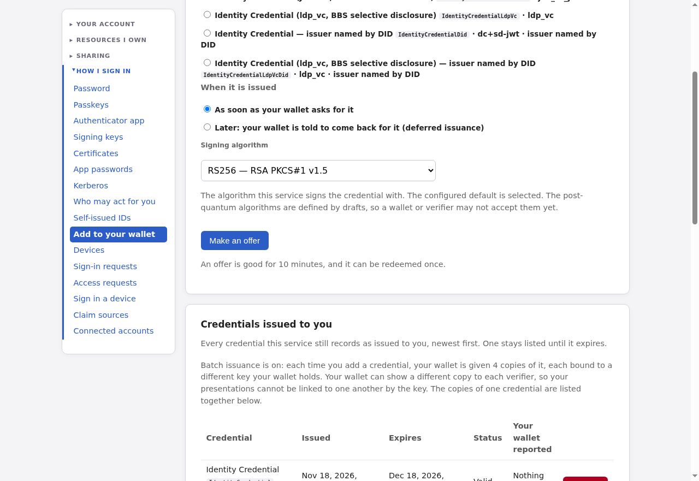
3. The portal shows **"Scan this with your wallet"** (a QR of the
   `openid-credential-offer://` link), **"Then type this Transaction Code into
   your wallet:"** with the code, and **"The offer, as a link."** Copy the link
   and note the Transaction Code.

   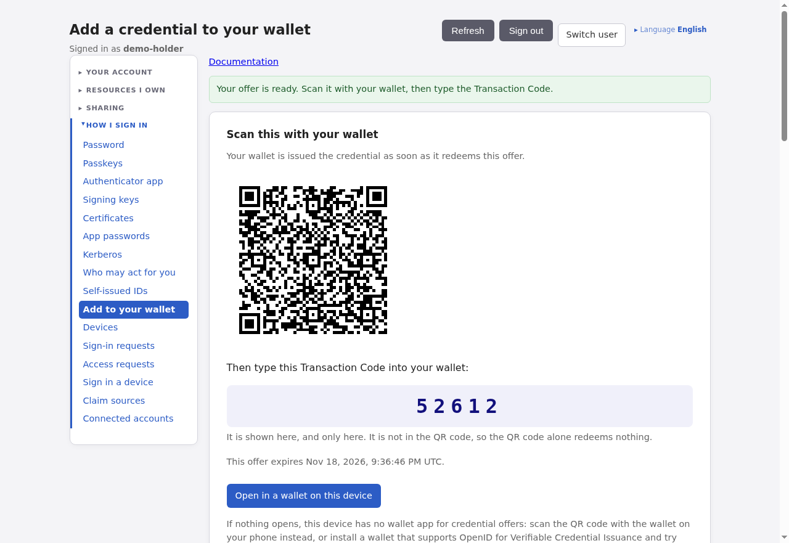
4. On `https://idptools.com`, choose **VC Issuance**. On step 1, set
   **client_id** (in **Configuration Parameters**) to `idptools-wallet`, paste
   the offer link into **Receive a Credential Offer**, and press **Take this
   offer**. The **Credential Offer** pane names `IdentityCredential` and the
   pre-authorized grant with its `tx_code`.

   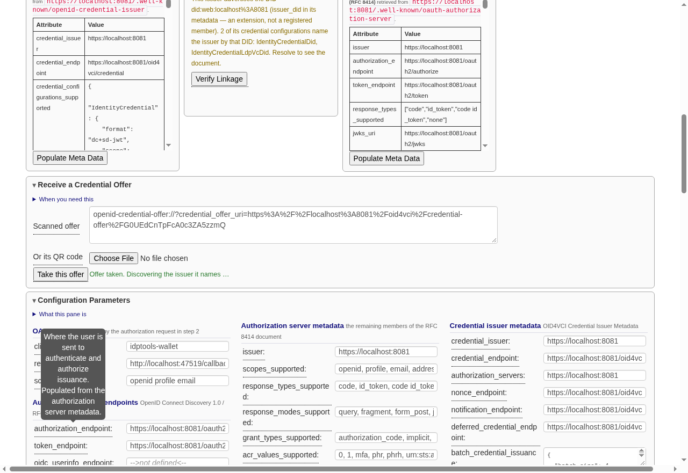
5. Now step 1 discovers the issuer, so **nothing else is typed by hand** — and
   you can see exactly where each value comes from:
   - **Credential Issuer Metadata** — the **Credential Issuer Metadata URL**
     is filled from the offer as
     `https://localhost:8081/.well-known/openid-credential-issuer`. Press
     **Retrieve** to fetch it (OpenID4VCI 1.0 §12.2); the pane lists the
     `credential_configurations_supported` and the `authorization_servers`.
     Press **Validate Signature** to verify the issuer's `signed_metadata`
     (§12.2.3).
   - **Authorization Server Metadata** — its **Metadata Endpoint URL** is taken
     from the `authorization_servers` just retrieved. Press **Retrieve** (RFC
     8414), then **Validate Signature**.

   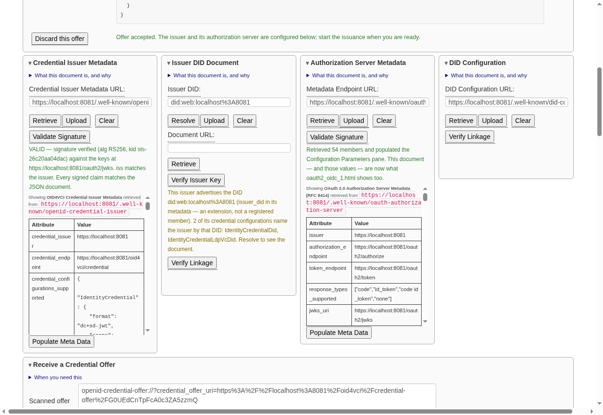
   The **Configuration Parameters** pane below is filled **from these two
   documents** — every endpoint, scope and credential setting the flow uses is
   shown there, sourced from the metadata rather than guessed. You can override
   any of it in that pane before continuing.

   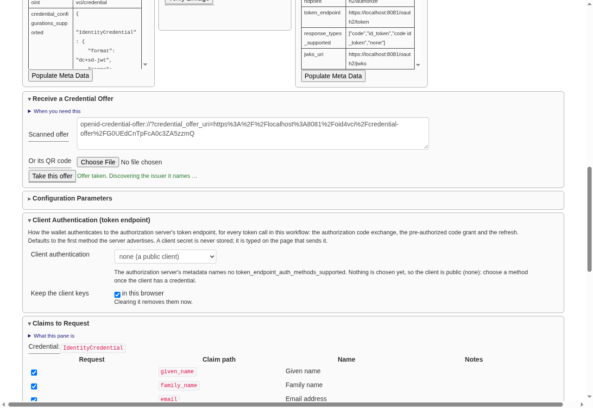
6. Press **Start Issuance** (a pre-authorized offer skips the sign-in). On
   step 2, type the **Transaction Code**, press **Send the Token Request**,
   then **Approve and Request Credential**.

   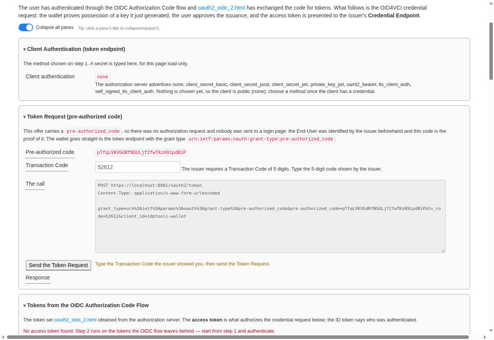
7. Step 3 shows the SD-JWT VC, verified — the credential is now held in the
   wallet.

   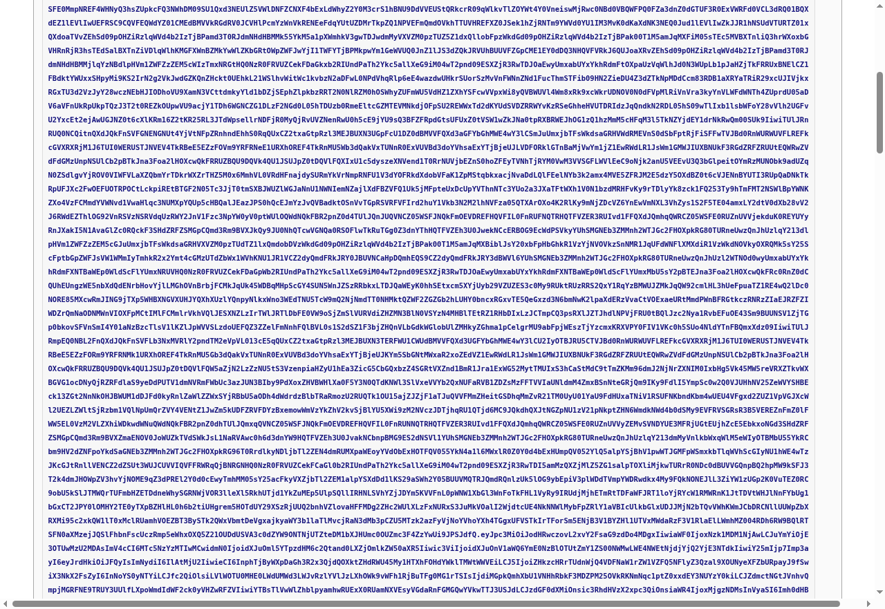

## Appendix C: VC Presentation

The wallet presents to **iya-sts's own OpenID4VP verifier**. (The
debugger's *own* Verifier page needs the self-hosted build, as it would store
the answer server-side; on the hosted site use iya-sts or the browser's Digital
Credentials API.)

1. As the verifier operator, open the admin console's VC page at
   `https://localhost:8081/admin/vc`. Under **"Start a verification"**, press
   **Start**. It asks for the default claims of `IdentityCredential` and shows
   an `openid4vp://` request — *by value*, `response_mode=direct_post` — as a
   link and QR code. (The same request comes from
   `POST /admin-api/verifications/start`.)
2. On `https://idptools.com`, choose **VC Presentation**. Unlike issuance,
   **OpenID4VP has no metadata document to discover**, so you set the Verifier's
   identity by hand on step 0, then press **Save**:

   | Field | Value |
   |---|---|
   | **Verifier base URL** (`vp_verifier_base_url`) | `https://localhost:8081` |
   | **Verifier JWKS URL** (`vp_verifier_jwks_url`) | `https://localhost:8081/oauth2/jwks` |
   | **x509 trust anchor (PEM)** (`vp_x509_trust_anchor`) | *leave empty* |

   The JWKS URL and the x509 trust anchor are **not** alternatives — they cover
   two different ways a Verifier is authenticated: the **JWKS URL** checks the
   signature of a request from a **pre-registered** client (no Client Identifier
   prefix), and the **x509 trust anchor** checks the `x5c` chain of a Verifier
   named by `x509_hash` / `x509_san_dns` (HAIP). The request iya-sts sends here
   names its client by the **`redirect_uri` prefix** and is **unsigned**, so it
   is authenticated by where the answer is posted, not by a signature — it needs
   **neither**. Setting the **Verifier base URL** alone is enough (the JWKS URL
   just auto-fills from it); the x509 anchor stays empty because this is not an
   x509-identified Verifier.

   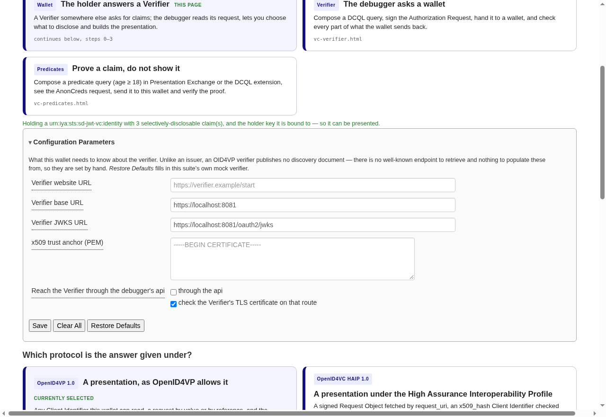
3. On step 1, paste the `openid4vp://` request. The wallet reads it (no fetch
   needed), and you pick the held credential and the claims to disclose.

   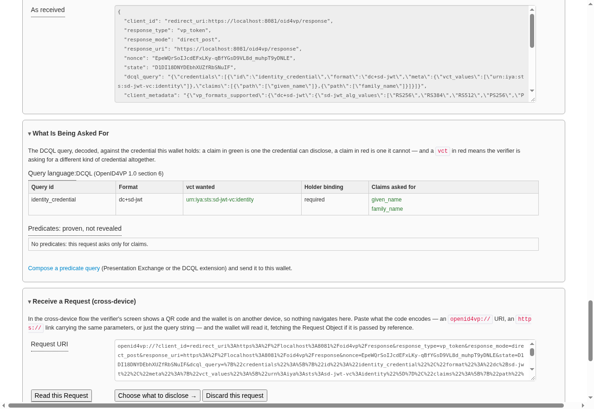
4. Press **Present**. The wallet posts the presentation to iya-sts's
   `response_uri` (allowed by the CORS origin configured in Appendix A).

   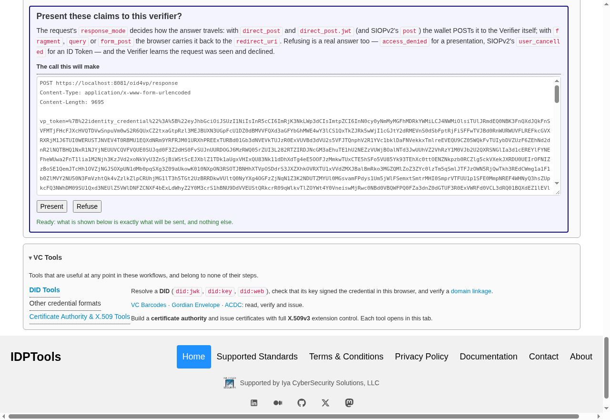
5. The admin console shows the presentation **received and verified**.

   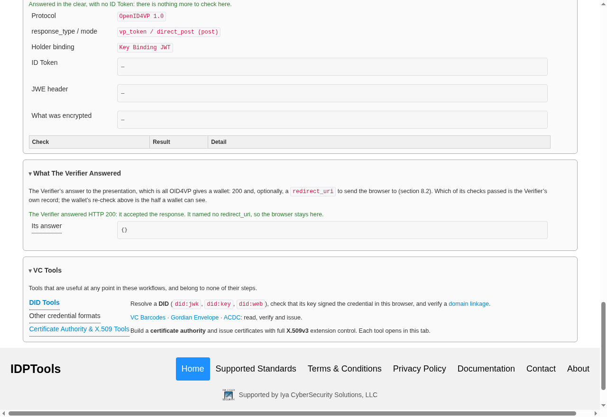

---

*Every capability in this report is defined by a published specification.
Reviewed 2026-11-18.*
