# SAML tutorials

Each tutorial is one way the SAML workflow is used. Start from
`saml_request.html` (the **SAML Protocol** card). The fields are in
[reference.md](reference.md). What the messages are is in
[protocol.md](protocol.md).

The pictures were taken against iya-sts in product mode, signed in as
`guide-saml`. Your identity provider's sign-in page will look
different. The debugger's panes are the same. What iya-sts requires
before **Call IdP** succeeds is in
[setup-iya-sts.md](setup-iya-sts.md): a registered service provider,
the certificate from **Generate Keys**, a real password, and then a
second factor. The password form is pictured with the password empty.
The authenticator set-up page is not pictured.

* TOC
{:toc}

## Sign in over HTTP-Redirect

SAML 2.0 Web Browser SSO. The `AuthnRequest` travels on a redirect.
The response comes back by HTTP-POST.

1. Open `saml_request.html`. In **IdP Metadata**, set **Metadata
   Document URL** to the identity provider's SAML 2.0 metadata and
   press **Load Metadata**. With a backend, the api fetches that URL.
   The status line says the document loaded, and **Metadata Document**
   shows the XML.

   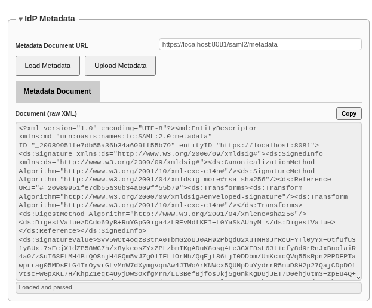

2. **Configuration Parameters** is filled from that document: the IdP
   entityID, the single sign-on URLs, the artifact resolution service,
   the logout URLs, and the signer certificate.

   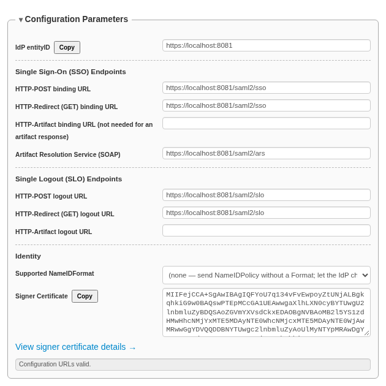

3. In **SP / Request Settings** leave **Protocol Version** on
   **SAML 2.0**. Set **Request binding** to **HTTP-Redirect (GET)** and
   **Response binding (ProtocolBinding)** to **HTTP-POST**. **SP
   entityID** and **ACS URL** are the Issuer and the consumer the
   identity provider must already accept. Leave **Supported
   NameIDFormat** on the value the metadata selected.

   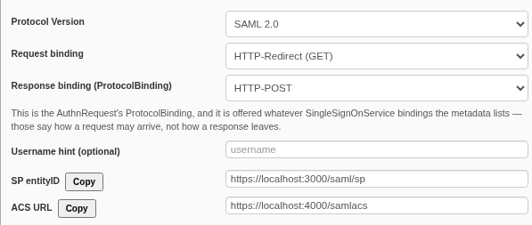

4. **Digitally sign the AuthnRequest** is on. Press **Generate Keys**
   if **Private Signing Key** is empty. **Call IdP** will not send a
   signed request without that key. Register the public certificate
   with the identity provider before you send. **Download SP
   Metadata** is the document most providers consume. On iya-sts in
   product mode the certificate has to be the one this page just
   generated.

5. **Generated AuthnRequest** is the XML that will be sent, deflated
   and signed on the query string.

   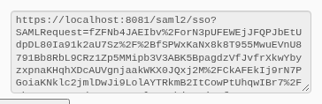

6. Press **Call IdP**. The browser goes to the identity provider.
   Sign in with an account that provider knows. The picture is the
   sign-in form after the account name is filled and before the
   password is typed. On iya-sts in product mode the next page asks
   for a second factor. That page is not pictured.

   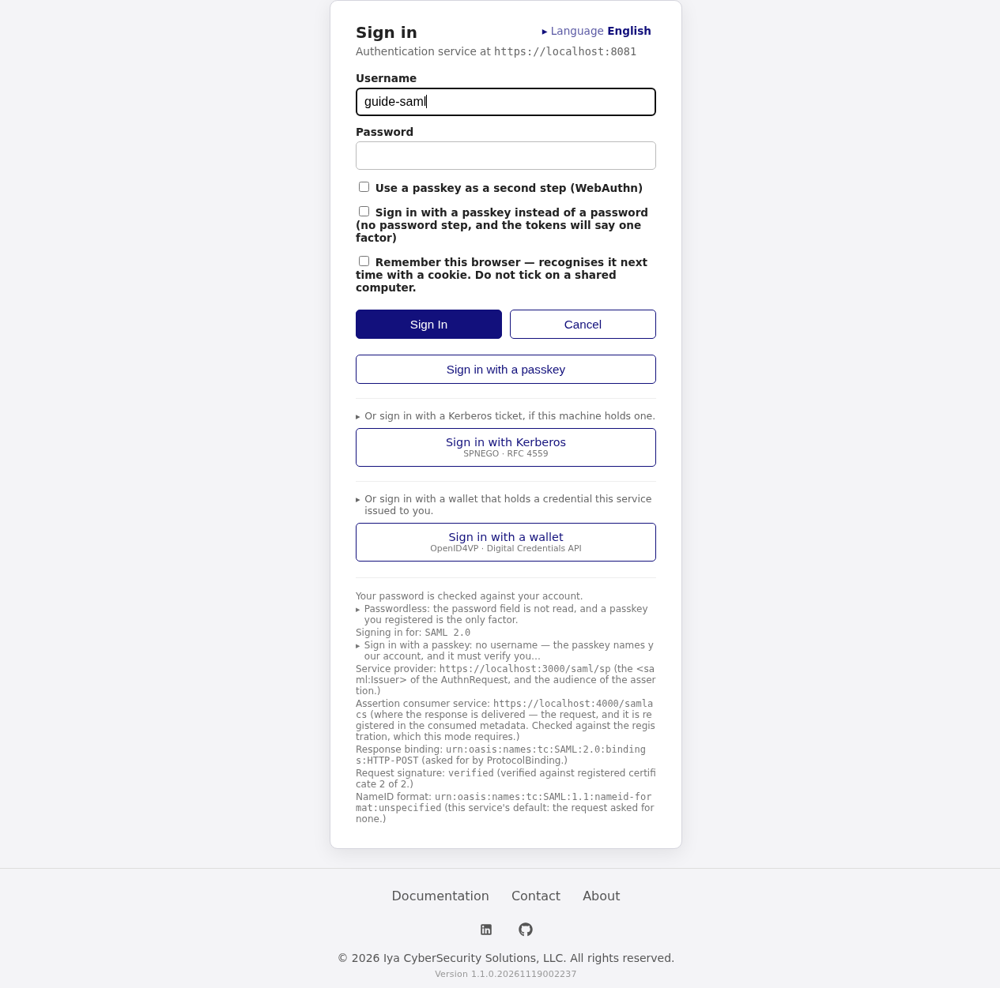

   Product mode then asks, once per service provider, whether that
   provider may sign you in. Choose **Allow**. The answer is
   remembered. Development mode does not ask.

   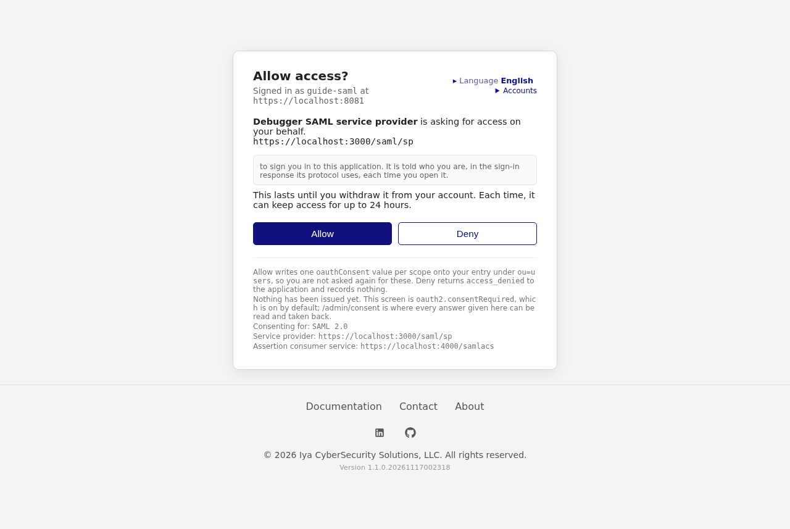

7. The assertion consumer redirects to `saml_response.html`. The status
   line and the response XML are the first thing on the page. A
   successful sign-in has a Success status and an assertion.

   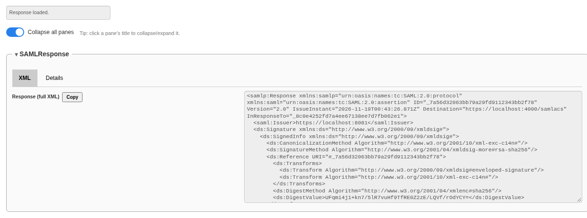

8. Open **Attributes** on the assertion pane. The table is the
   attributes and the NameID.

   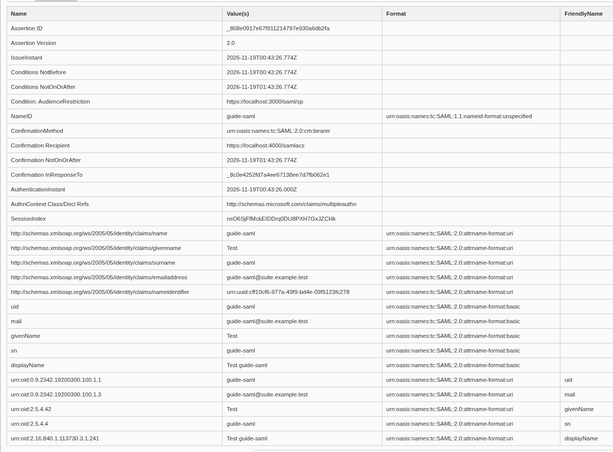

9. Press **Validate Signatures**. Each enveloped signature is its own
   row. **Verify with** the identity provider's metadata certificates
   is the check that the signer is that provider. **KeyInfo** only
   checks that the bytes were not altered.

   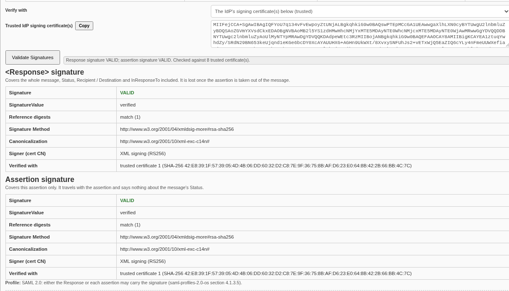

The NameID and the session index are kept for **Logout**. The
assertion itself is the last response the SAML Assertion Tool and the
WS-Trust **Import from SAML workflow** button can read.

## Send the AuthnRequest as a POST

Same profile. The request is a form POST to the identity provider's
HTTP-POST single sign-on URL, with an enveloped signature when signing
is on. The response is still HTTP-POST.

1. On `saml_request.html`, with metadata already loaded and a key pair
   already generated, set **Request binding** to **HTTP-POST**. Leave
   **Response binding** on **HTTP-POST**.

   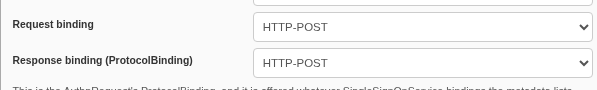

2. **Generated AuthnRequest** carries the enveloped signature. The
   browser will POST it.

   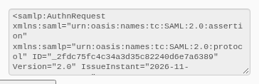

3. Press **Call IdP** and sign in. The response page is the same shape
   as the redirect walk. The status line names the binding the response
   used.

   

## Ask for an artifact

**HTTP-Artifact** is a response binding. The request still goes by
redirect or POST. `ProtocolBinding` asks the identity provider to
return an artifact instead of the assertion. The api calls the
artifact resolution service with a SOAP `ArtifactResolve` and shows
the `Response` that comes back. This needs the api. A static site
cannot finish it.

1. Set **Response binding** to **HTTP-Artifact**. The request binding
   can stay on redirect. The artifact consumer has to be registered
   with the identity provider. On this deployment it is the ACS URL
   with `/samlacs` replaced by `/samlacs/artifact`.

   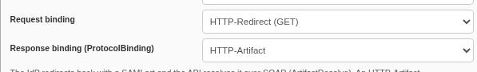

2. Press **Call IdP** and sign in. The response page shows the
   assertion the resolution service returned, not the artifact.

   

The resolution call is made by the api, so the artifact resolution
URL has to be reachable from the api. A URL that works in the browser
can still fail when the api is in another container.

## Single Logout

SAML 2.0 only. **Logout** is available after a sign-in has stored a
NameID and the metadata has a single logout URL.

1. Complete the [redirect sign-in](#sign-in-over-http-redirect) first.
   Back on `saml_request.html`, leave **Request binding** on
   **HTTP-Redirect (GET)** and press **Logout**.
2. The identity provider may ask you to sign in again, then posts a
   `LogoutResponse` to the same consumer. The response page shows that
   message. Open **Details** for the status.

   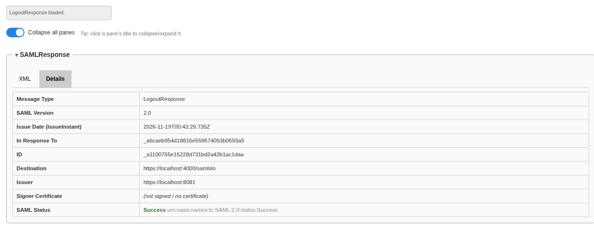

SAML 1.1 has no logout. The button is unavailable when the version
selector is on 1.1.

## SAML 1.1

SAML 1.1 sends no `AuthnRequest`. The browser is redirected with the
assertion consumer in the query. Five SAML 2.0 controls are switched
off. The developer note is [SAML 1.1](../saml11.md). This walk is the
Browser/POST profile.

1. Load the identity provider's metadata. On iya-sts the SAML 2.0
   document and the per-relying-party SAML 1.1 URL are the same
   document, and it names both protocols, so the selector stays on
   2.0. A document that names only 1.1 moves it. The identity provider
   still has to be given this service provider's SAML 1.1 metadata.
   See [setup-iya-sts.md](setup-iya-sts.md).
2. Set **Protocol Version** to **SAML 1.1**. The warning appears. The
   username hint, request signing, request encryption, logout, and
   the request-binding selector are greyed. The key pair stays,
   because an artifact resolution request is still signed with it.

   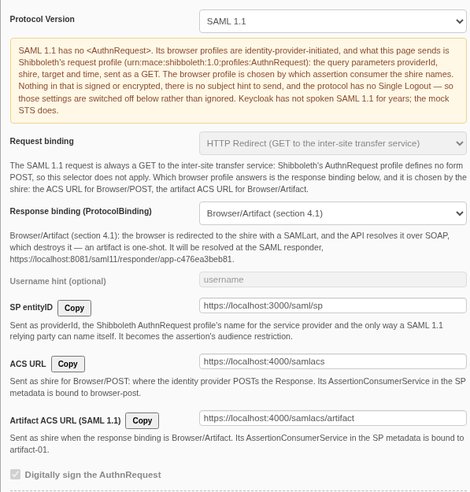

3. The generated request is the query the browser will send, not an
   `AuthnRequest`.

   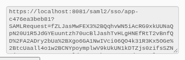

4. Press **Call IdP** and sign in. The response page reads a 1.1
   status code. A Success value there is the QName, not the SAML 2.0
   URI.

   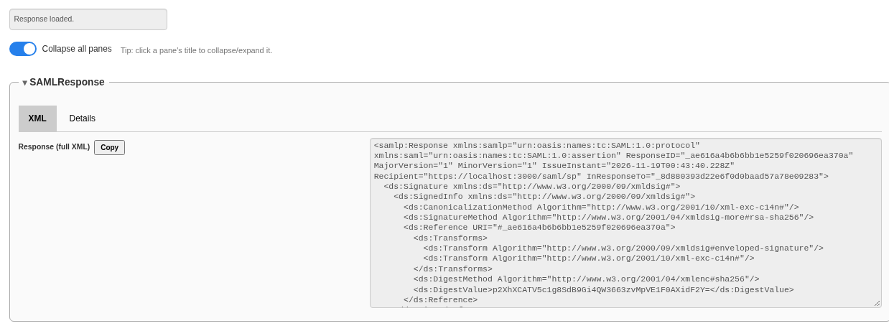

5. **Attributes** is the same table. The attribute names follow
   whichever form the identity provider used.

   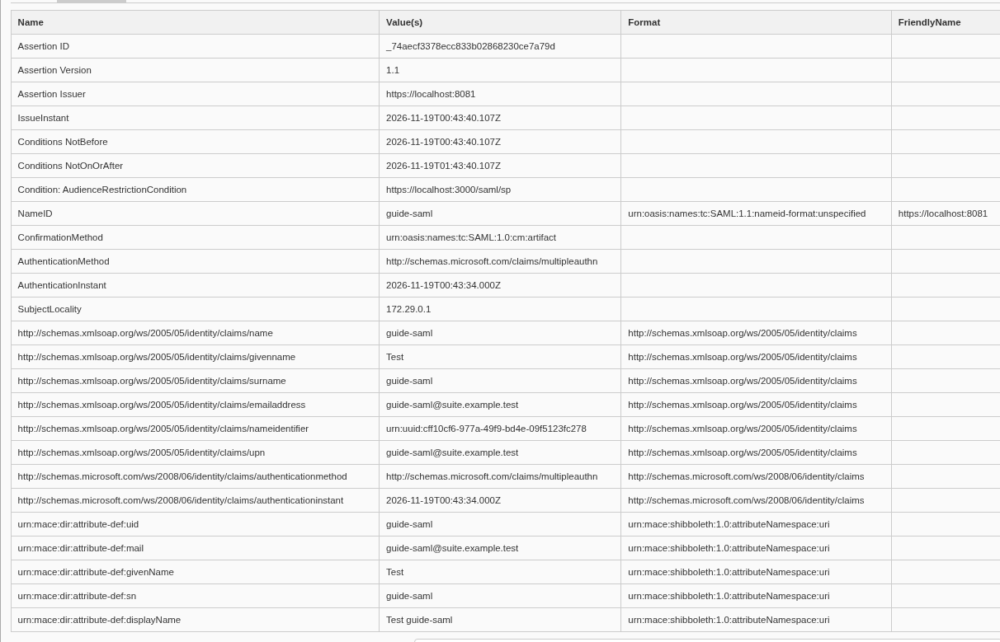

## What is not pictured

An encrypted assertion is decrypted on the response page with
**Decrypt** and **Decryption Key**. iya-sts does not encrypt a Web
Browser SSO assertion, so there is no picture of one here. A provider
that does, such as the stack's Keycloak, returns ciphertext the same
key can open when **Save this key pair** was left on. The fields are
in the [reference](reference.md#decrypting-an-assertion).
