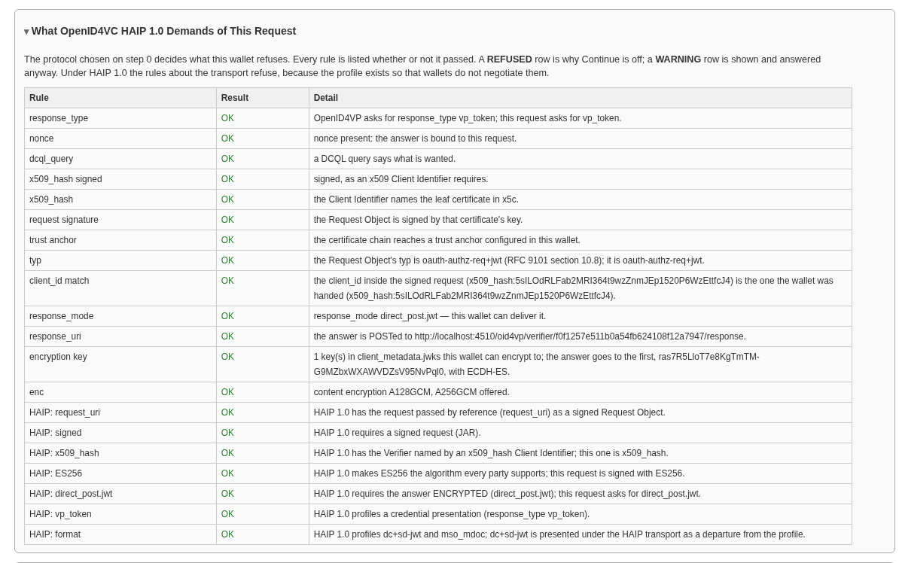
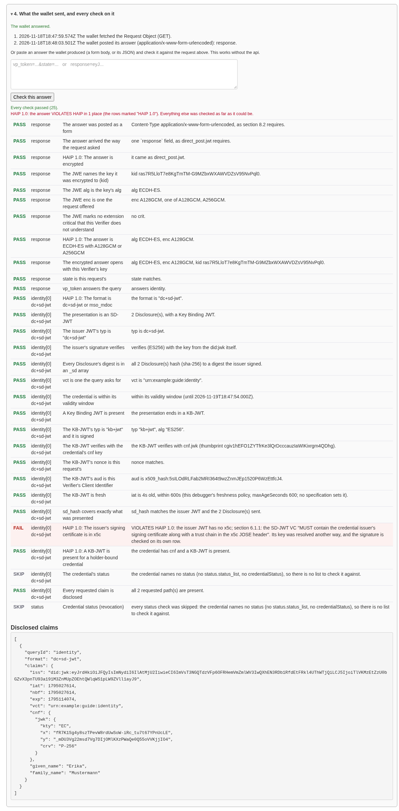

# HAIP 1.0 — the high-assurance profile of OpenID4VP

[OpenID4VC High Assurance Interoperability Profile 1.0][haip] (HAIP) is **a
profile, not a protocol**. It takes OpenID4VP 1.0 and removes the choices:
a wallet and a Verifier that both follow it do not negotiate how the request
is authenticated or how the answer is protected, because only one way is
allowed. Read [openid4vp.md](openid4vp.md) first; everything there still
applies.

In the debugger HAIP is a choice on both ends:

- **the wallet**: the **OpenID4VC HAIP 1.0** card on
  `vc-presentation-0.html` (`vp_protocol_haip`);
- **the Verifier page**: **Profile = HAIP 1.0** (`vpv_profile`) on
  `vc-verifier.html`.

## What HAIP demands of the request, and what the wallet does about it

Under HAIP the wallet's step 1 adds these rules to OpenID4VP's. A **REFUSED**
row disables Continue before a single claim is shown, which is the point of
the profile.

| Rule | Level | HAIP requires |
|---|---|---|
| `HAIP: request_uri` | refused | The request passed by reference |
| `HAIP: signed` | refused | A signed Request Object (JAR, RFC 9101) |
| `HAIP: x509_hash` | refused | The `x509_hash` Client Identifier prefix |
| `HAIP: direct_post.jwt` | refused | An encrypted answer |
| `HAIP: vp_token` | refused | `response_type` `vp_token` |
| `encryption key` | refused | An **ECDH-ES P-256** key in `client_metadata.jwks` (the post-quantum keys the wallet can use elsewhere do not count here) |
| `HAIP: ES256` | warning | The request signed with ES256 |
| `HAIP: format` | warning | `dc+sd-jwt` or `mso_mdoc` |

HAIP has no request by value, so choosing HAIP on step 0 while the
"Same device — request by value" flow is selected switches the flow to the
signed request by reference, and greys the by-value card out.

**Formats.** HAIP profiles SD-JWT VC and ISO mdoc. This wallet will still
present `jwt_vc_json` and `ldp_vc` over the HAIP transport — signed
`x509_hash` request, encrypted answer — and the `HAIP: format` row reports
that as a departure from the profile, as a warning. It is not silently
waived.

## What the Verifier page refuses to send under HAIP

With **Profile = HAIP 1.0**, the Verifier page will not create a request
HAIP forbids, and names each rule broken:

- a query format other than `dc+sd-jwt` or `mso_mdoc`;
- outside the Digital Credentials API: a prefix other than `x509_hash`,
  delivery by value, or a response mode other than `direct_post.jwt`;
- through the Digital Credentials API: a response mode other than
  `dc_api.jwt`, or a signed request with a prefix other than `x509_hash`;
- an `enc` list missing A128GCM or A256GCM.

It only **advises** against sending no `redirect_uri` in the same-device
flow (HAIP §5.1 says Verifiers MUST include one).

An answer that breaks a HAIP rule is reported on **HAIP 1.0** rows, and every
other check still runs; `vpv_profile_verdict` says separately whether the
answer conformed to every HAIP rule checked.

## Trust

`x509_hash` names the leaf certificate that signed the request. The wallet
completes the chain with the **x509 trust anchor** configured on step 0 and
warns when the chain does not reach it. When the Verifier is the debugger's
own Verifier page, that anchor is the page's root CA, shown in pane 3 and in
`vpv_identity_trust`; see
[tutorial-present-to-verifier.md](tutorial-present-to-verifier.md).

## Interoperability

Besides the debugger's own Verifier page, the suite presents under HAIP to
iya-sts's Verifier and to Polaris, an independent OpenID Certified HAIP
Verifier (see [../sd-jwt-vc-presentation.md](../sd-jwt-vc-presentation.md)).
Any HAIP Verifier works; it only has to be reachable from the browser (or
through the api's `POST /oid4vp/call`, **Reach the Verifier through the
debugger's api** on step 0).

[haip]: https://openid.net/specs/openid4vc-high-assurance-interoperability-profile-1_0.html
