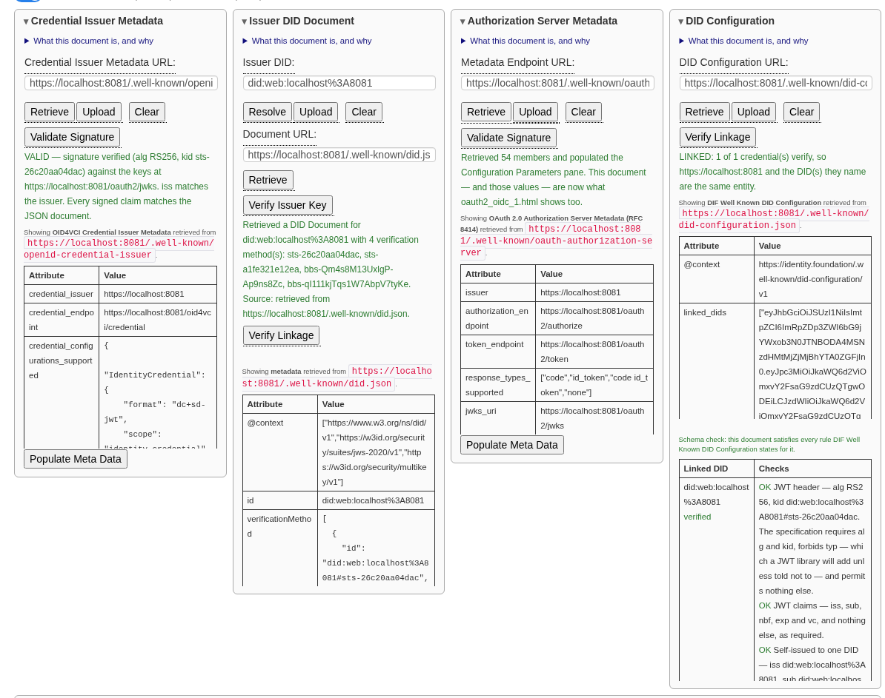

# OpenID4VCI 1.0 — receiving a credential

[OpenID for Verifiable Credential Issuance 1.0][oid4vci] (final, 2025) is how
a wallet gets a credential from a **Credential Issuer**. It is OAuth 2.0 with
one more protected resource: the wallet obtains an access token from the
issuer's authorization server, then POSTs a **Credential Request** to the
issuer's Credential Endpoint with a proof that it holds the key the credential
will be bound to.

In this workflow the debugger is the **wallet**. It works with any issuer
that publishes OpenID4VCI metadata; nothing on these pages is specific to one
product. The suite runs it against iya-sts and walt.id. Every value you type
comes from the issuer's metadata, or from the offer the issuer made you.

The field-by-field reference is [reference-issuance.md](reference-issuance.md).
The developer notes are [../sd-jwt-vc-issuance.md](../sd-jwt-vc-issuance.md),
[../vc-client-auth.md](../vc-client-auth.md) and [../dpop.md](../dpop.md).

- [The shape of an issuance](#the-shape-of-an-issuance)
- [Discovery: the two metadata documents](#discovery-the-two-metadata-documents)
- [How issuance starts: Appendix H](#how-issuance-starts-appendix-h)
- [Getting the access token](#getting-the-access-token)
- [Client authentication at the token endpoint](#client-authentication-at-the-token-endpoint)
- [DPoP](#dpop)
- [The Credential Request and the key proof](#the-credential-request-and-the-key-proof)
- [Deferred issuance, notification and refresh](#deferred-issuance-notification-and-refresh)
- [What the wallet checks](#what-the-wallet-checks)
- [What the wallet does not do](#what-the-wallet-does-not-do)

## The shape of an issuance

| Step | Page | What happens | Spec |
|---|---|---|---|
| 0 | `vc-issuance-0.html` | Choose who starts: the wallet, or an offer from the issuer | Appendix H |
| 1 | `vc-issuance-1.html` | Read the Credential Offer (if any), the Credential Issuer Metadata and the authorization server's metadata; choose the credential and claims | §4, §12.2, RFC 8414 |
| — | `oauth2_oidc_1.html`, `oauth2_oidc_2.html` | Authorization Code flow with PKCE (skipped for a pre-authorized offer) | §5, RFC 6749, RFC 7636 |
| 2 | `vc-issuance-2.html` | Token Request for a pre-authorized code; DPoP; nonce; key proof; Credential Request | §6, §7, §8 |
| 3 | `vc-issuance-3.html` | The credential, verified; the Notification Endpoint | §8.3, §11 |
| 4 | `vc-issuance-4.html` | Refresh the token, ask again, compare, keep or discard; Credential History | §14.5 (implementation considerations) |

## Discovery: the two metadata documents

Step 1 reads **Credential Issuer Metadata** from
`<credential_issuer>/.well-known/openid-credential-issuer` (§12.2). It names
the Credential Endpoint, the optional Nonce, Deferred Credential and
Notification Endpoints, `batch_credential_issuance`, the response and request
encryption the issuer supports, and `credential_configurations_supported` —
one entry per kind of credential, each with its `format`, `scope`, binding
methods, key-proof types and algorithms, and the claims it carries.

If the document carries `signed_metadata` (§12.2.3), **Validate Signature**
verifies that JWT and reports any member where the signed copy and the plain
JSON disagree.

The issuer's `authorization_servers` member, or the issuer itself, names the
authorization server; its RFC 8414 metadata supplies the authorization and
token endpoints, `token_endpoint_auth_methods_supported`,
`authorization_details_types_supported` and
`dpop_signing_alg_values_supported`.

The same page resolves the issuer's DID when the issuer is named by one, and
reads its DIF DID Configuration; see
[tutorial-did-linkage.md](tutorial-did-linkage.md).

**CORS.** The page fetches these documents from the browser, so the issuer
has to send CORS headers that name the page's origin. When it does not, save
the document yourself (for example with `curl`) and use **Upload**.

## How issuance starts: Appendix H

| Card on step 0 | Appendix | What you bring to step 1 |
|---|---|---|
| Start from the wallet | H.6 | The issuer's metadata URL. The flow is Authorization Code with PKCE. |
| The issuer offers you a credential | H.1 | A Credential Offer (§4.1) the issuer's website sent you back with, as `credential_offer` (by value) or `credential_offer_uri` (by reference). |
| Scan a code, type a transaction code | H.2 | A pre-authorized offer from the issuer's website, as text or as its QR code image, and the Transaction Code the issuer showed you separately. |
| The credential is not ready yet | H.3 | A pre-authorized offer whose credential is issued later. |

OpenID4VCI does not say where an issuer makes offers, so the three offer
cards send you to the **issuer website URL** you configure on step 0 (an
account page, a portal, a kiosk). A wallet only has to take what it is
given: step 1's **Receive a Credential Offer** pane reads the text of an
`openid-credential-offer://` URI, or decodes a picture of its QR code in the
page.

An offer names the issuer, the `credential_configuration_ids` on offer, and
its `grants`:

- `authorization_code`, optionally with `issuer_state`, which the wallet
  sends back on the authorization request so the issuer can tie the sign-in
  to the offer;
- `urn:ietf:params:oauth:grant-type:pre-authorized_code`, with the
  `pre-authorized_code` and, optionally, a `tx_code` object describing a
  Transaction Code (its `length` and `input_mode`) that the issuer delivers
  by another channel.

## Getting the access token

**Authorization Code** (H.1, H.6). Step 1's **Start Issuance** hands off to
the OAuth 2.0 pages with the grant set to the OIDC Authorization Code flow.
The credential is asked for in one of two ways (§5.1), chosen in the
**Ask for the credential with** select:

- `scope` — the chosen configuration's `scope` value;
- `authorization_details` (RFC 9396) — an `openid_credential` object naming
  the `credential_configuration_id`, and, when you unticked some claims on
  step 1, a `claims` array asking for only those (§5.1.1). The token response
  then grants `credential_identifiers`, and step 2 names one of them instead
  of the configuration (§8.2).

The client must be registered with the authorization server, with this
deployment's `/callback` as a redirect URI. How a wallet is registered is the
authorization server's business (by an administrator, RFC 7591 dynamic
registration, or OpenID Federation); the OAuth 2.0 pages carry a dynamic
registration pane, described in
[../oauth2-oidc/dynamic-client-registration.md](../oauth2-oidc/dynamic-client-registration.md).

**Pre-authorized code** (H.2, H.3). Nothing is signed in: step 2's
**Token Request (pre-authorized code)** pane POSTs the code, and the
Transaction Code you type, to the token endpoint (§6.1). The Transaction Code
is never stored. If the offer requires one and the box is empty, nothing is
sent. A claims selection, if any, goes on this request as
`authorization_details`, because this flow has no authorization request.

## Client authentication at the token endpoint

OpenID4VCI leaves client authentication to OAuth. The **Client
Authentication** pane on step 1 chooses one method for every token call the
workflow makes — the code exchange, the pre-authorized grant and the
refresh:

| Method | Spec |
|---|---|
| `none` (default: a public client) | RFC 6749 |
| `client_secret_basic`, `client_secret_post` | RFC 6749 §2.3.1 |
| `client_secret_jwt` | RFC 7523 §2.2 |
| `private_key_jwt` | RFC 7523, with the `aud` and `typ` of *draft-ietf-oauth-rfc7523bis-11* (a draft) selectable |
| `attest_jwt_client_auth` | *draft-ietf-oauth-attestation-based-client-auth-12* (a draft): a Client Attestation and a PoP, in two request headers |

A client secret is never stored; type it on each page that sends it. The
client key, the attestation and its instance key are key material, kept only
while **Keep the client keys in this browser** is ticked. A Client Attestation
during the code exchange needs that page's *Initiate call from: Front End*,
because the api does not forward request headers. Details are in
[../vc-client-auth.md](../vc-client-auth.md).

## DPoP

With **Sender-constrain the token** ticked on step 2 (it is off by default),
every token and Credential Request carries an RFC 9449 DPoP proof, and the
token should come back as `token_type: DPoP` with a `cnf.jkt` equal to the
thumbprint shown. The pane shows what the server actually answered, retries
once with a server-supplied `DPoP-Nonce`, and offers **Holder of Key**, where
the DPoP key is also the credential's holder key. To bind the authorization
code too (`dpop_jkt`, RFC 9449 §10), turn DPoP on **before** step 1's
hand-off. See [../dpop.md](../dpop.md).

## The Credential Request and the key proof

Before signing anything, step 2 fetches a fresh `c_nonce` from the issuer's
Nonce Endpoint (§7), when it has one. It then builds:

- a **key proof** of type `jwt` (§8.2, Appendix F.1): a JWT with `typ`
  `openid4vci-proof+jwt`, signed by the holder key, carrying the holder's
  public key, `aud` set to the Credential Issuer, `iat` and the `c_nonce`.
  The holder key's algorithm is the first of ES256, EdDSA, Ed25519, ES384,
  ES256K, ES512, PS256 and RS256 the configuration lists in
  `proof_signing_alg_values_supported` (an `mso_mdoc` key is always ES256);
- the **Credential Request** (§8.2): `credential_configuration_id` or
  `credential_identifier`, and `proofs.jwt` — one proof per key when you ask
  for a batch (§8.3; capped at the issuer's `batch_size`).

Options on **Credential Request Options**: ask for an encrypted Credential
Response (§10; the wallet decrypts RSA-OAEP-256), and encrypt the request to
a key in the issuer's `credential_request_encryption.jwks` (locked on when
the issuer requires it).

**Approve and Request Credential** sends it. A stale `c_nonce` is fetched
again and the request retried once. **Deny** sends nothing.

The holder private key is stored only while **Save this holder key pair in browser localStorage** is
ticked; **Download Key Pair** saves the pair for later pasting.

## Deferred issuance, notification and refresh

- **Deferred** (§9). A Credential Response carrying `transaction_id`
  instead of a credential opens the **Deferred Issuance** pane, which polls
  the Deferred Credential Endpoint at the `interval` the issuer asks for
  (5 seconds when it gives none) and opens step 3 when the credential
  arrives.
- **Notification** (§11). Step 3 sends `credential_accepted`,
  `credential_failure` or `credential_deleted`, with the `notification_id`
  from the Credential Response, to the Notification Endpoint.
- **Refresh** (§14.5). Step 4 exchanges the refresh token for a new access
  token (RFC 6749 §6), then asks the Credential Endpoint again — reusing the
  key the credential is bound to, or binding a new one — and shows **What
  Changed** before you choose to replace the credential you hold or discard
  the new one. An authorization server need not issue a refresh token; when
  there is none, step 4 says so.

## What the wallet checks

Step 3 verifies the credential the issuer returned, and the checks depend on
the format:

| Format | Guide |
|---|---|
| `dc+sd-jwt` | [format-sd-jwt-vc.md](format-sd-jwt-vc.md) |
| `jwt_vc_json` | [format-jwt-vc-json.md](format-jwt-vc-json.md) |
| `ldp_vc` (Data Integrity) | [format-ldp-vc.md](format-ldp-vc.md) |
| `vc+jwt`, `vc+sd-jwt`, `vc+cose` | [format-vc-jose-cose.md](format-vc-jose-cose.md) |
| `jpt`, `sd-cwt` (drafts) | [format-sd-cwt-jwp.md](format-sd-cwt-jwp.md) |
| `anoncreds` | [format-anoncreds.md](format-anoncreds.md) |
| `mso_mdoc` | [format-mdoc.md](format-mdoc.md) |

For an SD-JWT VC, for example, step 3 checks the `typ`, the algorithm,
`vct`, that `cnf` names the holder key the wallet generated, `_sd_alg`, the
validity window, that no Key Binding JWT is attached, every Disclosure's
digest, and the issuer's signature (keys from `/.well-known/jwt-vc-issuer`
or the issuer's DID).

## What the wallet does not do

These are stated so you do not look for them:

- Only the `jwt` key-proof type is sent. `attestation` and `di_vp` proofs,
  which an issuer may advertise, are not produced.
- The wallet decrypts an encrypted Credential Response with RSA-OAEP-256
  only.
- Step 4 polls a deferred re-issuance only when you press its button.
- No issuer in the debugger's own test stack issues `mso_mdoc`, the
  VC-JOSE-COSE formats, JPT, SD-CWT or AnonCreds; those reach the wallet from
  an issuer that offers them.

[oid4vci]: https://openid.net/specs/openid-4-verifiable-credential-issuance-1_0.html
