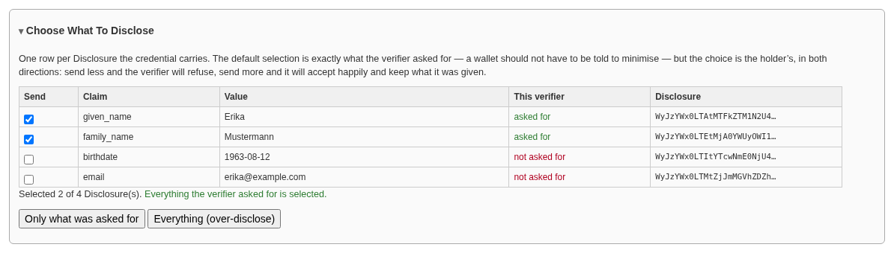
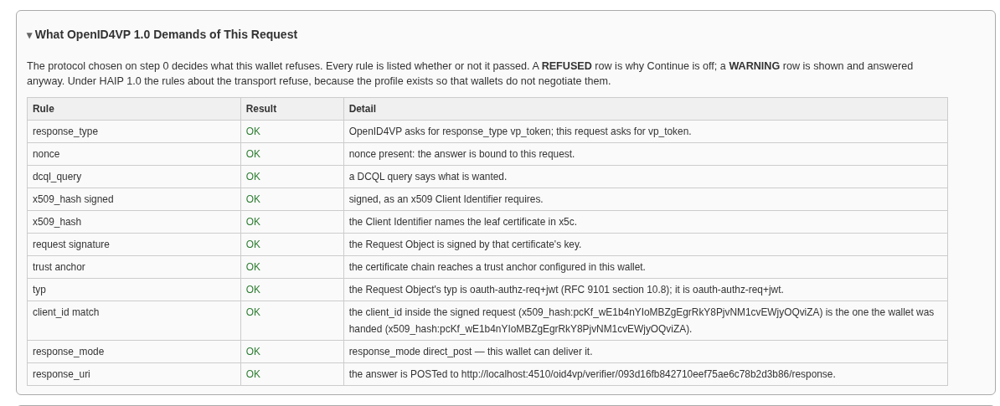
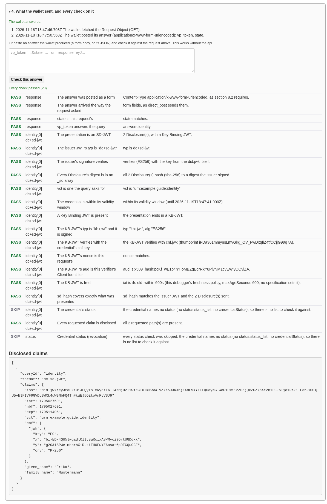

# OpenID4VP 1.0 — presenting a credential, and asking for one

[OpenID for Verifiable Presentations 1.0][oid4vp] (final, 2025) is how a
**Verifier** asks a **wallet** for claims and how the wallet answers. The
request is an OAuth 2.0 authorization request with `response_type=vp_token`;
the answer is a `vp_token` holding one presentation per query, each carrying
a proof that the presenter holds the key the credential is bound to.

The debugger plays **both ends**:

- **the wallet** — `vc-presentation-0.html` to `vc-presentation-3.html`. It
  answers any Verifier that sends an OpenID4VP request, with the credential
  the issuance workflow left in this browser.
- **the Verifier** — `vc-verifier.html`, reached from the role chooser on
  `vc-presentation-0.html`. It composes and signs requests, and checks the
  answer one row per check. The modes that **host** a `request_uri` or a
  `response_uri` for a wallet on another device need the debugger's api (the
  local containers): hosting a wallet's `direct_post` answer would mean
  holding a **presented credential on the server**, and the static content
  sites deliberately store nothing, so they do not offer those modes. On a
  static site the Verifier still works fully in **Digital Credentials API**
  mode (nothing is hosted — the answer comes back in the same browser) and
  still **checks an answer you paste** into pane 4. See
  [What the static sites can and cannot do](index.md#what-the-static-sites-can-and-cannot-do).

Two profiles of the same exchange are separate pages:
[HAIP 1.0](haip.md) and [SIOPv2](siopv2.md). Field references:
[reference-presentation.md](reference-presentation.md) and
[reference-verifier.md](reference-verifier.md). Developer notes:
[../sd-jwt-vc-presentation.md](../sd-jwt-vc-presentation.md),
[../vc-verifier.md](../vc-verifier.md),
[../vc-verifier-api.md](../vc-verifier-api.md).

- [What a request carries](#what-a-request-carries)
- [DCQL: saying what is wanted](#dcql-saying-what-is-wanted)
- [How the request reaches the wallet](#how-the-request-reaches-the-wallet)
- [Client Identifier prefixes](#client-identifier-prefixes)
- [Response modes](#response-modes)
- [Holder binding, by format](#holder-binding-by-format)
- [transaction_data and verifier_info](#transaction_data-and-verifier_info)
- [The Digital Credentials API](#the-digital-credentials-api)
- [What the wallet checks before it answers](#what-the-wallet-checks-before-it-answers)
- [What the Verifier page checks](#what-the-verifier-page-checks)

## What a request carries

| Parameter | Meaning | Section |
|---|---|---|
| `client_id` | The Verifier, with a **Client Identifier prefix** saying how the wallet is to authenticate it | §5.9 |
| `response_type` | `vp_token` (or `vp_token id_token` / `id_token` under SIOPv2) | §5.1 |
| `nonce` | Fresh per request; the presentation's holder proof must carry it | §5.2 |
| `dcql_query` or `scope` | What is wanted (a `scope` is an alias for a query the wallet already knows) | §5.1, §6 |
| `response_mode` | How the answer travels | §8 |
| `response_uri` | Where a `direct_post` answer goes | §8.2 |
| `state` | Echoed back | §5.2 |
| `client_metadata` | Among other things, the key a `direct_post.jwt` answer is encrypted to (`jwks`) and the `enc` values the Verifier accepts | §5.1 |

## DCQL: saying what is wanted

The Digital Credentials Query Language (§6) names one or more
**credential queries**, each with an `id`, a `format`, format-specific `meta`
(`vct_values` for SD-JWT VC, `doctype_value` for mdoc, `type_values` for the
W3C formats — Appendix B), the `claims` wanted as **paths**, optional
`claim_sets`, `require_cryptographic_holder_binding`, and optional
`trusted_authorities`. The wallet answers with `vp_token` keyed by those query
ids.

On the Verifier page, pane **1. What to ask for** generates one query from a
form — one claim path per line, dots between segments, `*` for every array
element, an optional `id:` prefix and `= v1 | v2` value constraints — into an
editable DCQL box; whatever is in the box is what is sent.

On the wallet, step 1's **What Is Being Asked For** shows each requested
path, marked when the credential you hold does not carry it, and step 2
lets you choose which selectively disclosable claims to include.

## How the request reaches the wallet

| Delivery | What the wallet gets | Section |
|---|---|---|
| By value | The request parameters, or a signed Request Object, in the link | §5 |
| By reference, GET | `request_uri`; the wallet fetches the signed Request Object (RFC 9101) | §5.7 |
| By reference, `request_uri_method=post` | The wallet POSTs `wallet_nonce` (and `wallet_metadata`) to `request_uri`; the Verifier signs a fresh object echoing that nonce | §5.10 |

The link itself is an `openid4vp://` URI (or another scheme the Verifier
chooses), shown on the Verifier page as text, a same-device link and a QR
code. The wallet takes it three ways: as a redirect into step 1, by fetching
its `request_uri`, or pasted into step 1's **Receive a Request** pane — which
is what a QR code amounts to on a desktop.

For `request_uri_method=post` the Verifier page signs the object **live**,
while the api holds the wallet's POST open; a wallet whose nonce cannot be
signed in time is answered 503, never with an object signed in advance.

## Client Identifier prefixes

| Prefix | How the wallet authenticates the Verifier | Wallet | Verifier page |
|---|---|---|---|
| *(none)* — pre-registered | The wallet already knows the `client_id`; a signed request is checked against the Verifier's JWKS URL from step 0 | validated | offered |
| `redirect_uri:` | Nothing to authenticate: the request must be unsigned and the answer goes to that URI | validated | offered (forces by-value) |
| `x509_hash:` | Hash of the leaf certificate in the signed request's `x5c`; the chain is checked up to the trust anchor configured on step 0 | validated | offered (default) |
| `x509_san_dns:` | A DNS name in that certificate, which must also be the host the answer goes to | validated | offered |
| `decentralized_identifier:` | A DID whose key signed the request | shown as received | offered (`did:jwk`) |
| `verifier_attestation:` | A Verifier Attestation JWT from an attester the wallet trusts | shown as received | offered |
| `openid_federation:` | An OpenID Federation 1.0 trust chain | shown as received | **refused by name** |

The wallet validates only the four marked *validated*; any other prefix is
shown as it arrived and is not authenticated. On the Verifier page, the
**Verifier's identity** — a root CA, an attester and a request key — lasts
from one request to the next so a wallet can be given it once;
`vpv_identity_trust` says what to give a wallet for each prefix.

## Response modes

| Mode | What travels | Wallet | Verifier page |
|---|---|---|---|
| `direct_post` | A form POSTed to `response_uri` | yes | yes |
| `direct_post.jwt` | The same fields as one JWE (`response`) encrypted to a key in `client_metadata.jwks` | yes (ECDH-ES P-256, and the ML-KEM / HPKE keys of [../jwe-pq-kem.md](../jwe-pq-kem.md)) | yes (ECDH-ES P-256 key per run) |
| `fragment`, `query`, `form_post` | The browser carries the answer back to the Verifier | yes | — |
| `dc_api`, `dc_api.jwt` | The browser's Digital Credentials API | **no** | yes |

The `enc` values the wallet supports for `direct_post.jwt` are A128GCM,
A256GCM, A128CBC-HS256 and A256CBC-HS512.

## Holder binding, by format

| Format | Proof of possession in the answer |
|---|---|
| `dc+sd-jwt` | A Key Binding JWT (RFC 9901 §4.3) with `aud` = `client_id`, the `nonce`, `iat`, and `sd_hash` over exactly what is presented |
| `jwt_vc_json` | A VP JWT signed by the bound key |
| `ldp_vc` | A Verifiable Presentation with a Data Integrity proof by the holder's key (none needed for `bbs-2023`) |
| `mso_mdoc` | A device signature over a session transcript binding `client_id`, the nonce and where the answer goes |
| `vc+jwt`, `vc+cose` | The credential enveloped in a `vp+jwt` the holder signs |

When the query sets `require_cryptographic_holder_binding: false`, no holder
proof is required. Per-format detail is in the format guides listed in
[index.md](index.md#protocol-and-format-guides).

## transaction_data and verifier_info

A Verifier may attach `transaction_data` (§8.4) — objects describing what
the presentation authorizes — and the KB-JWT then carries
`transaction_data_hashes`. The Verifier page sends it and checks the hashes.
**The wallet parses and shows `transaction_data` but does not compute
`transaction_data_hashes`**, so an answer from this wallet to a request that
carries it fails that check.

`verifier_info` (§5.1) — attestations about the Verifier — is sent as given
by the Verifier page.

## The Digital Credentials API

Under `dc_api` / `dc_api.jwt` (Appendix A) the Verifier page asks through
`navigator.credentials.get({ digital: … })` instead of hosting anything; a
signed request names this page's host, an unsigned one has the audience
`origin:<this page's origin>`, and a multisigned one is signed twice in JWS
JSON Serialization. It needs a browser with the API, a secure origin and a
platform wallet; otherwise the page says so. The debugger's own wallet pages
do not answer the DC API.

## What the wallet checks before it answers

Step 1 lists every rule the chosen protocol applies to the request, each as
**OK**, **WARNING** or **REFUSED**; a refused rule disables Continue. Under
OpenID4VP 1.0 these include the `nonce`, the presence of a DCQL query, the
prefix rules above, the request signature and its certificate chain (the
trust anchor is a warning), `typ` `oauth-authz-req+jwt` (a warning),
`client_id` inside the signed object matching the one handed over, the
`wallet_nonce` echo, a supported response mode and target, and, for
`direct_post.jwt`, a usable encryption key and `enc`. The full table is in
[reference-presentation.md](reference-presentation.md#what-blocks-continue-and-what-only-advises).

Step 3 shows what was sent, re-checks the answer as the Verifier will
(the Key Binding JWT against the credential's own `cnf.jwk`, `sd_hash`,
`aud`, `nonce`, decryption), and shows the Verifier's HTTP answer.

## What the Verifier page checks

Pane **4** lists every check as its own row — **PASS**, **FAIL** or
**SKIP** — grouped by the response (form, mode, `state`, the query answered,
decryption) and then by each credential: the format, the issuer's signature
(from `x5c`, the issuer's JWKS or its DID), every Disclosure's digest, `vct`,
the validity window, the holder proof's signature, `nonce`, `aud`, freshness
and `sd_hash`, the claims asked for, and the credential's status
([status-lists.md](status-lists.md)). The verdict is *passed*, *failed*, or
*incomplete* when a check could not be performed. It reads five formats:
`dc+sd-jwt`, `jwt_vc_json`, `mso_mdoc`, `ldp_vc` and `anoncreds`.

[oid4vp]: https://openid.net/specs/openid-4-verifiable-presentations-1_0.html
