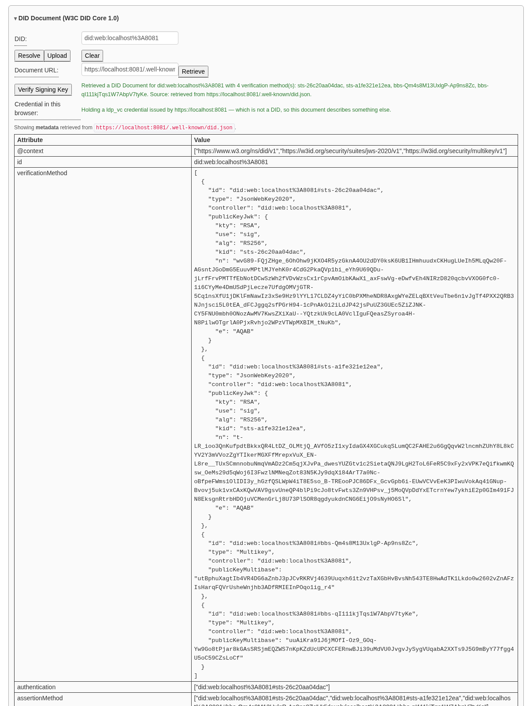
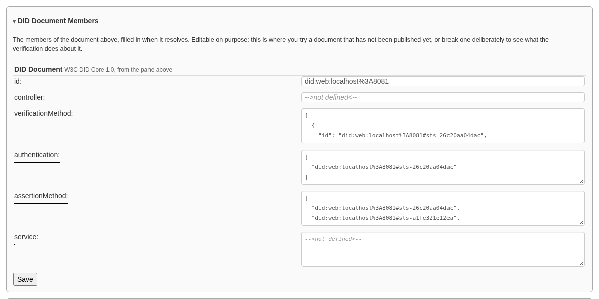
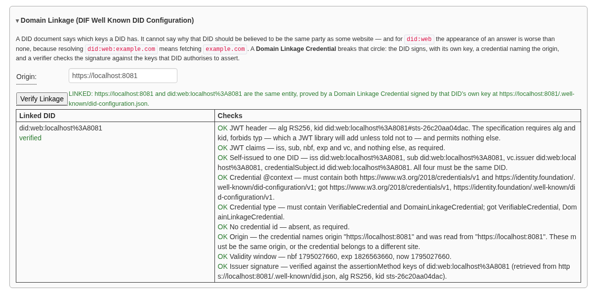

# Tutorial: resolve an issuer's DID and check its domain linkage

**What you will do:** resolve the `did:web` an issuer is named by, read its
verification methods, and then check the one thing a `did:web` document
cannot prove about itself — that the DID and the website really are the same
party — with a DIF Domain Linkage Credential.

**You need:** an issuer, or any site, that publishes a `did:web` document
and, for the second half, `/.well-known/did-configuration.json`. The
pictures use the OpenID4VCI Credential Issuer at `https://localhost:8081`,
whose metadata names it `did:web:localhost%3A8081`. This page works on the
static sites too; it needs no api.

Specifications: W3C DID Core 1.0, the `did:web` method, DIF Well Known DID
Configuration. Reference: [reference-tools.md](reference-tools.md#did-tools).
Developer notes: [../dids.md](../dids.md).

## 1. Resolve the DID

Open **DID Tools** (`did-tools.html`; it is linked from the **VC Tools** row
at the foot of every VC page). Type the DID — `did:web:localhost%3A8081`
here; the `%3A` is the colon of the port — and press **Resolve**.

- `did:jwk` and `did:key` are decoded in the page; nothing is fetched.
- `did:web` is turned into its document URL (`https://<host>/.well-known/did.json`,
  or `/<path>/did.json` for a DID with path segments), written into
  **Document URL**, and fetched.

**Verify Signing Key** asks whether a key this document publishes actually
signed the credential this browser holds; with no credential held, the page
says so, as here. **Retrieve** fetches from a Document URL you typed
yourself (a staging host, a tunnel), and **Upload** reads a document from a
file when the host sends no CORS headers.

**DID Document Members** lays the document out member by member.

## 2. Why that is not enough

Resolving `did:web:example.com` means fetching from `example.com`. A
document fetched from a site saying the site's DID has these keys proves
nothing about whether that DID and that site are the same party — it is the
site vouching for itself. That is the circle the Domain Linkage Credential
breaks.

## 3. Verify the linkage

In **Domain Linkage**, set **Origin** to the issuer's origin
(`https://localhost:8081`) and press **Verify Linkage**. The page fetches
`<origin>/.well-known/did-configuration.json` and, for each linked DID,
checks the Domain Linkage Credential in it:

- the JWT header: `alg` and `kid`, and no `typ`;
- the claims: `iss`, `sub`, `nbf`, `exp` and `vc`, and nothing else;
- self-issued: `iss`, `sub`, `vc.issuer` and `credentialSubject.id` are
  all the same DID;
- `@context` and `type` (`DomainLinkageCredential`), and no credential `id`;
- **the origin it names is the origin it was fetched from**;
- the validity window;
- **the issuer's signature**, against the keys that DID authorises for
  assertion.

**LINKED** means the DID signed, with its own key, a credential naming this
origin — the proof that the site and the DID are one party. Only the JWT
form of a Domain Linkage Credential is checked; a Linked Data Proof entry is
reported as unverified.

## The same checks on issuance step 1

Issuance step 1 has the same two panes (**Issuer DID Document** and **DID
Configuration**), filled in from the issuer's metadata; see
[tutorial-issuer-discovery.md](tutorial-issuer-discovery.md).
