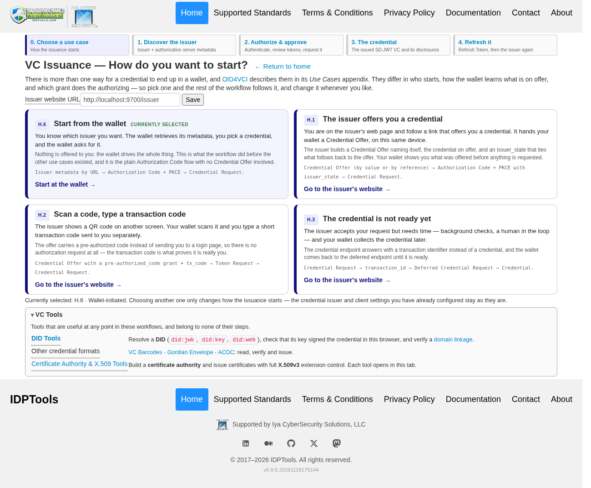
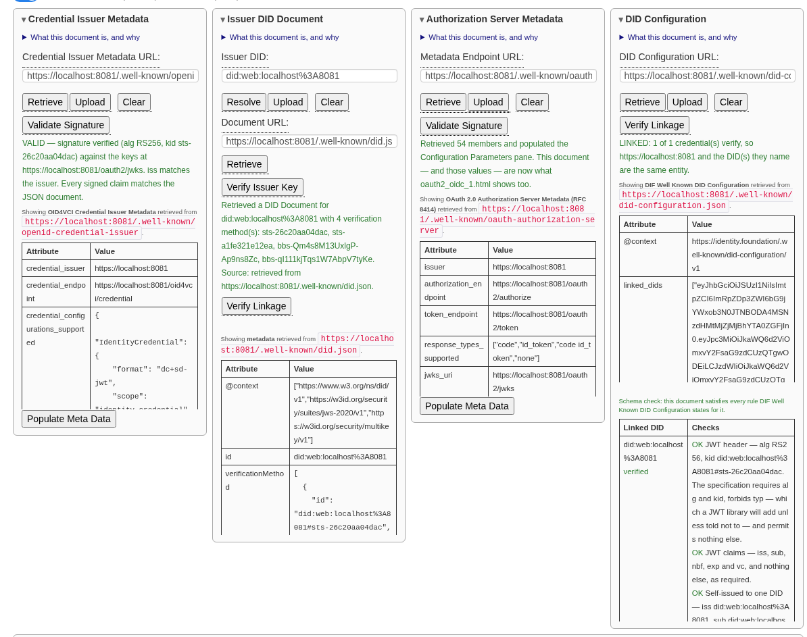
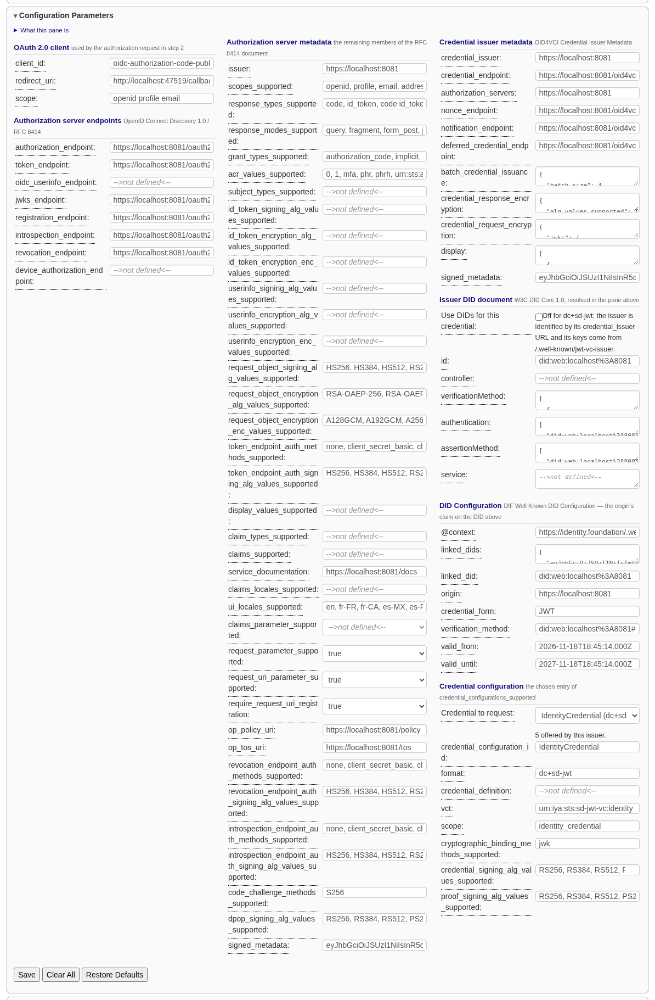
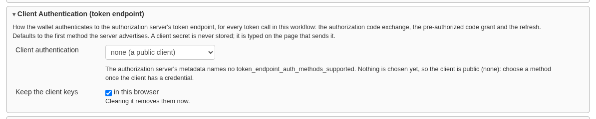
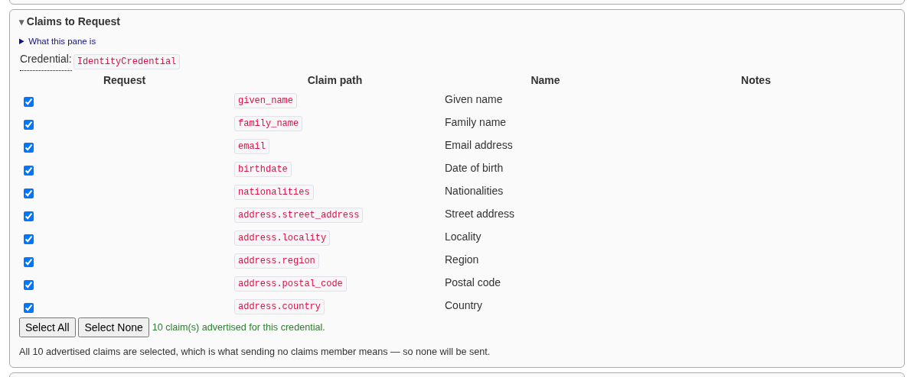
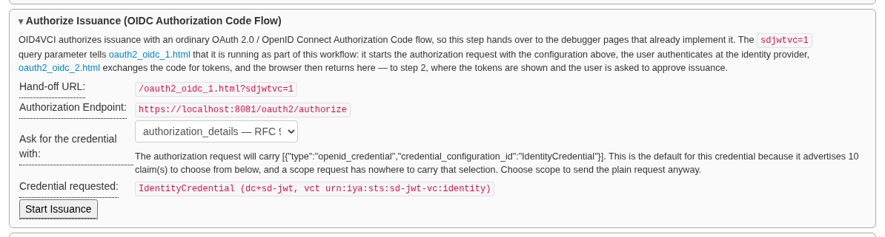
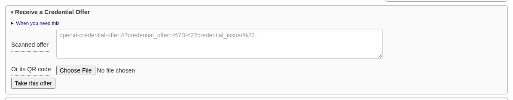

# Tutorial: read a Credential Issuer's metadata

**What you will do:** point the wallet at an OpenID4VCI Credential Issuer and
read everything it publishes about itself — its Credential Issuer Metadata,
its authorization server's metadata, its DID document and its DID
Configuration — then see how step 1 turns those documents into the
configuration the rest of the workflow uses. Nothing is issued, and nothing
needs an account at the issuer.

**You need:** the URL of a Credential Issuer. The pictures use an OpenID4VCI
Credential Issuer at `https://localhost:8081`; any issuer works — walt.id,
Keycloak's OID4VCI support, or a production issuer — so long as it sends
CORS headers naming the debugger's origin (otherwise use **Upload**, below).

Specifications: [OpenID4VCI 1.0][oid4vci] §12.2, RFC 8414, W3C DID Core,
DIF Well Known DID Configuration. Guide: [openid4vci.md](openid4vci.md).

## 1. Choose how the issuance starts

Open **VC Issuance** from the landing page (`vc-issuance-0.html`). The four
cards are OpenID4VCI's Appendix H use cases. For this tutorial choose
**Start from the wallet** (H.6), the only one that begins with nothing but
the issuer's address.

The **Issuer website URL** at the top matters only for the three offer
cards; it is where they send you to get an offer.

## 2. Retrieve the Credential Issuer Metadata

On step 1, in **Credential Issuer Metadata**, type the issuer's
`/.well-known/openid-credential-issuer` URL —
`https://localhost:8081/.well-known/openid-credential-issuer` here — and
press **Retrieve**. If the document carries `signed_metadata`, press
**Validate Signature**: the page verifies the JWT and reports any member
where the signed copy and the plain JSON disagree.

Then, in the panes beside it:

- **Authorization Server Metadata** has been filled in from the issuer's
  `authorization_servers`; press **Retrieve** (and **Validate Signature** if
  the server signs its metadata).
- **Issuer DID Document** holds the issuer's DID when its metadata or
  credential names one; press **Resolve**. A `did:web` is fetched from the
  URL the method derives.
- **DID Configuration** points at `/.well-known/did-configuration.json` on
  the issuer's origin; press **Retrieve**, then **Verify Linkage**.

Here the metadata signature is VALID, the authorization server's 54 members
populated the configuration, the issuer's `did:web` resolved to four
verification methods, and the DID Configuration's Domain Linkage Credential
verified — so the origin and the DID are the same entity (see
[tutorial-did-linkage.md](tutorial-did-linkage.md) for why that check is the
one that is not circular).

**When Retrieve fails with "Failed to fetch"**, the issuer sent no CORS
headers for this page's origin. Save the document yourself
(`curl -o metadata.json <url>`) and load it with **Upload**; everything
below works the same.

## 3. Read the Configuration Parameters

Every value the workflow will use is now in **Configuration Parameters**,
grouped by where it came from: the OAuth 2.0 client (`client_id`,
`redirect_uri`, `scope`), the authorization server's endpoints and metadata,
the Credential Issuer's members, the DID document and the chosen credential
configuration.

**Credential to request** lists `credential_configurations_supported`
first, then a built-in example for every other format (see the
[reference](reference-issuance.md#configuration-parameters-pane_config)).
Choosing one rewrites its rows: `format`, `vct` or `credential_definition`,
`scope`, the binding methods and the signing and key-proof algorithms. A row
the issuer leaves out keeps the default
[`vc_formats.js`](reference-issuance.md#configuration-parameters-pane_config)
derives from the format, and a value you typed yourself is never overwritten.

The `client_id` is **yours**, not the issuer's: it is the wallet's
registration at the authorization server. Change it to the client you have
registered there before using the Authorization Code flow.

## 4. Client authentication, claims and the hand-off

- **Client Authentication** chooses how the wallet authenticates at the
  token endpoint. `none` — a public client — is the default and is what most
  wallets are. The server's `token_endpoint_auth_methods_supported` is shown
  beside it. See [tutorials-issuance.md](tutorials-issuance.md#client-authentication-private_key_jwt-and-a-client-attestation).

  

- **Claims to Request** has one box per claim the chosen configuration
  advertises. Untick some to ask for a subset: the selection is sent as
  `authorization_details` (§5.1.1) only when it is a strict subset.

  

- **Authorize Issuance** shows what **Start Issuance** will do: the
  authorization endpoint, how the credential is asked for (`scope` or
  `authorization_details`) and the configuration requested.

  

- **Receive a Credential Offer** is where an offer goes when it did not
  arrive in the URL: paste its text, or choose a picture of its QR code.

  

**Next:** receive a credential —
[tutorials-issuance.md](tutorials-issuance.md).

[oid4vci]: https://openid.net/specs/openid-4-verifiable-credential-issuance-1_0.html
