# Tutorial: prove age >= 18 without revealing it

**What you will do:** compose a predicate query — "reveal `name`, prove
`age >= 18`" — on the debugger's **Predicate Queries** page, send it to the
debugger's wallet, watch the wallet prove the predicate in zero knowledge
without disclosing `age`, and verify the answer back on the page. Then see
the same query in the other language, what the wallet does when a DCQL
`values` match fails, and how the Verifier page asks for a predicate.

**You need:** an **AnonCreds** credential with an integer `age` attribute in
this browser's wallet — from the issuance workflow, from any AnonCreds
issuer. Only AnonCreds proves a range in zero knowledge; an ISO mdoc can
answer an age bound with its issuer-computed `age_over_NN`, and every other
format refuses a predicate (see
[presentation-exchange.md](presentation-exchange.md#how-each-format-proves-a-predicate)).
No api is needed; the page works on the static sites.

The pictures were taken with a test AnonCreds credential (`name` Alice,
`age` 28) issued for the run by anoncreds-rs, with a link secret generated
for that run alone.

Specifications: DIF Presentation Exchange 2.1.1 (as the **OpenID4VP drafts**
carried it — removed in 1.0), the debugger's **non-standard** DCQL predicate
extension, AnonCreds 1.0, OpenID4VP 1.0 §6.4.1. Reference:
[reference-predicates.md](reference-predicates.md).

## 1. Compose the query

Open **Predicate Queries** (`vc-predicates.html`; from presentation step 0's
role buttons or step 1). The page opens with its example loaded: format
`anoncreds`, **Claims to reveal** `name`, **Predicates** `age >= 18`, query
language **Presentation Exchange 2.1.1**, predicate **required**. Press
**Build**.

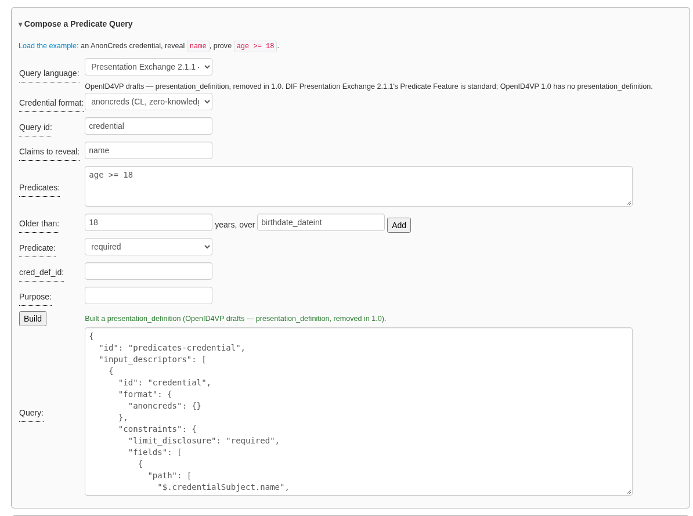

The **Query** box holds the `presentation_definition`: one Input Descriptor
whose fields select `name`, and a field on `age` with `"predicate":
"required"` and the filter `{ "type": "integer", "minimum": 18 }`.

For "older than 18" over a birth date instead, put `18` years over your
credential's `YYYYMMDD` attribute in **Older than** and press **Add**; the
page appends `birthdate_dateint <= <today minus 18 years>`.

## 2. See the AnonCreds request it maps onto

**The Equivalent AnonCreds Presentation Request** shows what the query means
to an AnonCreds wallet: a requested attribute `name`, and a requested
predicate `{ "name": "age", "p_type": ">=", "p_value": 18 }`.

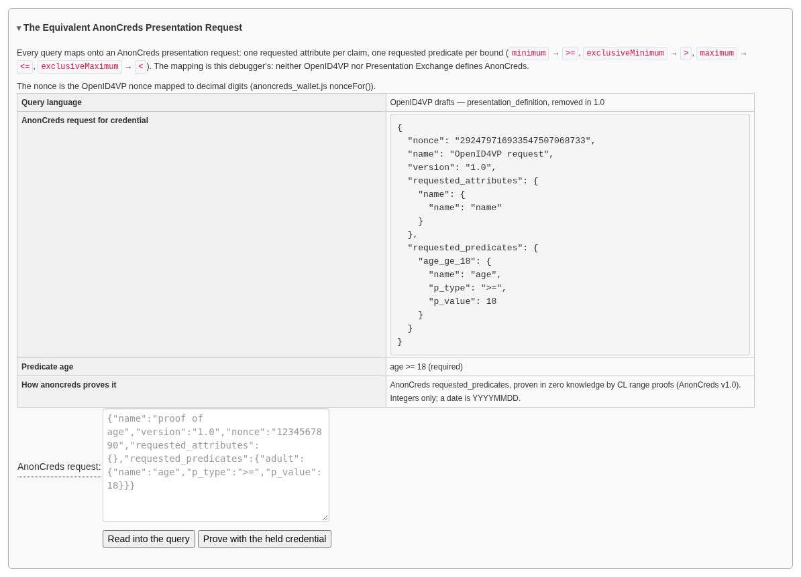

## 3. Send it to the wallet (step 1)

Press **Send to the wallet**. The page builds an OpenID4VP Authorization
Request from a `redirect_uri:` Client Identifier that is the page itself,
answered by `fragment`, and opens the wallet's step 1.

**What Is Being Asked For** labels the query language — *OpenID4VP drafts —
presentation_definition, removed in 1.0* — lists the claim asked for, and
the **Predicates** table says `age >= 18` is **proven (zero knowledge)** and
that `age` is not revealed.

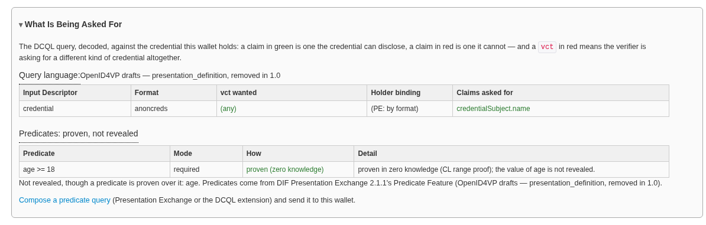

Press **Choose what to disclose →**.

## 4. The proof (step 2)

**Choose What To Disclose** ticks `name`. The `age` row **cannot be ticked**
— it is "proven by a predicate — not revealed" — and the summary above says
so.

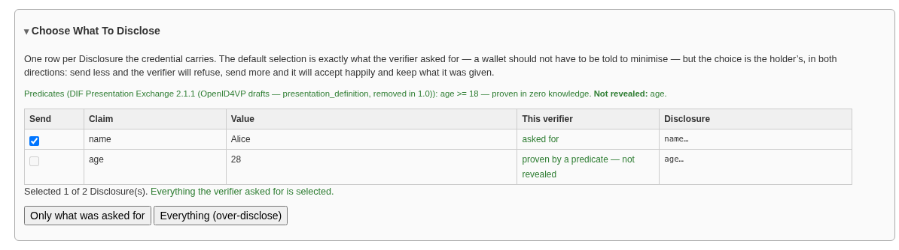

**The Presentation** holds the AnonCreds proof, whose `revealed_attrs` has
`name` only, and, for a `presentation_definition`, the
`presentation_submission` that maps it to the Input Descriptor.

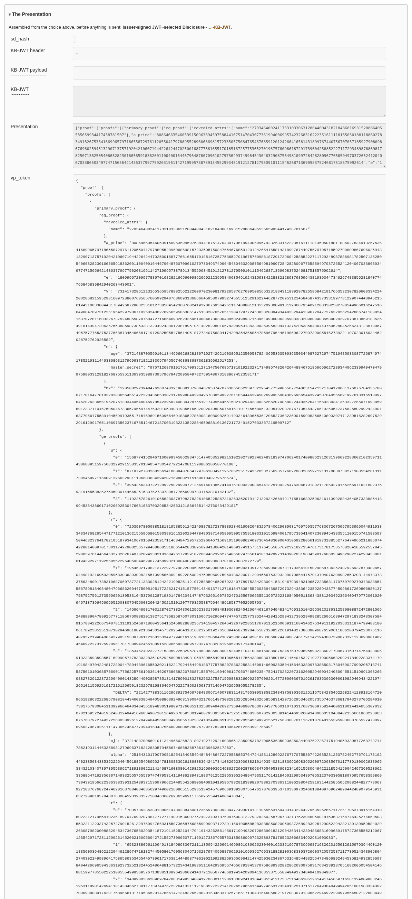

Press **Present**. The answer goes back to the page in the URL fragment.

## 5. Verify it on the page

**Inspect a Returned Presentation** fills in on its own: the `vp_token`, the
`presentation_submission`, and the verdict — **Every check passed: 1
predicate(s) proven, 1 attribute(s) revealed**. The rows: the submission
matches the definition and the `vp_token`; the CL proof verifies under the
request's nonce; **Predicate age >= 18: PROVEN in zero knowledge**, the
value of `age` not in the presentation; what was revealed; and the AnonCreds
request it was checked against.

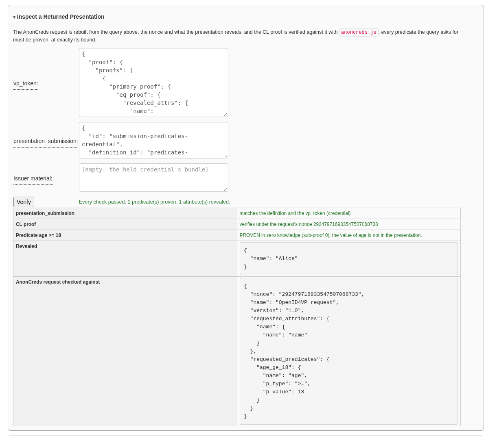

The issuer's schema and credential definition came from the credential this
browser holds. A Verifier somewhere else has no such thing: paste the
issuer's material into **Issuer material**.

## 6. The same query in DCQL, with the debugger's extension

Change **Query language** to **DCQL + debugger predicate extension
(non-standard)** and press **Build**. The predicate now lives in
`x_debugger_predicates` — never in `claims` — and `x_debugger_crit` lists it,
which is what makes the wallet honour it. A wallet that does not know the
extension ignores it and discloses nothing extra; this one proves it, or
refuses the credential.

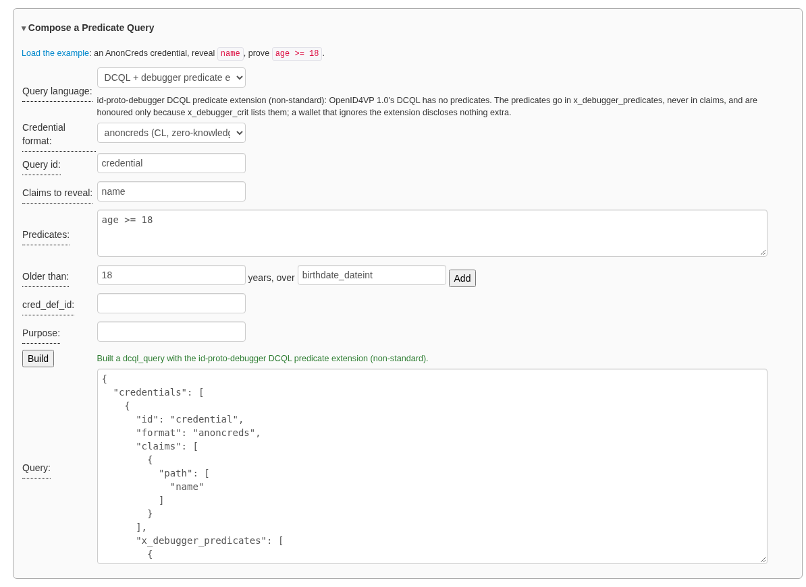

Send, choose and present as before. The wallet labels the language as DCQL,
`vp_token` is keyed by the query id, and there is no
`presentation_submission`; the page's verdict is the same.

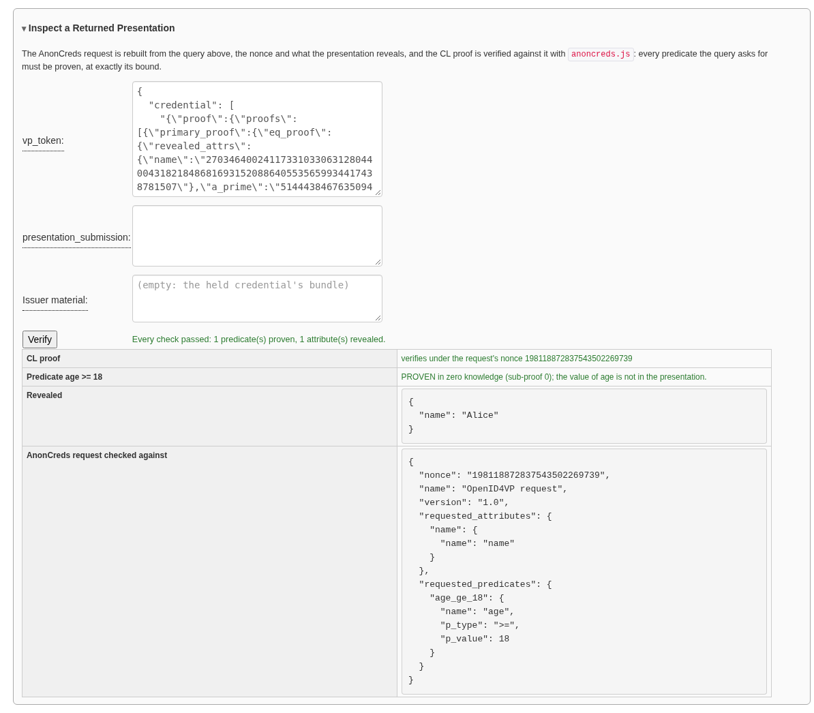

## When the value does not match

DCQL's own `values` is not a predicate but an exact match (OpenID4VP 1.0
§6.4.1). Ask an SD-JWT VC holding `age_over_18: false` for `age_over_18`
with `values: [true]`, and step 1 refuses: the claim is a **value-mismatch**,
treated as if it did not exist, so the credential is not returned and
Continue stays off. The same request against a credential holding `true`
selects `age_over_18` and nothing else.

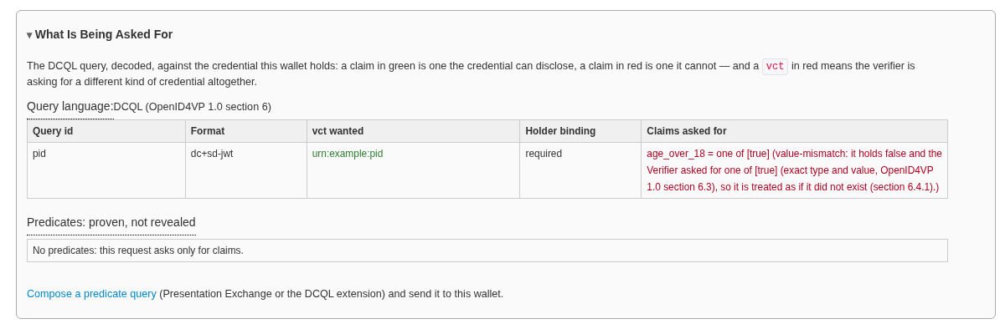

## Asking from the Verifier page

On `vc-verifier.html`, pane 1, choose format `anoncreds`, put `name` in the
claims and `age >= 18` in **Predicates (optional)**, and pick the **Query
language**. As DCQL, the page writes the extension, marked critical, and
says it is non-standard; as Presentation Exchange it writes a
`presentation_definition` and says it is from the OpenID4VP drafts, removed
in 1.0. Answers are checked fail-closed: a predicate the answer does not
prove is a **FAIL**. To verify an AnonCreds proof the page needs the issuer's
material in **AnonCreds issuer material**; without it the verdict is
*incomplete*.

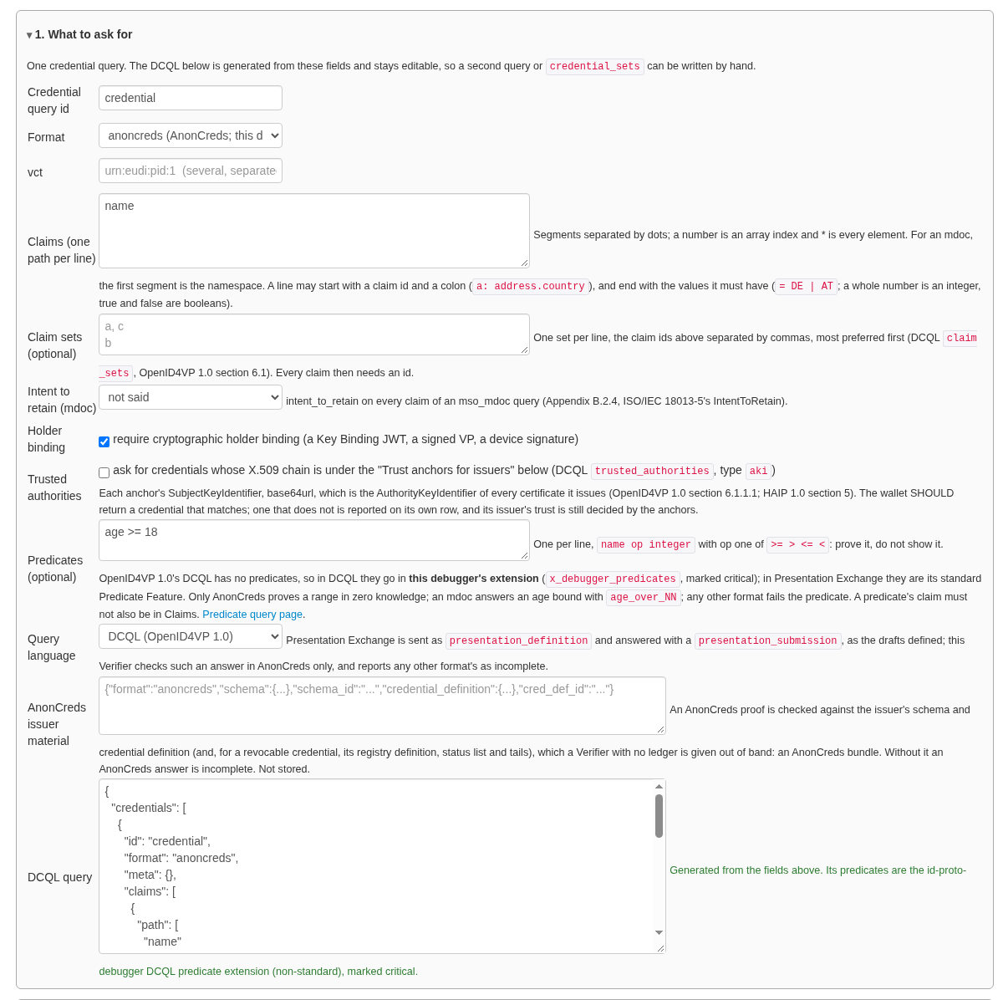

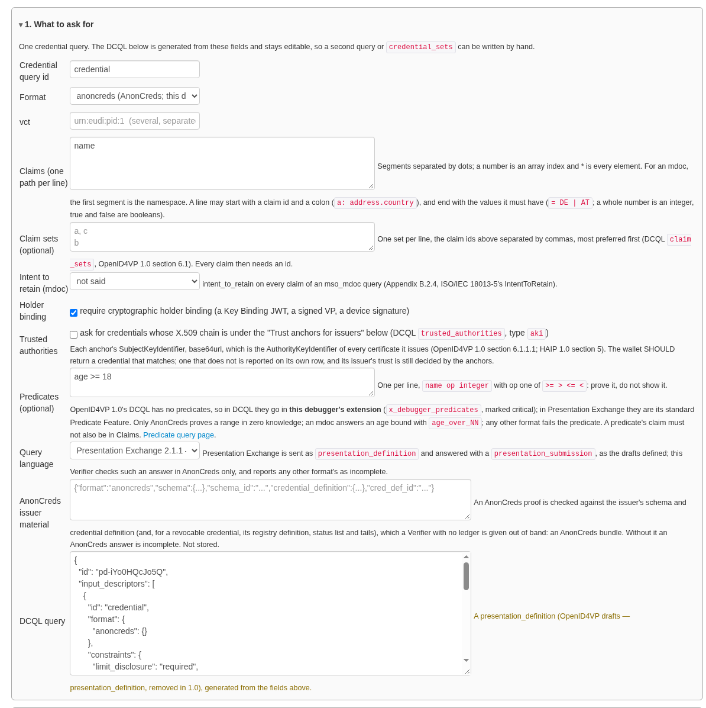
