# Tutorial: present selected claims to the debugger's own Verifier

**What you will do:** play both ends of OpenID4VP 1.0 in one browser. In one
tab the debugger's **Verifier page** asks for two claims of an SD-JWT VC with
a DCQL query, signs the request with an `x509_hash` Client Identifier and has
the api host it; in another tab the debugger's **wallet** reads the request,
lets you choose what to disclose, and answers. The Verifier page then checks
the answer, one row per check. The second half does the same under
[HAIP 1.0](haip.md).

**You need:**

- a deployment **with the api** (the **local containers**) for this tutorial:
  it uses the `request_uri` / `response_uri` hosting modes, which the static
  content sites do not offer because hosting a wallet's answer would store a
  presented credential on the server
  ([why](index.md#what-the-static-sites-can-and-cannot-do)). On a static
  site the Verifier still works in Digital Credentials API mode and checks a
  pasted answer;
- an SD-JWT VC in the wallet — the one
  [tutorials-issuance.md](tutorials-issuance.md) received from your issuer,
  or any other.

If your issuer is iya-sts, [setup-iya-sts.md](setup-iya-sts.md) shows one
way to create the account, client and offers (optional, iya-sts only).

The pictures present a test SD-JWT VC (`vct` `urn:example:guide:identity`,
claims `given_name`, `family_name`, `birthdate`, `email`) from a test issuer
named by `did:jwk`, so the Verifier page can check the issuer's signature
with no network fetch. With a credential from your own issuer, use its `vct`
and claims, and see [the note on issuer trust](#issuer-trust) below.

Specifications: [OpenID4VP 1.0][oid4vp], RFC 9101 (JAR), RFC 9901 (SD-JWT),
[HAIP 1.0][haip]. Guides: [openid4vp.md](openid4vp.md), [haip.md](haip.md).

## Part 1 — OpenID4VP 1.0, answered in the clear

### 1. The Verifier: say what you want, and how to ask

Open `vc-presentation-0.html` and choose **Verifier — the debugger asks a
wallet**, or open `vc-verifier.html` directly, in a tab of its own; it must
stay open while the wallet answers, because it polls the api for the answer.

In **1. What to ask for**:

| Field | Value |
|---|---|
| Credential query id | `identity` |
| Format | `dc+sd-jwt` |
| vct values | your credential's `vct` (`urn:example:guide:identity` here) |
| Claims | `given_name` and `family_name`, one per line |
| Holder binding | ticked |

The **DCQL query** box at the bottom is regenerated from these fields; edit
it directly for anything the form does not cover.

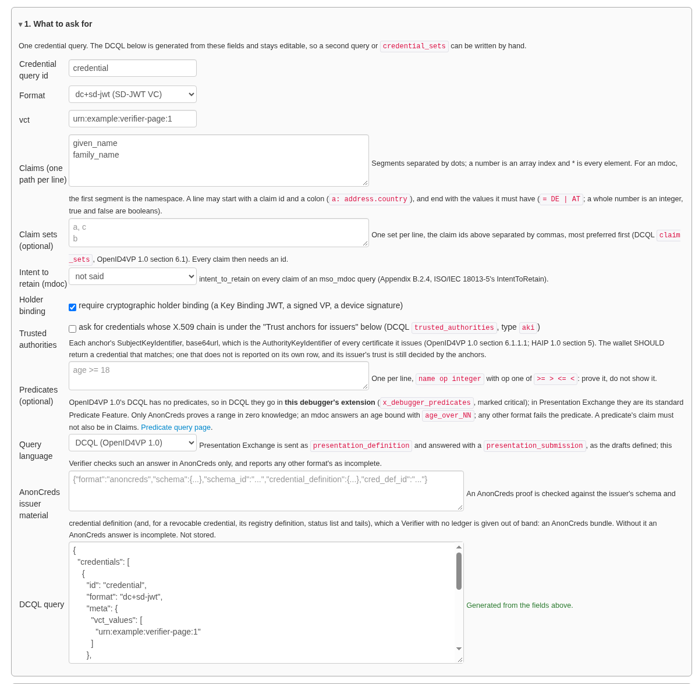

In **2. How to ask**, keep **Profile: OpenID4VP 1.0**, **Client Identifier
prefix: x509_hash**, **Response mode: direct_post** and **Request delivery:
by reference: request_uri, fetched with GET**, and press **Create the
request**.

### 2. The Verifier: hand the request to a wallet

Pane **3. Hand it to a wallet** shows the `openid4vp://` Authorization
Request as text, as a same-device link and as a QR code, together with the
signed Request Object and **the Verifier's root certificate**. Under
`x509_hash` the request is signed by a leaf certificate made for this
request, issued under that root, which stays the same while the Verifier's
identity is kept — so a wallet is given it once.

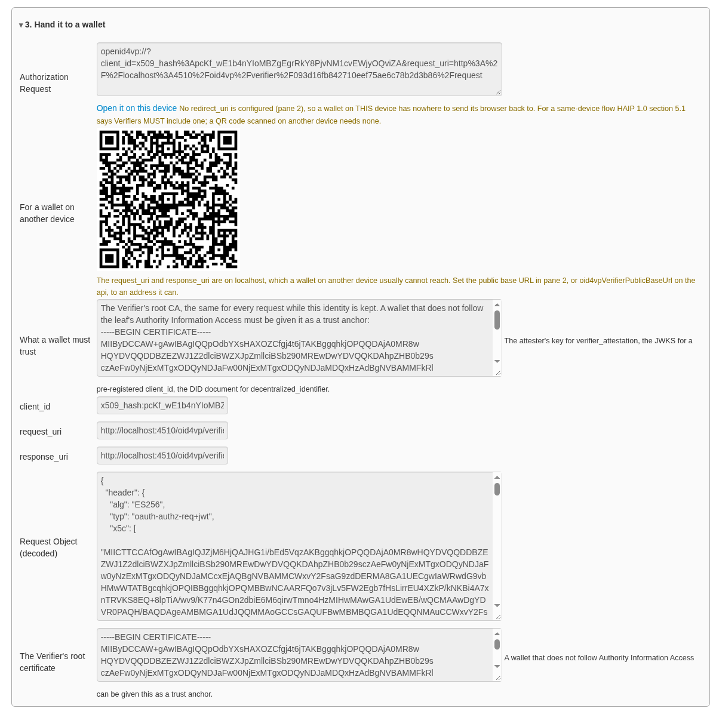

Copy the **Authorization Request** text and the **Verifier's root
certificate**.

### 3. The wallet: trust the Verifier and choose the protocol

Open `vc-presentation-0.html` in a second tab. The status line says what the
wallet holds and whether the holder key is in this browser.

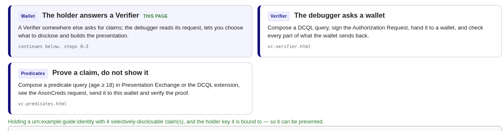

In **Configuration Parameters**, paste the root certificate into **x509 trust
anchor (PEM)** and press **Save**. (The two URL fields are for a Verifier
with a website or a pre-registered client; they are not used here.)

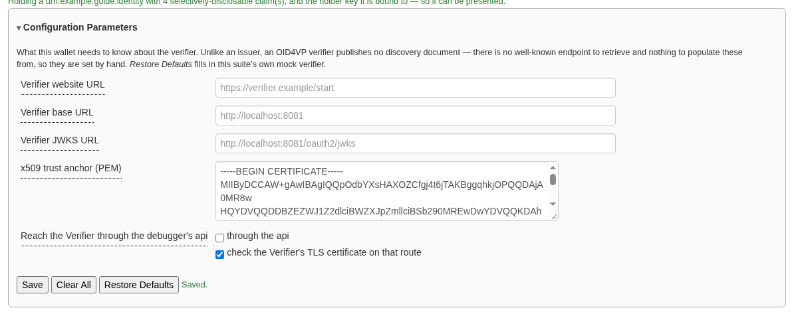

Choose the protocol: **OpenID4VP 1.0**. The flow cards below it send you to a
Verifier's website; here you will paste the request instead, which is what
reading a QR code amounts to on a desktop.

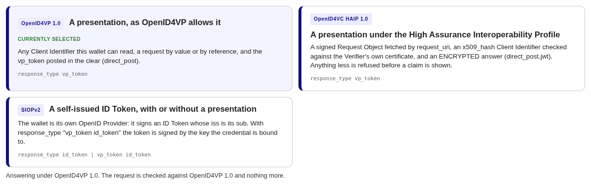

### 4. The wallet: read the request (step 1)

Open step 1 (`vc-presentation-1.html`). In **Receive a Request
(cross-device)** paste the Authorization Request and press **Read this
Request**. The wallet fetches the Request Object from `request_uri` and
checks it.

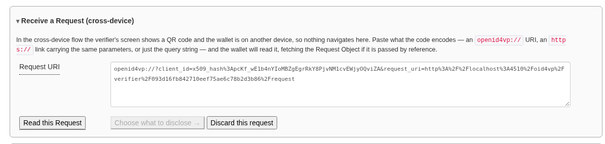

**What OpenID4VP 1.0 Demands of This Request** lists every rule and its
result. A **REFUSED** row disables Continue; a **WARNING** is shown and the
request may still be answered. Here every rule passes: the request is signed,
the `x509_hash` names the leaf in `x5c`, the chain reaches the trust anchor
you configured, `typ` is `oauth-authz-req+jwt`, and the `client_id` inside
the signed object is the one in the link.

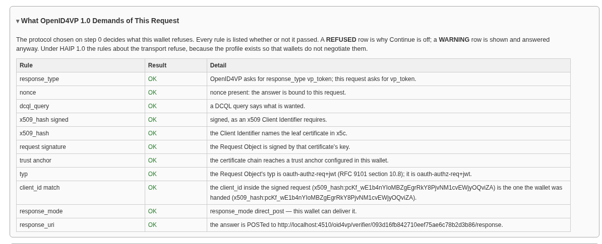

**The Verifier's Authorization Request** shows who is asking (the
`client_id` and its prefix), the signature verdict, the `nonce`, the
response type and mode, where the answer goes, the DCQL query and the raw
request. **What Is Being Asked For** lists each requested claim path and
whether the credential you hold carries it.

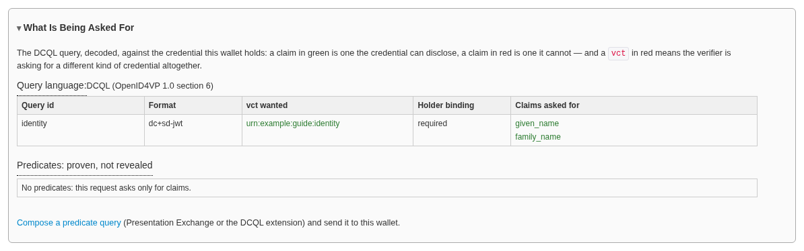

Press **Choose what to disclose →**.

### 5. The wallet: choose and present (step 2)

**What This Verifier Asked For** repeats the audience, nonce and claims, and
says how this format binds the holder — a Key Binding JWT for an SD-JWT VC.

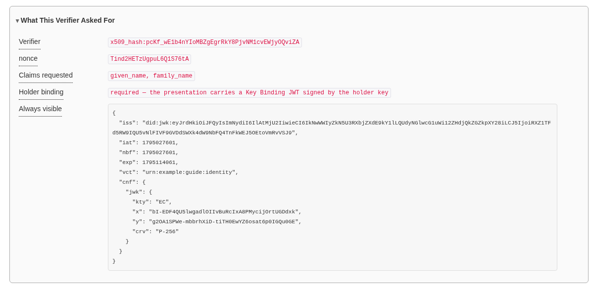

**Choose What To Disclose** has one box per selectively disclosable claim;
the requested ones are ticked. Untick one to withhold it (the Verifier will
then report the claim missing).

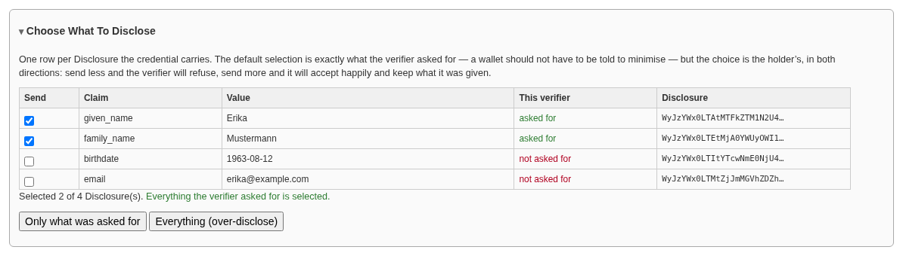

**The Presentation** shows what will go: the issuer-signed JWT, the chosen
Disclosures and a Key Binding JWT whose `aud` is the Verifier's `client_id`,
whose `nonce` is the request's and whose `sd_hash` covers exactly those
bytes; the `vp_token` keyed by the query id; and **What they will know** —
the claims the Verifier will see.

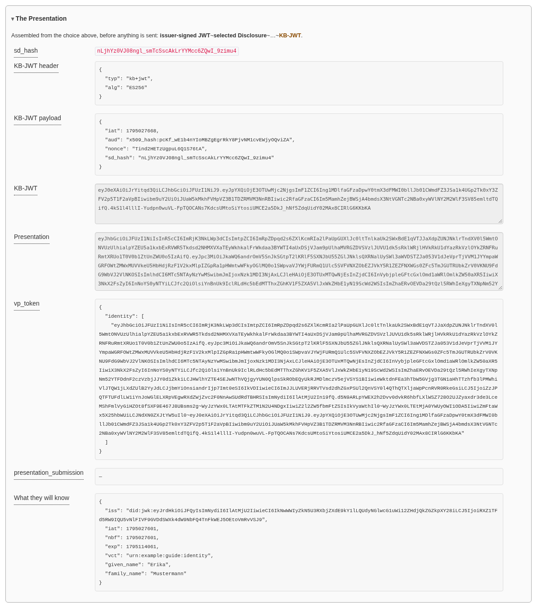

**Present It** shows the exact HTTP request — a form POST to the
`response_uri`. Press **Present**.

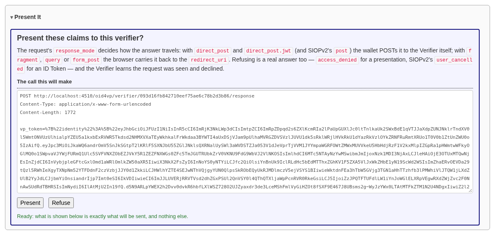

### 6. The wallet: what happened (step 3)

Step 3 shows **What The Wallet Sent**, then **The Wallet's Own Checks** —
the wallet re-verifies its own answer the way a Verifier will: the KB-JWT is
present, its `nonce` and `aud` match, its `sd_hash` matches the bytes sent,
and every Disclosure hashes to a digest in `_sd`.

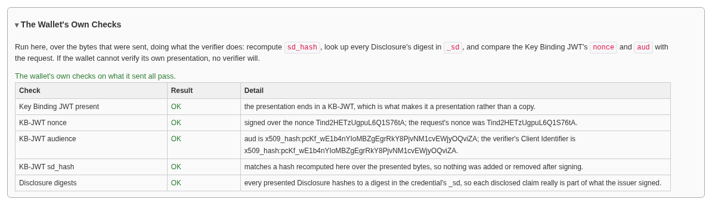

**How It Was Answered** names the protocol, the response type and mode and
the holder binding, and **What The Verifier Answered** shows the Verifier's
HTTP reply.

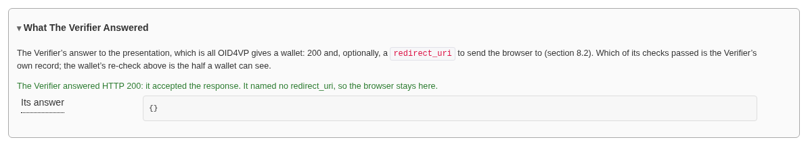

### 7. The Verifier: every check on the answer

Back in the Verifier's tab, pane **4. What the wallet sent, and every check
on it** lists what the wallet did (fetched the Request Object, fetched the
root certificate, posted its answer), the verdict, one row per check, and
the disclosed claims.

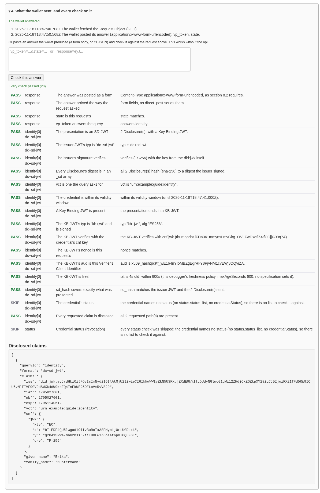

The rows to look at first: **The issuer's signature verifies**, **Every
Disclosure's digest is in an _sd array**, **The KB-JWT verifies with the
credential's cnf key**, **The KB-JWT's nonce is this request's**, **sd_hash
covers exactly what was presented** and **Every requested claim is
disclosed**. The credential's status is **SKIP** here because the test
credential names no status list; see [status-lists.md](status-lists.md).
To see a failure, try [tutorial-verifier-checks.md](tutorial-verifier-checks.md).

## Part 2 — HAIP 1.0: a signed request and an encrypted answer

Repeat Part 1 with two changes.

1. **Verifier**: set **Profile** to **HAIP 1.0** and **Response mode** to
   **direct_post.jwt** (keep `x509_hash` and delivery by reference). Under
   HAIP the page refuses to create anything else and names the rule. The
   request now carries an ECDH-ES P-256 key in `client_metadata.jwks`, made
   for this request.
2. **Wallet**: on step 0 choose **OpenID4VC HAIP 1.0**. Paste the new
   request on step 1.

Step 1 now adds the HAIP rows — request by reference, signed, `x509_hash`,
ES256, `direct_post.jwt`, `vp_token`, and the format — and all pass.

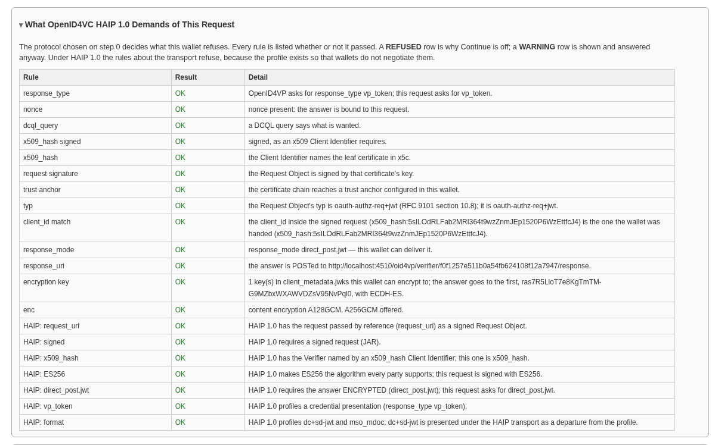

Step 2's **The Encrypted Response** shows the JWE header (ECDH-ES to the
Verifier's key, with an `enc` the Verifier offers) and the single form
field, `response`, that will be POSTed. Step 3's **How It Was Answered**
shows the JWE header, what was encrypted, and an **Encrypted** check.

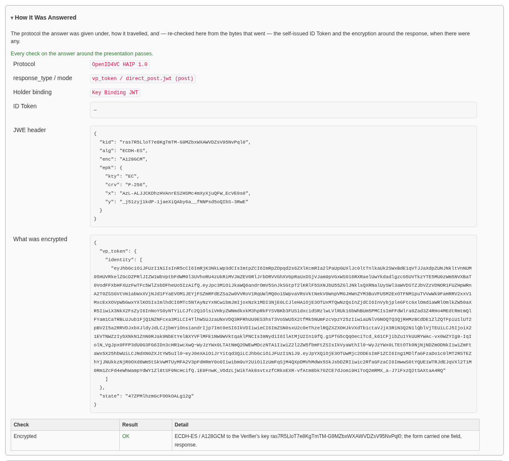

The Verifier page decrypts the answer (a row of its own), runs every check
of Part 1, and adds the HAIP 1.0 rows.

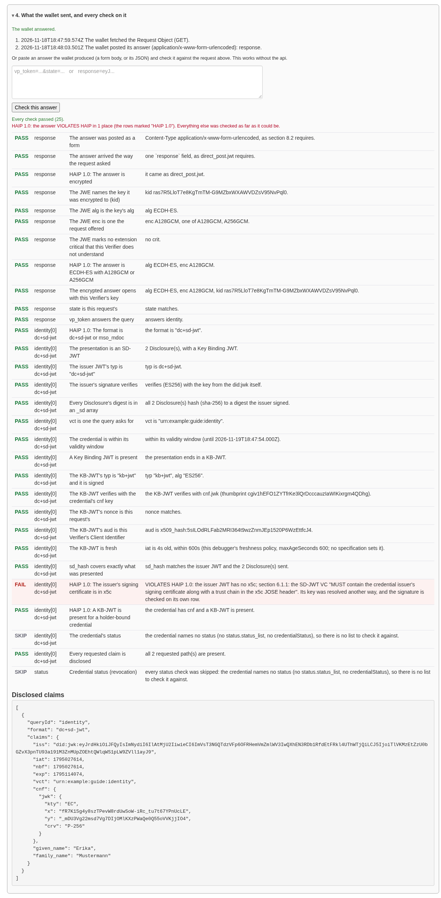

## Issuer trust

The Verifier page finds the issuer's key from the credential itself: from an
`x5c` header (which must chain to a root in **Trust anchors for issuers**,
or the check is *not performed* and the verdict *incomplete*), from the
issuer's `/.well-known/jwt-vc-issuer` JWKS, or from its DID. Most issuers
send no CORS headers for those documents, which is why **Issuer-side
fetches** goes through the api by default. A fetch that fails is reported as
a check not performed, naming the URL — never as a bad signature.

## Presenting to another Verifier

The wallet half is the same for any OpenID4VP Verifier: put its root (for
`x509_hash` / `x509_san_dns`) or its JWKS URL (for a pre-registered client)
in step 0's configuration, and get its request — from its website (the flow
cards, with **Verifier website URL** set) or as the text of its QR code. For
a Verifier that sends no CORS headers, tick **Reach the Verifier through the
debugger's api**. The suite runs this against iya-sts, walt.id and Polaris.

### Sending through the api

A wallet in a browser page can use a Verifier only if it sends CORS headers.
Most do not, because a wallet is normally a native app. Tick **through the
api** on step 0 and every call the wallet makes to the Verifier goes through
the debugger's api, `POST /oid4vp/call`, which no browser policy applies to:

* the Request Object, by GET or by POST under `request_uri_method=post`;
* the Verifier's JWKS;
* every answer and refusal the wallet posts.

Answers the browser carries (`fragment`, `query`, `form_post`) always go
through the browser.

**check the Verifier's TLS certificate on that route** is on by default.
Clear it for a Verifier with a self-signed certificate.

The boxes are enabled only when the api answers `GET /oid4vp/limits`.
Otherwise they are disabled and the note says *This deployment has no api
answering at ..., so the wallet reaches the Verifier from the browser, which
needs the Verifier to send CORS headers.*

The api answers in three ways, and the page reports them differently:

| What happened | What the page says |
|---|---|
| The Verifier answered anything, including a refusal | The Verifier's own status and body, as if the page had called it |
| The api refused the call (its checks, or its address policy) | *the debugger's api refused the call: ...* |
| The Verifier could not be reached | *the debugger's api could not reach the Verifier: ...* |

The api forwards a body of at most 262144 bytes by default
(`oid4vpMaxRequestBytes`).

Step 3 says which route an answer took: **response_type / mode** ends in
*, through the debugger's api* when it went that way.

## Common errors

| What you see | What it means |
|---|---|
| *This request cannot be answered: ...* on step 1 | A REFUSED rule or a wallet problem. The rules pane shows which. |
| *Could not fetch the Request Object: the request_uri returned HTTP 404.* | The Verifier did not serve the Request Object, for example because the request expired. Start a new one. |
| *Could not fetch the Request Object: Failed to fetch* | Usually a Verifier that sends no CORS headers. Tick **through the api**. |
| *the debugger's api ...* with a TLS or connection error | The api could not reach the Verifier or did not trust its certificate. Clear the TLS box for a self-signed Verifier. If every api call fails in the browser, trust the stack's root, or accept the certificate on `https://localhost:4000` as well as on port 3000, as the README's *Running it* says. |
| *Nothing in that text looks like an OID4VP Authorization Request. ...* | The pasted text has no query string the wallet recognises. |
| *... asked for a `<format>` credential and this wallet holds a `<format>` one ...* | A presentation cannot change a credential's format. Issue the format asked for. |
| *... the private half of the holder key is missing, so no Key Binding JWT can be signed* | Saving was on and the key was never generated in this browser. Issue the credential again. |
| *this browser holds N key(s) but none of them is the one this credential is bound to ...* | The stored key is another one. A credential issued under Holder of Key needs the DPoP key, which is discarded when DPoP is switched off. |
| A `trust anchor` WARNING, and *FAILED trust anchor — no trust anchor is configured ...* under **Signature** | Paste the Verifier's root into **x509 trust anchor (PEM)** on step 0. |
| *Ready, but the selection is missing a claim the verifier asked for — it will refuse this.* | A requested row is not selected. |
| *The verifier refused the response: ...* | The Verifier's own answer. Step 3 shows it beside the wallet's checks. |
| *N of the wallet's own checks on what it sent FAIL — the verifier was right to refuse.* | The wallet could not verify its own presentation. |

[oid4vp]: https://openid.net/specs/openid-4-verifiable-presentations-1_0.html
[haip]: https://openid.net/specs/openid4vc-high-assurance-interoperability-profile-1_0.html
