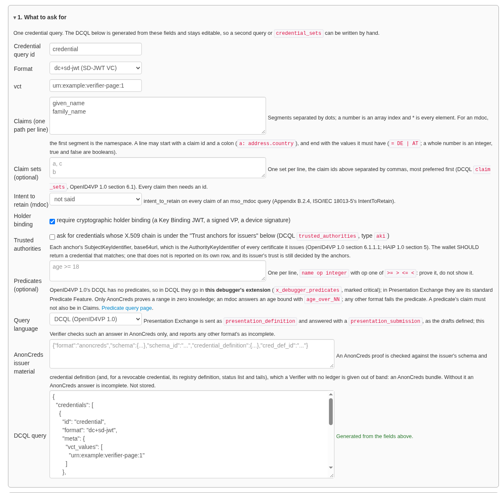
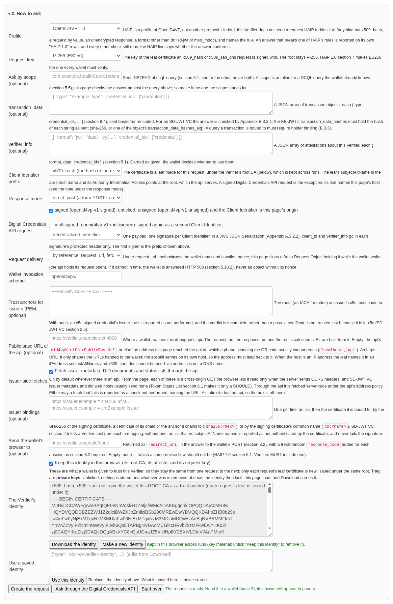
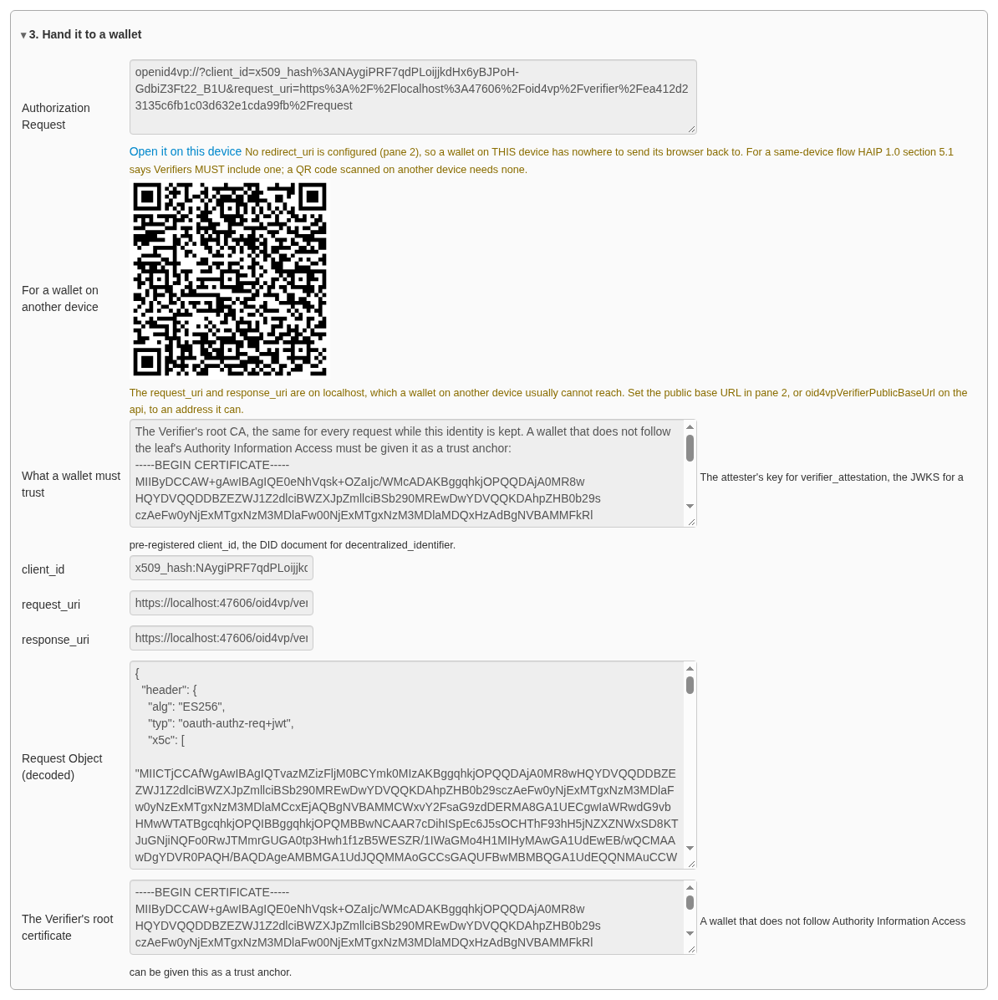
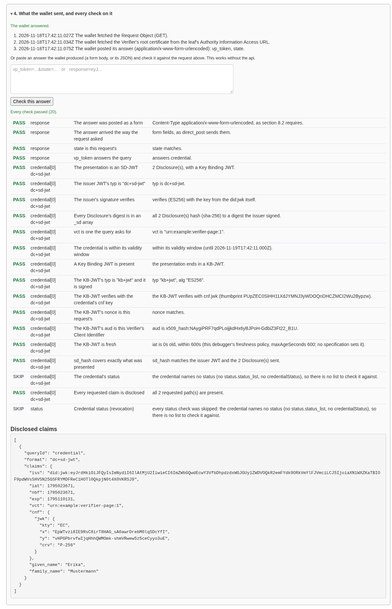
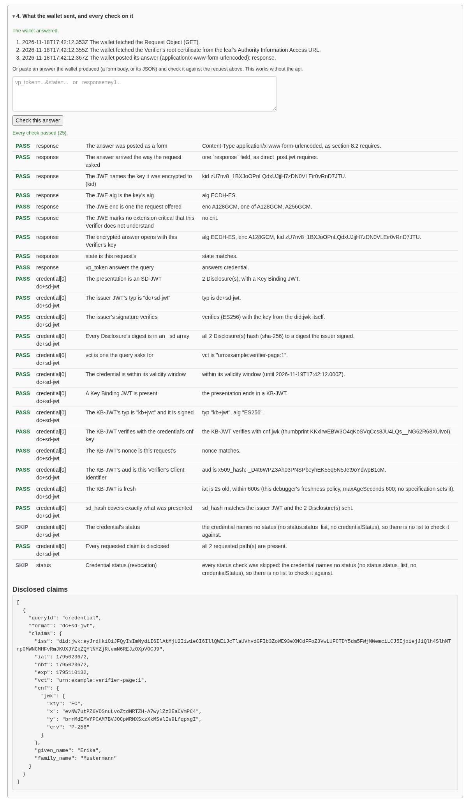
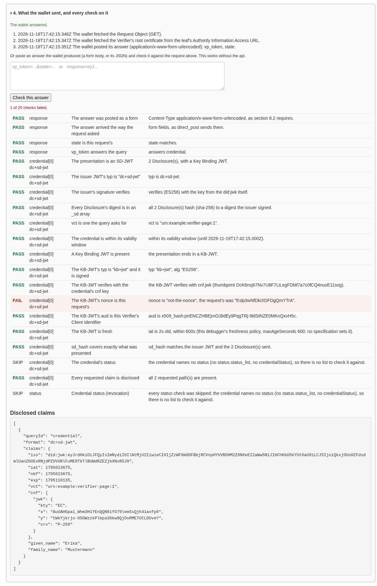
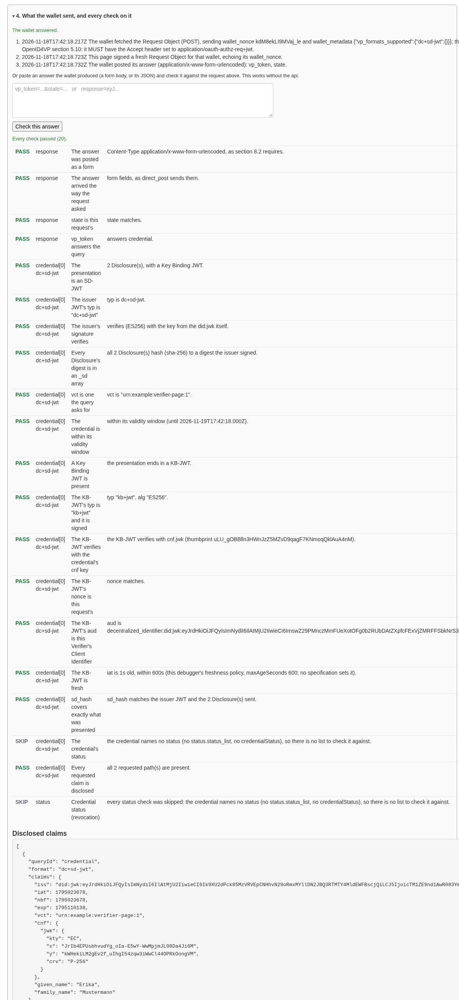

# Tutorial: the Verifier page, and reading its checks

**What you will do:** use the debugger as an OpenID4VP 1.0 **Verifier**
(`vc-verifier.html`) against any wallet, and learn to read the answer it
gets: one row per check, so a wallet that gets one thing wrong fails exactly
one row. You will also see an encrypted answer, a wrong nonce, and a request
signed live for a wallet that sends a `wallet_nonce`.

**You need:** a deployment with the api, and a wallet — the debugger's own
([tutorial-present-to-verifier.md](tutorial-present-to-verifier.md)) or any
other OpenID4VP wallet that can reach the api's `request_uri` and
`response_uri`. The pictures were taken while a wallet answered with an
SD-JWT VC (`vct` `urn:example:verifier-page:1`) from a test issuer named by
`did:jwk`.

Reference: [reference-verifier.md](reference-verifier.md). Developer notes:
[../vc-verifier.md](../vc-verifier.md) and the api routes in
[../vc-verifier-api.md](../vc-verifier-api.md).

## 1. What to ask for

Pane **1** builds one DCQL credential query from a form — format, `vct`
(or doctype, or type values), one claim path per line, optional claim sets,
holder binding and trusted authorities — into the **DCQL query** box. The
box is what is sent, so you can also write several queries or
`credential_sets` there by hand.

The page reads five formats: `dc+sd-jwt`, `jwt_vc_json`, `mso_mdoc`,
`ldp_vc` and `anoncreds`. It can also ask for a predicate ("age >= 18")
instead of a value; see [tutorial-predicates.md](tutorial-predicates.md).

## 2. How to ask

Pane **2** chooses the profile (OpenID4VP 1.0 or [HAIP 1.0](haip.md)), the
Client Identifier prefix, the response mode, how the request is delivered,
the wallet invocation scheme, and optional `scope`, `transaction_data`,
`verifier_info` and `redirect_uri`. It also holds the trust anchors for
issuers' `x5c` chains, issuer bindings, and **the Verifier's identity**: a
root CA, an attester and a request key that last from one request to the
next, so a wallet is told to trust them once. They are private keys, kept
in this browser only while **Keep this identity in this browser** is
ticked; **Download the identity** carries them elsewhere.

**Create the request** checks the api answers, opens a session there, makes
a leaf certificate for this request, signs the Request Object in the page,
and has the api publish it with the root certificate. The api never holds a
private key: it stores and serves what the page made, and keeps what the
wallet posts until the page collects it.

## 3. Hand it to a wallet

Pane **3** shows the invocation as text, as a same-device link and as a QR
code, plus `client_id`, `request_uri`, `response_uri`, the decoded Request
Object and the root certificate. The notes in yellow are worth reading:
a wallet on **another device** usually cannot reach `localhost`, so set
**Public base URL of the api** in pane 2 to an address it can.

## 4. Read the checks

When the wallet answers, pane **4** lists what it did — fetched the Request
Object, fetched the root from the leaf's Authority Information Access URL,
posted its answer — then the verdict and every check, and the disclosed
claims.

Each row is **PASS**, **FAIL** or **SKIP**, with what it checked and what it
found. Response rows come first (the form, the mode, `state`, that
`vp_token` answers the query), then each credential's rows. A **SKIP** is a
check that could not apply — here the status check, because the credential
names no status list. When a check **could not be performed** (an issuer key
that could not be fetched, an `x5c` with no trust anchor configured), the
verdict is *incomplete*, never a pass.

**No api, or an answer from elsewhere?** Paste a wallet's answer — a form
body or its JSON — into the box above the checks and press **Check this
answer**. That works without the api, against the request shown above it.

## 5. An encrypted answer (direct_post.jwt)

Set **Response mode** to `direct_post.jwt` and create a new request. The
page makes a fresh ECDH-ES P-256 key for it, puts the public half in
`client_metadata.jwks`, and offers A128GCM and A256GCM. The wallet POSTs one
field, `response`, a JWE; the page decrypts it, and the decryption is a row
of its own beside every other check.

## 6. A wrong nonce fails one row and no other

A wallet that signs its Key Binding JWT over some other nonce — a replayed
presentation, or a wallet answering an earlier request — fails **The
KB-JWT's nonce is this request's** and nothing else. That is what one row per
check is for: the failure names itself.

## 7. A request signed live for the wallet (request_uri_method=post)

Set **Request delivery** to *by reference: request_uri_method=post*
(OpenID4VP §5.10). The wallet then POSTs a `wallet_nonce` (and its
`wallet_metadata`) to the `request_uri`; the api holds that POST open while
this page signs a fresh Request Object echoing the nonce. The event list says
**signed a fresh Request Object**. A page that cannot answer in time (15
seconds by default) makes the api answer 503; it never serves an object
without the nonce. The picture uses the `decentralized_identifier` prefix,
whose `client_id` is a `did:jwk` of the request key.

## Where to go next

- [status-lists.md](status-lists.md) — the status rows, for credentials that
  name a Token Status List or a Bitstring Status List.
- [haip.md](haip.md) — what HAIP refuses before a request is sent.
- [openid4vp.md](openid4vp.md#the-digital-credentials-api) — asking through
  the browser's Digital Credentials API instead of hosting a request.
