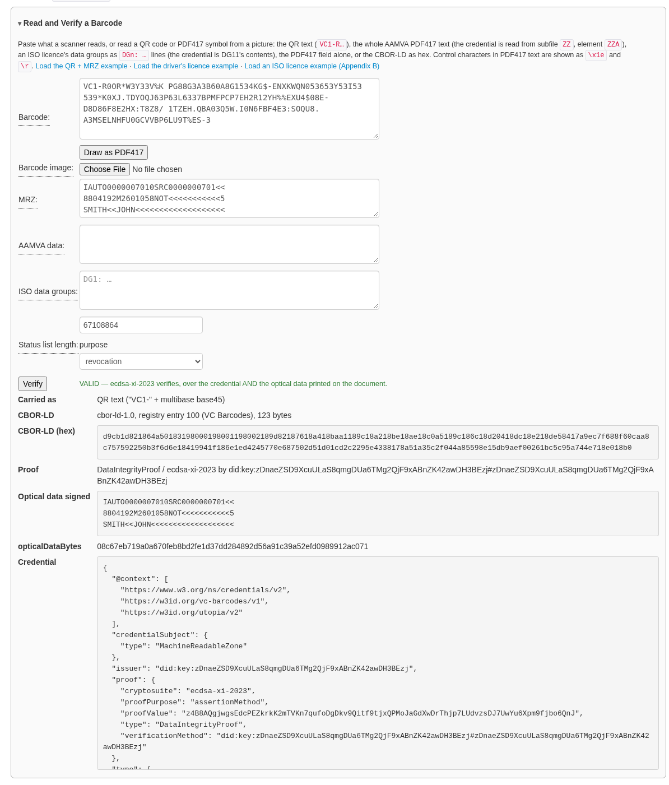
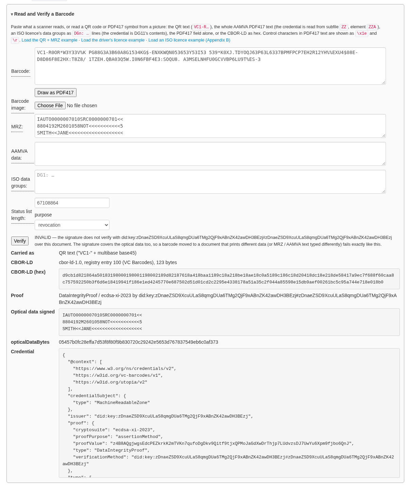
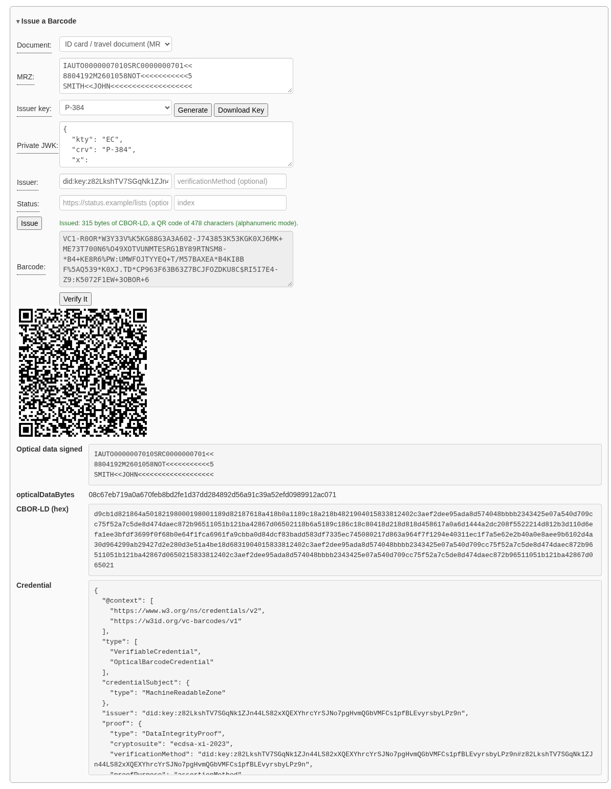
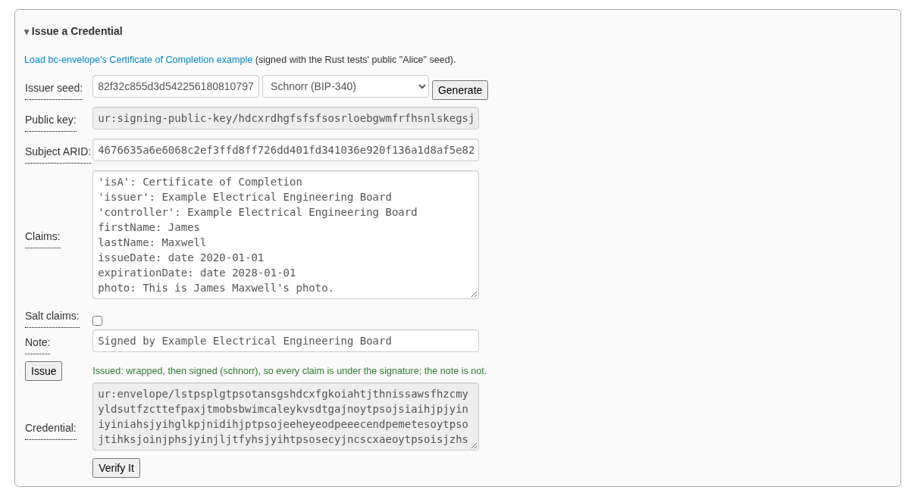
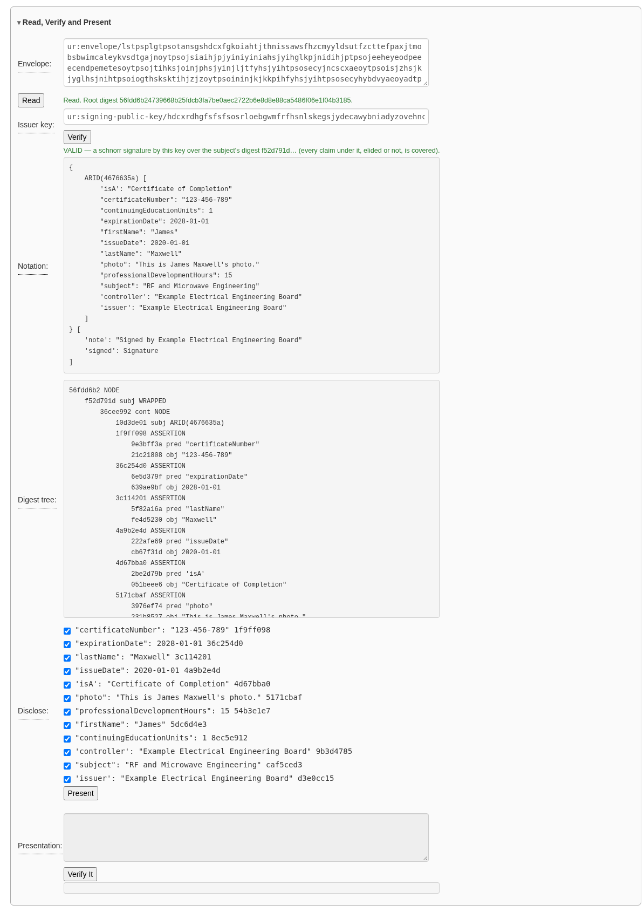
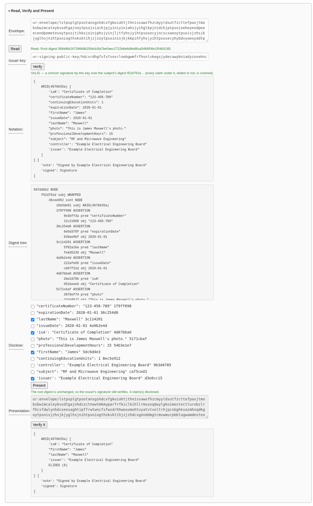
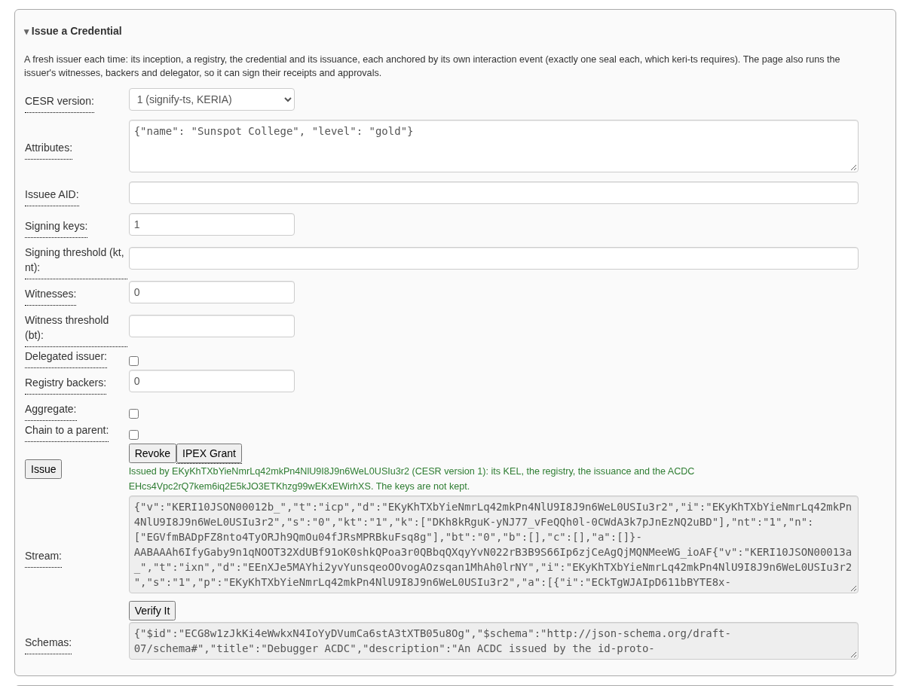
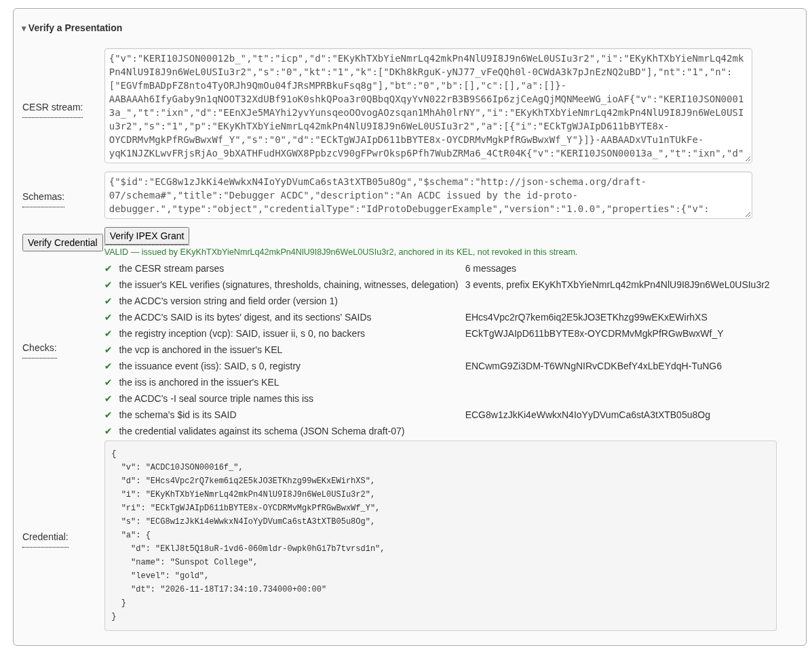
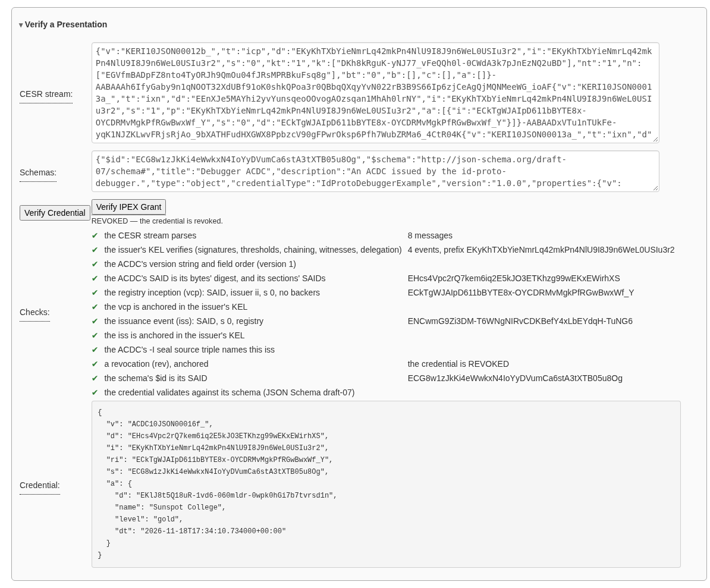

# Tutorials: VC Barcodes, Gordian Envelope and ACDC

The three credential formats on the **VC Tools** row are not issued or
presented over OpenID4VCI / OpenID4VP; each has a page of its own that
issues, reads and verifies them entirely in the browser. None of the three
needs the api, none stores anything, and all three ship to the static sites;
the only network use is a barcode's status list, which the browser fetches
when you ask it to. Each page carries the sample input these tutorials
start from.

Reference: [reference-tools.md](reference-tools.md). Format guides:
[format-vc-barcodes.md](format-vc-barcodes.md),
[format-gordian-envelope.md](format-gordian-envelope.md),
[format-acdc.md](format-acdc.md).

- [Verify a VC barcode, then issue one](#verify-a-vc-barcode-then-issue-one)
- [Issue a Gordian Envelope credential and present it with claims elided](#issue-a-gordian-envelope-credential-and-present-it-with-claims-elided)
- [Issue, verify and revoke an ACDC](#issue-verify-and-revoke-an-acdc)

## Verify a VC barcode, then issue one

W3C Verifiable Credential Barcodes v1.0 (*a W3C Working Draft*): a credential
compressed with CBOR-LD into a QR code or a driver's licence PDF417, signed
with `ecdsa-xi-2023`, whose signature also covers the document's printed
**optical data** — the MRZ of a passport or ID card, or the licence's AAMVA
fields — so the barcode cannot be moved to another document.

1. Open **VC Barcodes** (`vc-barcodes.html`) and press **Load the QR + MRZ
   example**: the specification's Utopia QR text and its three-line MRZ.
2. Press **Verify**. The result shows how the credential was carried, the
   CBOR-LD (registry entry and hex), the proof and its verification method,
   the optical data signed, and the credential: **VALID**.

   

3. Change one character of the MRZ (a name, say) and press **Verify** again:
   **INVALID**. The QR code is unchanged; it is the printed data beside it
   that no longer matches what was signed.

   

4. **Load the driver's licence example** does the same for a PDF417 licence,
   naming the AAMVA fields the signature protects.
5. To issue: in **Issue a Barcode**, keep **Document:
   MachineReadableZone**, choose the curve, press **Generate** (a key made
   for this page load; **Download Key** is the only way to keep it), and
   press **Issue**. The page draws the QR code. **Verify It** copies the
   result into pane 1 and verifies it.

   

   The private JWK in this picture belongs to a key generated for that run
   alone. Nothing on this page is ever stored, the key included.

### Going further with barcodes

* **A driver's licence.** Choose **Driver's licence (AAMVA PDF417)** as the
  document, tick the AAMVA fields the signature should protect, and **Issue**:
  the credential is added to the licence's PDF417 text as subfile `ZZ`, and
  the whole is drawn as a **PDF417 symbol**. Save the symbol as an image and
  choose it in pane 1's **Barcode image** to read it back — the page reads QR
  codes and PDF417 symbols from pictures, in the page. **Draw as PDF417**
  draws whatever text is in pane 1's **Barcode** box, the specification's
  licence example included.
* **An ISO licence** (Appendix B, *informative*). **Load an ISO licence
  example** loads data groups as `DGn: …` lines with the credential in DG11;
  **Verify** checks the data groups the signature protects. Issuing one takes
  the data groups already separated, and protects any of DG1–DG10 (DG11
  carries the credential and cannot be protected). No ISO symbol is drawn.
* **The status list.** A barcode carrying a terse status entry is expanded,
  on **Verify**, into a Bitstring Status List entry in pane 2. **Fetch and
  Check** fetches the list from the browser (the server must send CORS
  headers; otherwise paste the list and **Check Pasted**), verifies the list's
  own proof and reads the bit: **NOT REVOKED**, **REVOKED** or **SUSPENDED** —
  or **UNVERIFIED** when the list itself did not verify. For the
  specification's licence example, set **Status list length** to 131072
  (2^17), the length its own example works with.

## Issue a Gordian Envelope credential and present it with claims elided

Gordian Envelope (*draft-mcnally-envelope-12*, over dCBOR,
*draft-mcnally-deterministic-cbor-18* — individual IETF drafts) is a Merkle
tree of digests: eliding a claim replaces it with its digest, the root
digest does not change, and so the issuer's signature over the root still
verifies. A holder presents by eliding; nothing is re-signed.

1. Open **Gordian Envelope** (`gordian-envelope.html`) and press **Load
   bc-envelope's Certificate of Completion example** — Blockchain Commons'
   own example, signed with their tests' public "Alice" seed.
2. Press **Issue**. The page wraps the credential, signs it (Schnorr by
   default), and shows the `ur:envelope/…` text and the issuer's public key.

   

3. Press **Verify It**. Pane 1 reads the envelope — its root digest, its
   notation and its digest tree — and verifies the signature: **VALID**.

   

4. Under **Disclose**, keep four claims (first name, last name, `isA`,
   issuer) and untick the rest. Press **Present**. The presentation's
   notation shows the other eight claims as `ELIDED`, and the page confirms
   the root digest is unchanged. **Verify It** verifies the presentation
   with the same key.

   

Tick **Salt claims** when issuing your own credential, so that an elided
claim with a guessable value cannot be recovered from its digest.

### Going further with envelopes

The four panes below the issue pane are collapsed when the page opens; click
a pane's title to open it. Each has a **Read It** button that shows its
result in pane 1, and none keeps a key or password beyond the page load.

* **Encrypt to a recipient.** In **Encrypt and Decrypt**, press **Make Keys**
  (X25519 from a seed, or an ML-KEM-512/768/1024 pair): the public keys go
  into **Recipients** and the private keys into **Private keys**. Paste an
  envelope, press **Encrypt** — the content key is made for you and sealed to
  each recipient — then **Decrypt** with the private keys. A password
  (Argon2id, PBKDF2, scrypt or HKDF) locks the content key the same way. The
  digests do not change, so a signature over the envelope still verifies.
* **Compress** an envelope, or only its subject; its digest is unchanged.
* **Split with SSKR.** In **SSKR: Split and Join**, give groups such as
  `2-of-3` and a group threshold and press **Split**; delete some share lines,
  keeping enough to meet the thresholds, and **Join** rebuilds the envelope.
* **Send it as a multi-part UR.** **Make Parts** cuts the envelope into
  `ur:envelope/<seq>-<count>/…` parts plus fountain parts; delete a few and
  **Join Parts** still rebuilds it. Pane 1 reads the parts directly too.
* **Sign with ML-DSA or SSH.** Choose ML-DSA-44/65/87 or SSH Ed25519 as the
  scheme before **Issue**. Pane 1 verifies against the public key the issue
  pane shows, or an OpenSSH public key line.

## Issue, verify and revoke an ACDC

Authentic Chained Data Containers (Trust over IP's ACDC, over KERI and
CESR — *working-group drafts*). An ACDC carries no signature of its own: its
SAID (the digest of its own bytes) is sealed by an `iss` event in the
issuer's registry, which is anchored in the issuer's KERI key event log,
which is signed. Verifying one is walking that chain.

1. Open **ACDC** (`acdc.html`). In **Issue a Credential**, press **Issue**.
   The page writes the CESR stream — the issuer's KEL, the registry, the
   credential — and the schema it generated.

   

2. Press **Verify It**. Pane 1 verifies the stream step by step — every
   SAID, every signature, the anchoring — and gives the verdict: **VALID**
   (issued by the issuer, anchored in its KEL, not revoked in this stream).

   

3. Press **Revoke**, which appends a `rev` event to the registry, anchored
   by another interaction event, then **Verify It** again: **REVOKED**.

   

4. Change one character of an attribute in the stream in pane 1 and press
   **Verify Credential**: **INVALID**, naming the SAID that no longer
   matches.

### Going further with ACDC

The issue pane's options each add one part of the KERI suite to the stream,
and **Verify It** checks it:

* **CESR version 2** — the current specification: version 2 events and an
  `acm` credential whose SAID is over its most compact form, in a `rip` /
  `upd` registry. Version 1 is what signify-ts and KERIA issue; the page reads
  both, mixed in one stream.
* **Signing keys** and a **weighted threshold** such as
  `["1/2","1/2","1/2"]` — the KEL's signatures must reach it.
* **Witnesses** and a **witness threshold** — each event carries the
  witnesses' receipts; an event short of the threshold is refused.
* **Delegated issuer** — a delegator's KEL first, approving the issuer's
  inception.
* **Registry backers** (version 1) — a backer registry whose events need the
  backers' receipts.
* **Chain to a parent** — a second issuer issues a parent credential, and
  this one's edge points to it; verifying checks the parent too (a far node
  that is revoked, invalid or missing makes its edge invalid).
* **Aggregate** — attributes as blinded blocks. In **Disclose Selectively**,
  choose the blocks to reveal and **Verify It**: in version 2 the SAID, and so
  the registry's binding, is unchanged.
* **IPEX Grant** — appends a grant of the credential to its issuee (the
  credential must have been issued with an **Issuee AID**). **Verify It**
  moves the stream to pane 1; **Verify IPEX Grant** then checks the exchange
  and the credential it carries.

**Verify It** also copies the schema(s) the issue pane generated into
**Schemas**, so the credential is validated against its JSON Schema as well.
