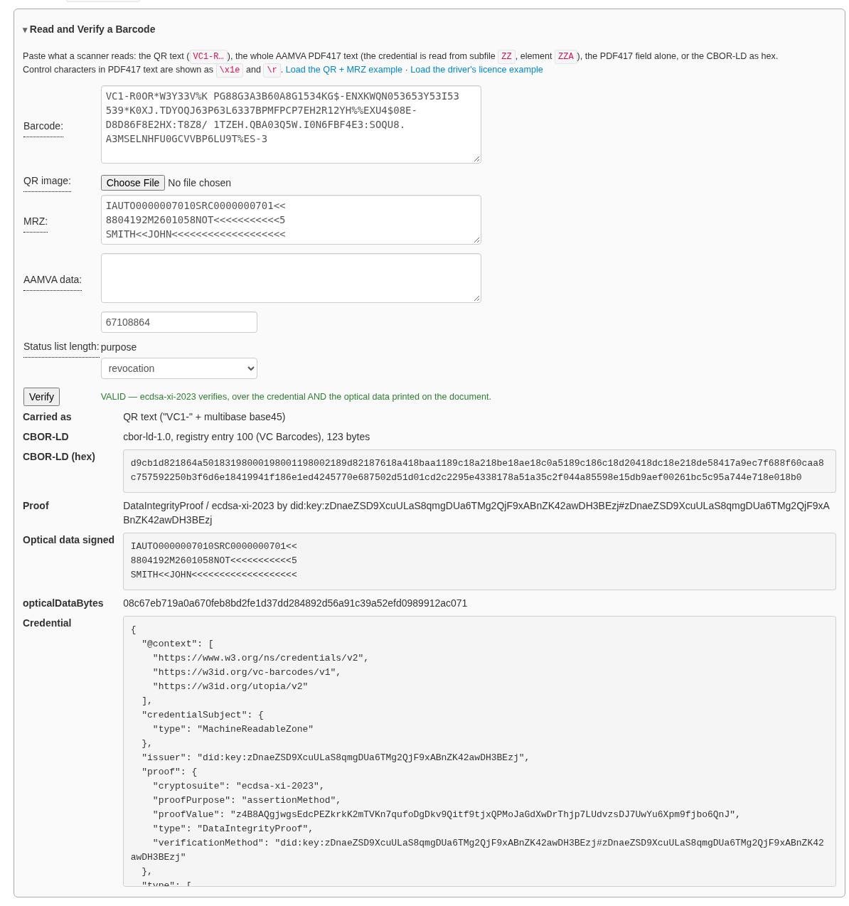
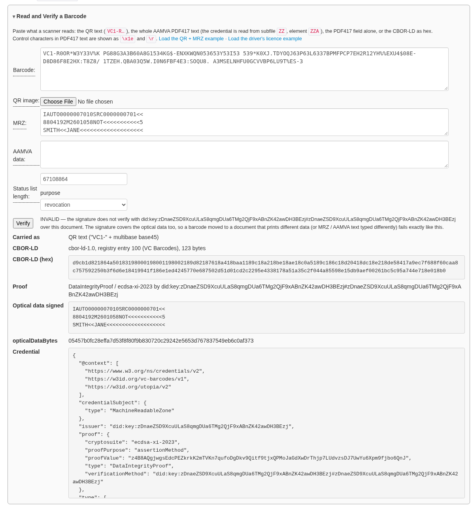
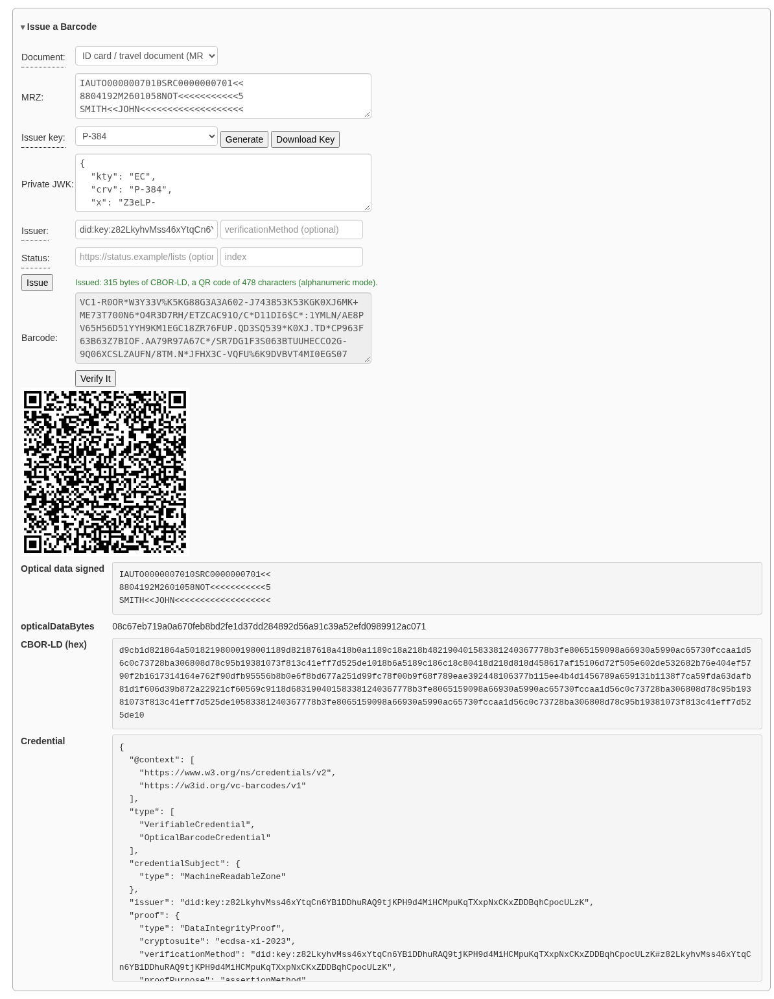
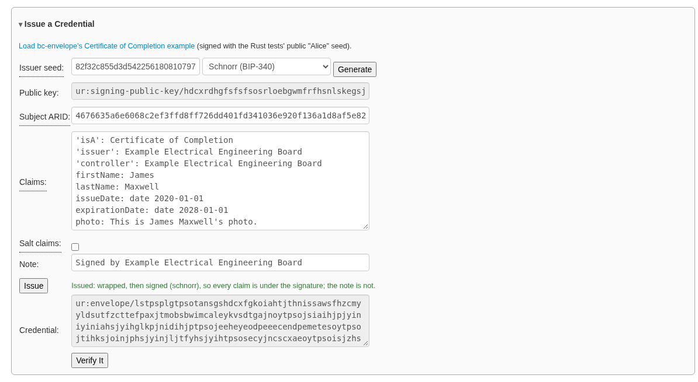
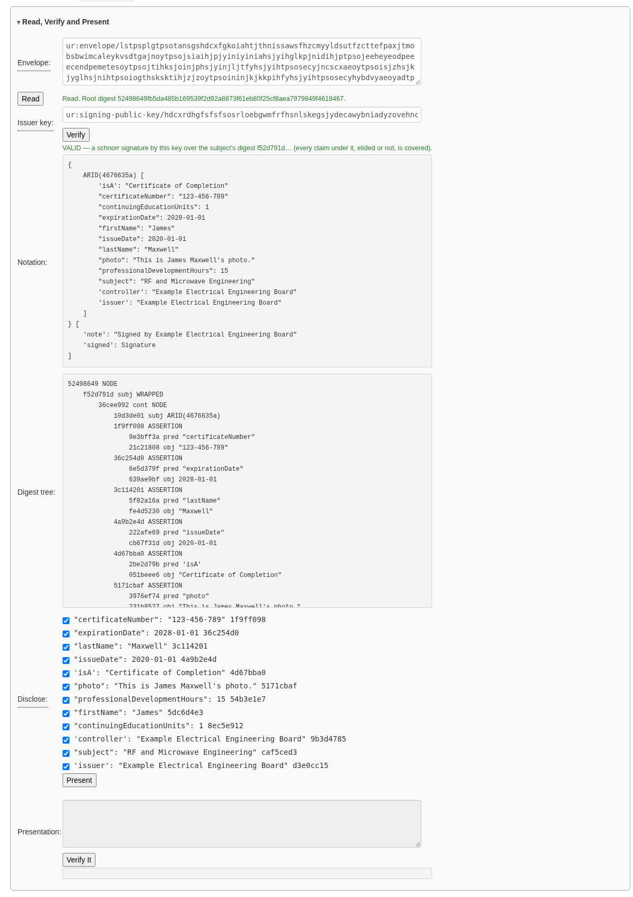
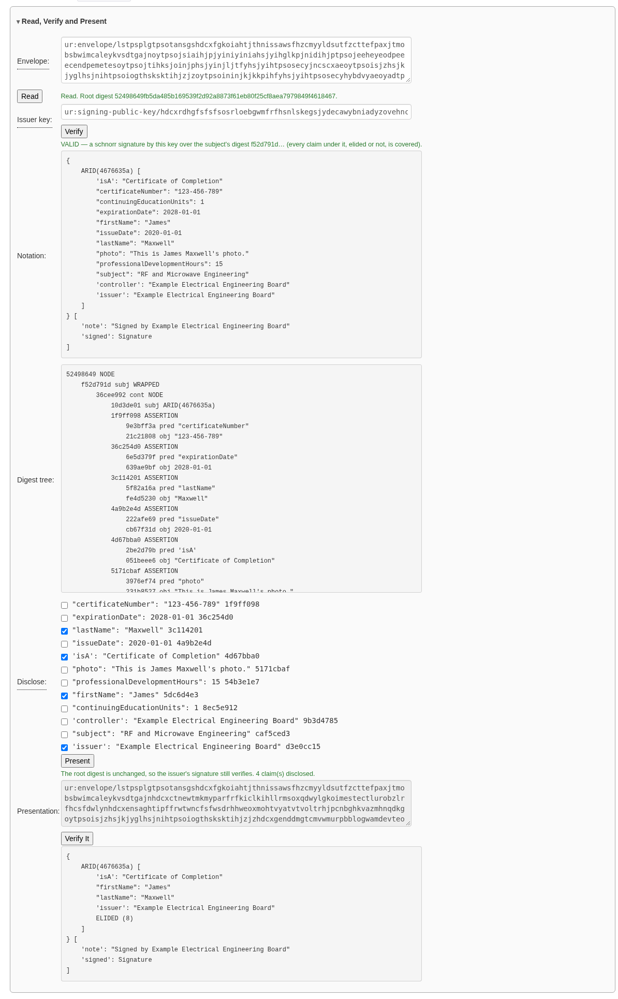
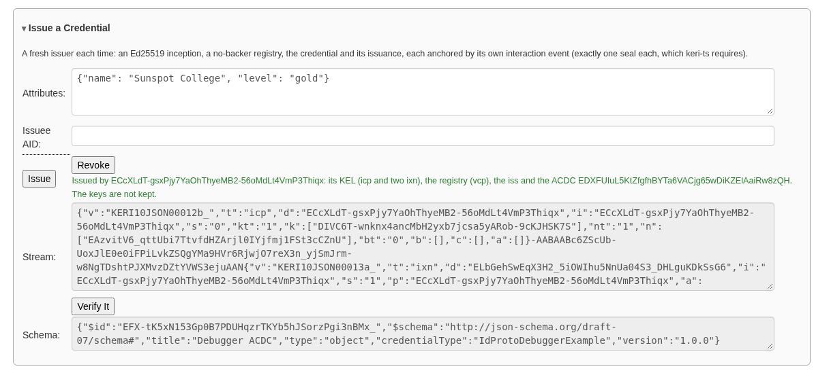
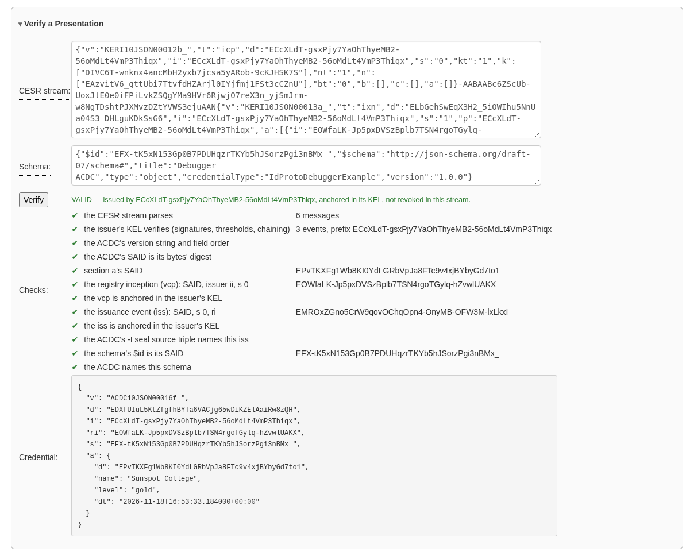
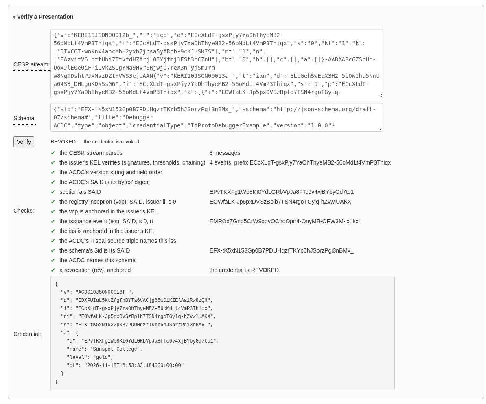

# Tutorials: VC Barcodes, Gordian Envelope and ACDC

The three credential formats on the **VC Tools** row are not issued or
presented over OpenID4VCI / OpenID4VP; each has a page of its own that
issues, reads and verifies them entirely in the browser. None of the three
needs the api or a network peer, none stores anything, and all three ship
to the static sites. Each page carries the sample input these tutorials
start from.

Reference: [reference-tools.md](reference-tools.md). Format guides:
[format-vc-barcodes.md](format-vc-barcodes.md),
[format-gordian-envelope.md](format-gordian-envelope.md),
[format-acdc.md](format-acdc.md).

- [Verify a VC barcode, then issue one](#verify-a-vc-barcode-then-issue-one)
- [Issue a Gordian Envelope credential and present it with claims elided](#issue-a-gordian-envelope-credential-and-present-it-with-claims-elided)
- [Issue, verify and revoke an ACDC](#issue-verify-and-revoke-an-acdc)

## Verify a VC barcode, then issue one

W3C Verifiable Credential Barcodes v1.0 (*a W3C Working Draft*): a credential
compressed with CBOR-LD into a QR code or a driver's licence PDF417, signed
with `ecdsa-xi-2023`, whose signature also covers the document's printed
**optical data** — the MRZ of a passport or ID card, or the licence's AAMVA
fields — so the barcode cannot be moved to another document.

1. Open **VC Barcodes** (`vc-barcodes.html`) and press **Load the QR + MRZ
   example**: the specification's Utopia QR text and its three-line MRZ.
2. Press **Verify**. The result shows how the credential was carried, the
   CBOR-LD (registry entry and hex), the proof and its verification method,
   the optical data signed, and the credential: **VALID**.

   

3. Change one character of the MRZ (a name, say) and press **Verify** again:
   **INVALID**. The QR code is unchanged; it is the printed data beside it
   that no longer matches what was signed.

   

4. **Load the driver's licence example** does the same for a PDF417 licence,
   naming the AAMVA fields the signature protects.
5. To issue: in **Issue a Barcode**, keep **Document:
   MachineReadableZone**, choose the curve, press **Generate** (a key made
   for this page load; **Download Key** is the only way to keep it), and
   press **Issue**. The page draws the QR code. **Verify It** copies the
   result into pane 1 and verifies it.

   

   The private JWK in this picture belongs to a key generated for that run
   alone. Nothing on this page is ever stored, the key included.

A status entry in a barcode is only **expanded** (the status list is not
fetched), and PDF417 symbols are neither drawn nor read from images — paste
what a scanner reads.

## Issue a Gordian Envelope credential and present it with claims elided

Gordian Envelope (*draft-mcnally-envelope-12*, over dCBOR,
*draft-mcnally-deterministic-cbor-18* — individual IETF drafts) is a Merkle
tree of digests: eliding a claim replaces it with its digest, the root
digest does not change, and so the issuer's signature over the root still
verifies. A holder presents by eliding; nothing is re-signed.

1. Open **Gordian Envelope** (`gordian-envelope.html`) and press **Load
   bc-envelope's Certificate of Completion example** — Blockchain Commons'
   own example, signed with their tests' public "Alice" seed.
2. Press **Issue**. The page wraps the credential, signs it (Schnorr by
   default), and shows the `ur:envelope/…` text and the issuer's public key.

   

3. Press **Verify It**. Pane 1 reads the envelope — its root digest, its
   notation and its digest tree — and verifies the signature: **VALID**.

   

4. Under **Disclose**, keep four claims (first name, last name, `isA`,
   issuer) and untick the rest. Press **Present**. The presentation's
   notation shows the other eight claims as `ELIDED`, and the page confirms
   the root digest is unchanged. **Verify It** verifies the presentation
   with the same key.

   

Tick **Salt claims** when issuing your own credential, so that an elided
claim with a guessable value cannot be recovered from its digest.

## Issue, verify and revoke an ACDC

Authentic Chained Data Containers (Trust over IP's ACDC, over KERI and
CESR — *working-group drafts*). An ACDC carries no signature of its own: its
SAID (the digest of its own bytes) is sealed by an `iss` event in the
issuer's registry, which is anchored in the issuer's KERI key event log,
which is signed. Verifying one is walking that chain.

1. Open **ACDC** (`acdc.html`). In **Issue a Credential**, press **Issue**.
   The page writes the CESR stream — the issuer's KEL, the registry, the
   credential — and the schema it generated.

   

2. Press **Verify It**. Pane 1 verifies the stream step by step — every
   SAID, every signature, the anchoring — and gives the verdict: **VALID**
   (issued by the issuer, anchored in its KEL, not revoked in this stream).

   

3. Press **Revoke**, which appends a `rev` event to the registry, anchored
   by another interaction event, then **Verify It** again: **REVOKED**.

   

4. Change one character of an attribute in the stream in pane 1 and press
   **Verify**: **INVALID**, naming the SAID that no longer matches.

The page reads the CESR version 1 streams the released KERI libraries
produce (signify-ts, which vLEI uses), and refuses CESR version 2 by name.
