# WS-Trust tutorials

Each tutorial is one way the WS-Trust workflow is used. Start from
`wstrust_tools.html` (the **WS-Trust Protocol** card). The fields are
in [reference.md](reference.md). What the messages are is in
[protocol.md](protocol.md).

The pictures were taken against iya-sts at
`https://localhost:8081/sts`, as the account `guide-wstrust`. In
product mode the **Password** field is an application password scoped
to WS-Trust, not the account password. It is typed into the field and
is not stored. The pictures show that field masked. Another security
token service has its own accounts and its own rule for `AppliesTo`.
What iya-sts requires in product mode is in
[setup-iya-sts.md](setup-iya-sts.md).

**Initiate STS Call From** stays on **Backend (proxy)** in every walk
below. The STS URL then has to be reachable from the api.

* TOC
{:toc}

## Issue a bearer token

WS-Trust 1.4 Issue. The token is a SAML 2.0 bearer assertion for
`urn:wstrust:test:rp`. The caller is a UsernameToken.

1. Set **STS URL** to the service. An empty field is filled with
   `https://localhost:8081/sts` on this deployment. **Load** reads
   what the service publishes about itself, when it publishes anything.

   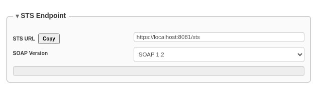

2. Leave **WS-Trust Version** on **1.4**, **Operation** on **Issue**,
   **Token Type** on **SAML 2.0**, and **Key Type** on **Bearer**.
   **AppliesTo** is the relying party the token is for. **Lifetime
   (minutes)** is 60 unless you change it. On iya-sts in product mode
   that audience has to be registered before Issue or Renew will
   answer.

   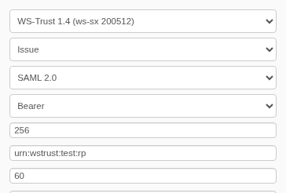

3. Under **Credentials / WS-Security**, leave **Credential** on
   **UsernameToken**. Type the account. On iya-sts in product mode,
   type an application password scoped to WS-Trust, not the account
   password. **Password Type** stays **PasswordText**. The password is
   not written to storage.

   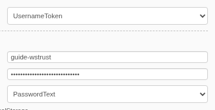

4. Leave **Initiate STS Call From** on **Backend (proxy)**. **Validate
   STS TLS certificate (backend)** stays on when the api trusts the
   service. **Generated Request** is the SOAP that will be sent.
   Press **Send Request**.

   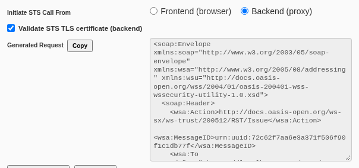

   If the status line says the certificate was refused, the api does
   not trust that service's certificate. Clear **Validate STS TLS
   certificate (backend)** and press **Send Request** again. A stack
   that issued the api and the service from one root does not need
   this. The picture is that refusal on a service whose certificate
   is not the debugger's.

   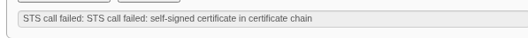

5. `wstrust_response.html` opens on the answer. **Response (RSTR)** is
   the `RequestSecurityTokenResponse`.

   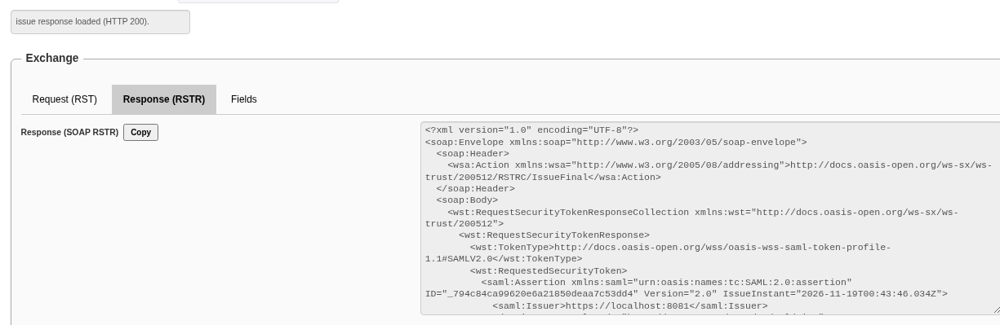

6. **Issued Token**, on **Token XML**, is the SAML assertion inside
   `RequestedSecurityToken`. The box indents that assertion so it can
   be read. The indent is not part of what the service signed. **Copy**
   copies the assertion as it was issued, which is what OnBehalfOf and
   ActAs have to present when the service checks the signature.

   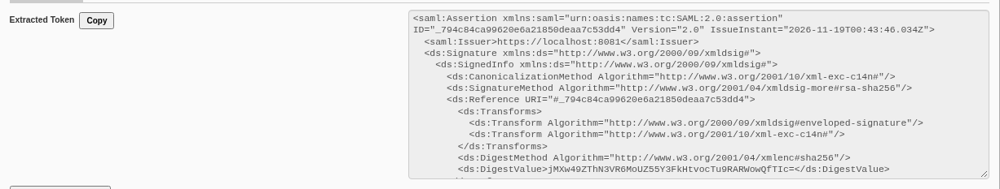

7. **Fields** is the same answer in rows: the operation, the SOAP and
   HTTP status, the token type, the key type, AppliesTo, and the
   lifetime.

   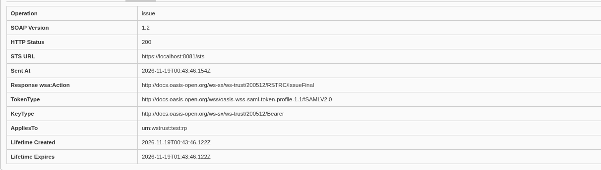

Copy the assertion from **Token XML**. Renew, Validate, Cancel, and
the delegation walks paste it back.

## Renew, validate, and cancel

The three operations that act on a token you already hold. Paste the
assertion from the [issue walk](#issue-a-bearer-token) into **Target
Token**. Authenticate again with the same UsernameToken. The audience
stays the one the token was issued for.

1. Set **Operation** to **Renew** and paste the assertion into
   **Target Token**. It is sent as `RenewTarget`.

   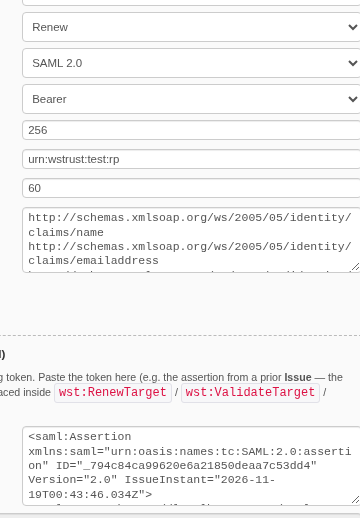

2. Press **Send Request**. The response carries a new lifetime. **Fields**
   shows it beside the status.

   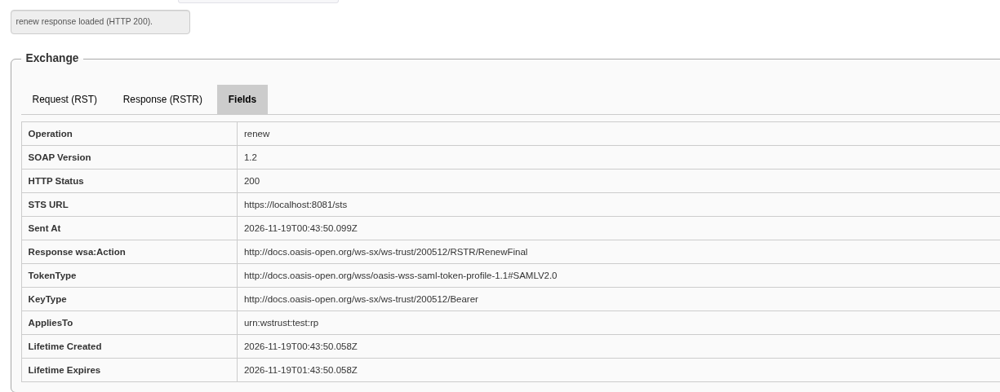

3. Set **Operation** to **Validate**, paste the token you want checked
   (the renewed one, if Renew replaced it), and send. **Fields** shows
   the status code. A token the service still accepts is valid.

   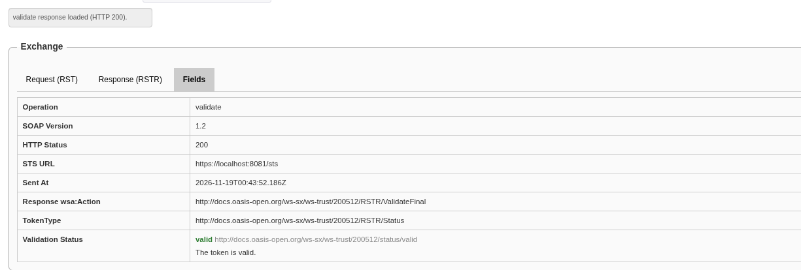

4. Set **Operation** to **Cancel**, paste that token, and send.
   **Fields** shows the cancel status. A later Validate of the same
   token is the service's decision. This service reports it cancelled.

   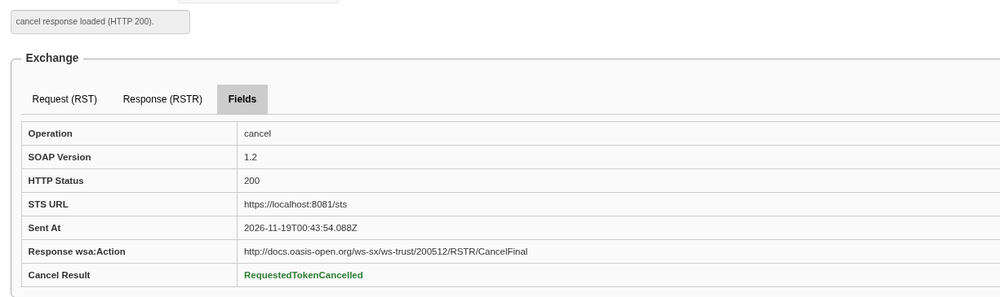

Renew in product mode needs the same registered `AppliesTo` as Issue.
Validate and Cancel are not asked for one.

## Sign the request

**Digitally sign the request** with **Credential** set to **None**.
The signature is the authentication. **Also sign the Timestamp** stays
on. The certificate is in `KeyInfo`.

On iya-sts in product mode that certificate has to be one the service
already holds for this account, or a leaf its message-signing CA
issued. **Generate Keys** produces a key the service has never seen,
and the call is refused. Issue a message-signing certificate for the
account and paste the PKCS#8 private key and the certificate into the
signing fields. The steps are in
[setup-iya-sts.md](setup-iya-sts.md#a-signed-request). Do not send a
UsernameToken beside the signature unless it names that same account.

1. Tick **Digitally sign the request**. Leave **Also sign the
   Timestamp** on and **Signature Algorithm** on RSA-SHA256. The
   picture is those controls. The private key is on the page below
   them and is not in the picture.

   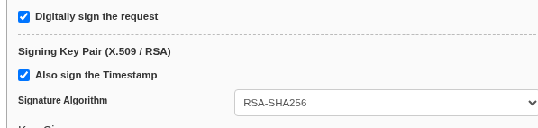

2. **AppliesTo** stays `urn:wstrust:test:rp`. Press **Send Request**.
   The response is an Issue of a bearer assertion, and the caller was
   the signature rather than a password.

   

Leave **Save this key pair** on if the next walk should decrypt with
this key. The private key is stored only while that box is checked.

## An encrypted issued token

Some services encrypt the token they issue. iya-sts does when the STS
URL carries `encrypt=1`:

`https://localhost:8081/sts?encrypt=1`

It encrypts the SAML 2.0 assertion to the certificate on the request's
signature. The request has to be signed, with the key from the
[signed walk](#sign-the-request). **Credential** stays **None**. In
product mode a missing certificate or a certificate it will not
encrypt to is a SOAP fault, and the assertion is not sent in the
clear.

1. Press **Send Request**. **Issued Token** is an `EncryptedData`, not
   an assertion.

   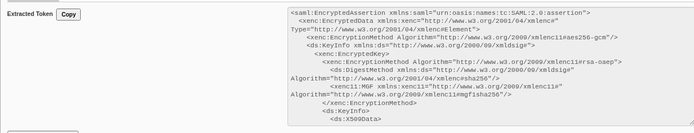

2. Press **Decrypt**. The decryption key is the private key that signed
   the request, when that key was saved. **Token XML** becomes the
   assertion.

   

3. The status line says the decrypt succeeded.

   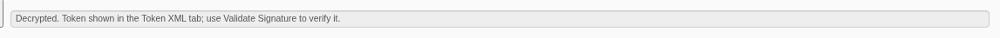

Set **STS URL** back to the URL without `encrypt=1` before the next
call. The field is stored, so the query stays until you remove it.

## OnBehalfOf and ActAs

Two Issue calls. Each presents a token the service already issued, and
asks for a new one for a different audience. **OnBehalfOf** is
impersonation: the new token is about the subject of the token you
present. **ActAs** is composite delegation: the new token says both
who asked and who they acted as. ActAs is a WS-Trust 1.4 control.

The pictures use a bearer assertion just issued for
`urn:wstrust:test:rp`, then ask for `https://esb.example.com` and
`https://soap1.example.com`. On iya-sts those audiences are registered
applications. The caller authenticates again as `guide-wstrust`, the
same account the first token is about. What product mode requires of
that caller, and of the two audiences, is in
[setup-iya-sts.md](setup-iya-sts.md#delegation). None of it is a
control on this page.

1. Issue a fresh bearer token, as in the
   [first walk](#issue-a-bearer-token). Copy the assertion.
2. Set **AppliesTo** to the next audience. Tick **OnBehalfOf
   (delegation)** and paste the assertion into **OnBehalfOf token**.
   **Credential** is **UsernameToken** for the same account. Signing
   stays off.

   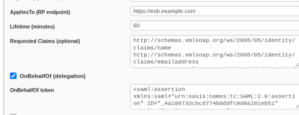

3. Press **Send Request**. **Issued Token** is a new assertion for
   that audience.

   

4. Copy that assertion. Set **AppliesTo** to a third audience. Clear
   **OnBehalfOf** and tick **ActAs (WS-Trust 1.4)**. Paste the
   assertion into **ActAs token**. Authenticate as the same account.

   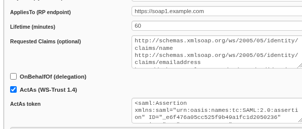

5. Press **Send Request**. **Issued Token** is a new assertion for
   that audience. The picture is the start of it. Further down, an
   ActAs assertion names the subject and each party that acted, in a
   SAML 2.0 Delegation Restriction. OnBehalfOf does not add the caller
   there, so the relying party sees the subject.

   
